::: {.front card-id="kodaira-draw-unstarred" tags="application visual"}
Sketch $I_1,II,I_2,III,I_3,IV$. Which distinctions are lost by recording only pairwise component intersections?
:::

::: {.back card-id="kodaira-draw-unstarred"}
In order: node, cusp, two transverse crossings, tangency, three separate crossings, and a common triple point.

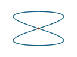{width=220px}

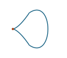{width=220px}

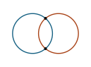{width=220px}

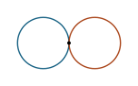{width=220px}

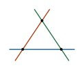{width=220px}

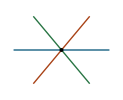{width=220px}

$I_1$ and $II$ are both irreducible. The pairs $I_2,III$ and $I_3,IV$ have equal intersection matrices within each pair, but different incidence geometry and Euler numbers. Thus a weighted dual graph needs geometric information about singularities, tangencies, and coincident intersection points.
:::

::: {.front card-id="kodaira-components-root-summary" tags="formula"}
For each Kodaira fiber, recall the component count and root lattice contributed to Shioda–Tate. Is the affine diagram itself the negative-definite lattice used there?
:::

::: {.back card-id="kodaira-components-root-summary"}
Remove the component met by the zero section. The remaining component classes form the negative-definite root lattice:

| Fiber | Components | Root type, with negative form |
| --- | --- | --- |
| $I_0,I_1,II$ | 1 | 0 |
| $I_n,\ n\ge2$ | $n$ | $A_{n-1}$ |
| $III$ | 2 | $A_1$ |
| $IV$ | 3 | $A_2$ |
| $I_n^*,\ n\ge0$ | $n+5$ | $D_{n+4}$ |
| $IV^*$ | 7 | $E_6$ |
| $III^*$ | 8 | $E_7$ |
| $II^*$ | 9 | $E_8$ |

The full fiber intersection matrix is negative semidefinite and has the fiber multiplicity vector in its kernel. Removing the identity component makes the matrix negative definite and gives rank one less than the component count. It is this finite root rank that enters Shioda–Tate.
:::

::: {.front card-id="kodaira-scope-models" tags="definition"}
What does Kodaira classify for a relatively minimal complex elliptic surface with section? Which surface should a fiber picture depict?
:::

::: {.back card-id="kodaira-scope-models"}
It classifies the fibers of the smooth relatively minimal surface $f:S\to B$, whose general fiber is a smooth genus-one curve. A zero section rules out multiple fibers: intersecting $F=\sum m_iC_i$ with the section gives one, so it meets a multiplicity-one component once.

The Weierstrass model contracts the fiber components not meeting the section. Its special plane cubic is often nodal or cuspidal even when the resolved fiber has many components. Thus a picture of the cubic alone does not identify the Kodaira type on $S$. For example an $II^*$ fiber has nine components on $S$, while its Weierstrass model has an $E_8$ surface singularity.

All visual cards here use schematic curves or weighted graphs, not literal embeddings of complex curves in a real plane. In weighted graphs each vertex is a component, its number is its fiber multiplicity, and a double rim marks the identity component. Reference: [Schütt–Shioda, §§4–6](https://arxiv.org/abs/0907.0298).
:::

::: {.front card-id="kodaira-recognize-smooth" tags="application visual"}
Identify this fiber type and its Euler number. The picture is a topological schematic of a smooth fiber.

{width=460px}
:::

::: {.back card-id="kodaira-recognize-smooth"}
Type $I_0$: a smooth genus-one curve, with $e=0$. Its connected smooth group is elliptic, and its component group is trivial.
:::

::: {.front card-id="kodaira-recognize-node" tags="application visual"}
Identify this irreducible singular fiber and compute its Euler number.

{width=460px}
:::

::: {.back card-id="kodaira-recognize-node"}
Type $I_1$: an irreducible nodal rational curve. Normalization is $\mathbb P^1$ and identifies two points, so $e=2-1=1$. Its arithmetic genus is one, geometric genus zero. The smooth locus is $\mathbb G_m$.
:::

::: {.front card-id="kodaira-recognize-cusp" tags="application visual"}
Identify this irreducible singular fiber and compute its Euler number.

{width=460px}
:::

::: {.back card-id="kodaira-recognize-cusp"}
Type $II$: an irreducible cuspidal rational curve. Normalization is bijective on points, so $e=2$. Its arithmetic genus is one, geometric genus zero. The smooth locus is $\mathbb G_a$. A one-vertex component graph would not distinguish it from $I_1$.
:::

::: {.front card-id="kodaira-recognize-two-crossings" tags="application visual"}
Identify this fiber of two smooth rational components. What distinguishes it from the tangent configuration?

{width=460px}
:::

::: {.back card-id="kodaira-recognize-two-crossings"}
Type $I_2$: the components meet transversely at two distinct points, so $e=2+2-2=2$. Both have multiplicity one and square $-2$. The intersection number is two, just as for $III$, but the two intersection points are distinct. Deleting the identity component gives $A_1(-1)$.
:::

::: {.front card-id="kodaira-recognize-tangency" tags="application visual"}
Identify this fiber of two smooth rational components. What distinguishes it from two transverse intersections?

{width=460px}
:::

::: {.back card-id="kodaira-recognize-tangency"}
Type $III$: two rational components tangent at one point, with intersection multiplicity two. Both have multiplicity one and square $-2$. There is only one intersection point, so $e=2+2-1=3$. Its finite root lattice is $A_1(-1)$, as for $I_2$, but its Euler number and local geometry differ.
:::

::: {.front card-id="kodaira-recognize-three-crossings" tags="application visual"}
Identify this fiber. Each stroke represents a smooth rational component; the marked intersections are distinct.

{width=460px}
:::

::: {.back card-id="kodaira-recognize-three-crossings"}
Type $I_3$: three rational components form a cycle, with three distinct transverse intersection points. All multiplicities are one, all component squares are $-2$, and $e=6-3=3$. Its finite root lattice is $A_2(-1)$.
:::

::: {.front card-id="kodaira-recognize-triple-point" tags="application visual"}
Identify this fiber. Each stroke represents a smooth rational component, and all meet at the marked point.

{width=460px}
:::

::: {.back card-id="kodaira-recognize-triple-point"}
Type $IV$: three rational components meet at one common point with distinct tangent directions. All multiplicities are one. Inclusion–exclusion gives $e=6-3+1=4$. Its pairwise intersection matrix and ordinary dual graph agree with $I_3$, so the graph alone does not record the common triple point. Its finite root lattice is $A_2(-1)$.
:::

::: {.front card-id="kodaira-recognize-cycle" tags="application visual"}
Identify this weighted component graph and its general family. Vertices are components; the double-rim vertex meets the zero section.

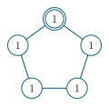{width=460px}
:::

::: {.back card-id="kodaira-recognize-cycle"}
This is $I_5$, in the family $I_n$: a cycle of $n$ rational components for $n\ge3$, all of multiplicity one and square $-2$. It has $e=n$ and finite root lattice $A_{n-1}(-1)$. The cases $I_1$ and $I_2$ require a nodal curve and a pair with two intersections, respectively.
:::

::: {.front card-id="kodaira-recognize-four-arms" tags="application visual"}
Identify this weighted component graph. Numbers are multiplicities; the double-rim vertex meets the zero section.

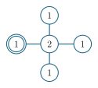{width=460px}
:::

::: {.back card-id="kodaira-recognize-four-arms"}
Type $I_0^*$: a central multiplicity-two rational component meets four disjoint multiplicity-one rational components. All have square $-2$. There are five components and four intersection points, so $e=10-4=6$. Removing the identity component gives $D_4(-1)$. This is not a multiple fiber: the greatest common divisor of its component multiplicities is one.
:::

::: {.front card-id="kodaira-recognize-double-chain" tags="application visual"}
Identify this weighted component graph and recover the index in its Kodaira family. The double-rim vertex meets the zero section.

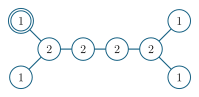{width=460px}
:::

::: {.back card-id="kodaira-recognize-double-chain"}
Type $I_3^*$. In general $I_n^*$ for $n\ge1$ has a chain of $n+1$ multiplicity-two components, with two multiplicity-one leaves at each end. Thus it has $n+5$ components, $e=n+6$, and finite root lattice $D_{n+4}(-1)$. Here the chain has four double components, so $n=3$, with eight components, Euler number nine, and root lattice $D_7(-1)$.
:::

::: {.front card-id="kodaira-recognize-three-equal-arms" tags="application visual"}
Identify this weighted component graph, its Euler number, and its finite root lattice.

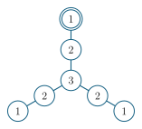{width=460px}
:::

::: {.back card-id="kodaira-recognize-three-equal-arms"}
Type $IV^*$: affine $E_6$, with central multiplicity three and three arms of multiplicities $2,1$. There are seven rational components and six transverse intersections, giving $e=14-6=8$. Removing the double-rim identity component gives $E_6(-1)$.
:::

::: {.front card-id="kodaira-recognize-long-symmetric-arms" tags="application visual"}
Identify this weighted component graph, its Euler number, and its finite root lattice.

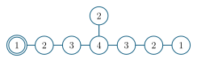{width=460px}
:::

::: {.back card-id="kodaira-recognize-long-symmetric-arms"}
Type $III^*$: affine $E_7$. The central multiplicity is four; two arms have multiplicities $3,2,1$, and the short arm has multiplicity two. There are eight rational components and seven transverse intersections, giving $e=16-7=9$. Removing the double-rim identity component gives $E_7(-1)$.
:::

::: {.front card-id="kodaira-recognize-long-asymmetric-arms" tags="application visual"}
Identify this weighted component graph, its Euler number, and its finite root lattice.

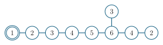{width=460px}
:::

::: {.back card-id="kodaira-recognize-long-asymmetric-arms"}
Type $II^*$: affine $E_8$. From the central multiplicity-six component the arms have multiplicities $5,4,3,2,1$; $4,2$; and $3$. There are nine rational components and eight transverse intersections, giving $e=18-8=10$. Removing the unique multiplicity-one identity component gives $E_8(-1)$.
:::

::: {.front card-id="kodaira-draw-starred" tags="application visual"}
Sketch the weighted configurations of $I_0^*,I_n^*$ ($n\ge1$), $IV^*,III^*,II^*$. How are their multiplicities checked?
:::

::: {.back card-id="kodaira-draw-starred"}
The diagrams show $I_0^*$, an $I_3^*$ representative, $IV^*$, $III^*$, and $II^*$, in order. For general $I_n^*$ the double chain has $n+1$ vertices.

{width=260px}

{width=460px}

{width=300px}

{width=460px}

{width=500px}

Every component is a smooth rational $(-2)$-curve. The fiber multiplicity vector is the primitive positive kernel vector of the intersection matrix: $F\cdot C_i=0$. Thus twice each multiplicity equals the sum of adjacent multiplicities. Normalize to greatest common divisor one; the section meets a multiplicity-one component.
:::

::: {.front card-id="kodaira-minimal-orders" tags="formula application"}
For a minimal short Weierstrass equation $y^2=x^3+a(t)x+b(t)$ over $\mathbb C[[t]]$, identify the Kodaira type from the vanishing orders of $a,b,\Delta$. What must be checked first?
:::

::: {.back card-id="kodaira-minimal-orders"}
Use $\Delta=-16(4a^3+27b^2)$ and require $\Delta\not\equiv0$. If $\operatorname{ord}a\ge4$ and $\operatorname{ord}b\ge6$, replace $x=t^2X$, $y=t^3Y$ and repeat until minimal. For the zero coefficient use order $+\infty$.

| Type | $\operatorname{ord}a$ | $\operatorname{ord}b$ | $\operatorname{ord}\Delta$ |
| --- | --- | --- | --- |
| $I_0$ | $\ge0$ | $\ge0$ | 0 |
| $I_n,\ n\ge1$ | 0 | 0 | $n$ |
| $II$ | $\ge1$ | 1 | 2 |
| $III$ | 1 | $\ge2$ | 3 |
| $IV$ | $\ge2$ | 2 | 4 |
| $I_0^*$ | $\ge2$ | $\ge3$ | 6 |
| $I_n^*,\ n\ge1$ | 2 | 3 | $n+6$ |
| $IV^*$ | $\ge3$ | 4 | 8 |
| $III^*$ | 3 | $\ge5$ | 9 |
| $II^*$ | $\ge4$ | 5 | 10 |

The three orders are used together: cancellation can increase the discriminant order. In characteristic zero, $\operatorname{ord}\Delta=e(F)$ for the minimal model. The table needs modification in residue characteristics two and three.

Reference: [Miranda, The Basic Theory of Elliptic Surfaces, III.4](https://www.math.colostate.edu/~miranda/BTES-Miranda.pdf).
:::

::: {.front card-id="kodaira-equations-ambiguous-discriminant" tags="application"}
At $t=0$, classify the fibers of $y^2=x^3-3x+2+t^3$ and $y^2=x^3+tx+t^2$. Why is the discriminant order alone insufficient?
:::

::: {.back card-id="kodaira-equations-ambiguous-discriminant"}
For the first equation,
$$4(-3)^3+27(2+t^3)^2=108t^3+27t^6,$$
so the orders are $(0,0,3)$ and the type is $I_3$. For the second,
$$4t^3+27t^4=t^3(4+27t),$$
so the orders are $(1,2,3)$ and the type is $III$. Both minimal discriminants have order three, but one fiber has a three-component cycle and the other has two tangent components.
:::

::: {.front card-id="kodaira-equations-star-and-minimality" tags="application"}
Classify at $t=0$: $y^2=x^3+t^5$; $y^2=x^3+t^4x+t^6$; and $y^2=x^3-3t^2x+2t^3+t^4$.
:::

::: {.back card-id="kodaira-equations-star-and-minimality"}
The first has orders $(\infty,5,10)$ and is minimal, hence type $II^*$.

The second is not minimal. Set $x=t^2X$, $y=t^3Y$ to obtain $Y^2=X^3+X+1$, whose discriminant is nonzero. Its minimal fiber is smooth $I_0$, not a fiber of Euler number twelve.

For the third,
$$4(-3t^2)^3+27(2t^3+t^4)^2=108t^7+27t^8.$$
The orders $(2,3,7)$ give $I_1^*$.
:::

::: {.front card-id="kodaira-components-groups" tags="formula application"}
Over an algebraically closed field of characteristic zero, give the identity group and component group of the Néron fiber for each Kodaira type. Which components can a section meet?
:::

::: {.back card-id="kodaira-components-groups"}
The identity group is elliptic for $I_0$, $\mathbb G_m$ for $I_n$ with $n\ge1$, and $\mathbb G_a$ for every additive type.

| Type | Component group $\Phi$ |
| --- | --- |
| $I_0,II,II^*$ | 0 |
| $I_n,\ n\ge1$ | $\mathbb Z/n$ |
| $III,III^*$ | $\mathbb Z/2$ |
| $IV,IV^*$ | $\mathbb Z/3$ |
| $I_n^*$, $n$ even, including zero | $(\mathbb Z/2)^2$ |
| $I_n^*$, $n$ odd | $\mathbb Z/4$ |

A section meets a multiplicity-one component at a smooth point of the fiber, since its total intersection with the fiber is one. The order of $\Phi$ is the number of multiplicity-one components, not the total number of components. Over a nonclosed residue field, Galois action and split/nonsplit reduction affect rational components and Tamagawa numbers.
:::

::: {.front card-id="kodaira-root-height-computation" tags="application"}
How does a fiber diagram give the local correction to the height pairing? Compute it for a section meeting component $i$ of an $I_n$ fiber, and for a nonidentity component of $I_0^*$.
:::

::: {.back card-id="kodaira-root-height-computation"}
Delete the identity component and let $A=(C_i\cdot C_j)$ be the remaining negative-definite intersection matrix. The local correction is $-(A^{-1})_{ij}$ for sections meeting $C_i,C_j$, and zero if either meets the identity component.

For $I_n$, number components cyclically with identity $0$. The diagonal correction is
$$\operatorname{contr}_v(P)=\frac{i(n-i)}n.$$
For $I_5$ and $i=2$ this is $6/5$. At $I_0^*$, deleting an outer identity component gives $D_4(-1)$; the inverse Cartan diagonal at each of the other outer vertices is one. Thus a section meeting any nonidentity component contributes one. It cannot meet the central multiplicity-two component.
:::

::: {.front card-id="kodaira-monodromy-table" tags="formula"}
Give local monodromy representatives for Kodaira fibers. Fix the positive-loop convention with $I_1$ represented by $T=\begin{pmatrix}1&1\\0&1\end{pmatrix}$.
:::

::: {.back card-id="kodaira-monodromy-table"}
On integral first homology, after a choice of symplectic basis, the representatives are:

| Fiber | Monodromy |
| --- | --- |
| $I_n$, including $I_0$ | $T^n$ |
| $I_n^*$, including $I_0^*$ | $-T^n$ |
| $II$ | $\begin{pmatrix}1&1\\-1&0\end{pmatrix}$ |
| $III$ | $\begin{pmatrix}0&1\\-1&0\end{pmatrix}$ |
| $IV$ | $\begin{pmatrix}0&1\\-1&-1\end{pmatrix}$ |
| $IV^*$ | $\begin{pmatrix}-1&-1\\1&0\end{pmatrix}$ |
| $III^*$ | $\begin{pmatrix}0&-1\\1&0\end{pmatrix}$ |
| $II^*$ | $\begin{pmatrix}0&-1\\1&1\end{pmatrix}$ |

Changing basis conjugates the matrices; reversing the loop inverts them. The starred exceptional matrices are the inverses of their unstarred partners of the same Roman numeral. The finite orders are respectively $6,4,3,3,4,6$; $I_0^*$ has order two. The $I_n$ and $I_n^*$ cases with $n>0$ have infinite order.

Reference: [Bogomolov–Tschinkel, Monodromy of elliptic surfaces](https://math.nyu.edu/~tschinke/papers/yuri/03monodromy/monodromy21.pdf).
:::

::: {.front card-id="kodaira-base-change-twist" tags="application"}
How do ramified base change and ramified quadratic twist change Kodaira fibers over $\mathbb C$? State examples requiring minimalization.
:::

::: {.back card-id="kodaira-base-change-twist"}
Under $t=s^e$, local monodromy becomes $M^e$. Multiplicative fibers change by $I_n\mapsto I_{en}$. For $I_n^*$, $n>0$, even $e$ gives $I_{en}$ and odd $e$ gives $I_{en}^*$ after minimalization.

For potentially good fibers, a ramification degree equal to the finite monodromy order gives good reduction: degrees $6,4,3,2,3,4,6$ suffice for $II,III,IV,I_0^*,IV^*,III^*,II^*$ respectively. A quadratic base change takes $II$ to $IV$, $III$ to $I_0^*$, and $I_0^*$ to $I_0$. For $y^2=x^3+t^3x$, substituting $t=s^2$ gives $y^2=x^3+s^6x$; rescaling $x=s^2X,y=s^3Y$ gives $Y^2=X^3+s^2X$, type $I_0^*$.

A quadratic twist ramified at the place sends
$$I_n\leftrightarrow I_n^*,\qquad
II\leftrightarrow IV^*,\qquad III\leftrightarrow III^*,\qquad IV\leftrightarrow II^*.$$
For $y^2=x^3+ax+b$, twisting by $t$ replaces $(a,b)$ with $(t^2a,t^3b)$, then one minimizes. An unramified quadratic base change of a smooth fiber simply gives two smooth fibers over that point.
:::

::: {.front card-id="kodaira-global-fiber-check" tags="application"}
A proposed elliptic K3 with section has fibers $II^*,IV^*,I_0^*$ and no others. What do Euler number and Shioda–Tate say? Do the numerical checks prove existence?
:::

::: {.back card-id="kodaira-global-fiber-check"}
The Euler sum is $10+8+6=24$, which passes the K3 Euler test. But the root ranks are $8,6,4$, so Shioda–Tate gives
$$\rho=2+8+6+4+\operatorname{rank}\operatorname{MW}
=20+\operatorname{rank}\operatorname{MW}.$$
Since a complex K3 has $\rho\le20$, the Mordell–Weil rank would have to be zero and $\rho=20$. These are necessary constraints, not an existence proof; a Weierstrass construction or lattice embedding must establish existence.
:::

::: {.front card-id="kodaira-scope-multiple-wild" tags="application"}
What changes when an elliptic-fiber picture is used for a genus-one fibration without section, or over a nonclosed or positive-characteristic field?
:::

::: {.back card-id="kodaira-scope-multiple-wild"}
Without a section a fiber may be $mF_0$ with $m>1$, multiplying every component multiplicity. This differs from a starred Kodaira fiber, whose normalized multiplicities have greatest common divisor one. The reduced picture alone loses the multiple-fiber information.

Over a nonclosed residue field, distinguish the geometric fiber after algebraic closure from its split/nonsplit form and Galois action on components. In characteristics two and three, the characteristic-zero short-Weierstrass order table is not sufficient: Tate's algorithm includes wild reduction, and the minimal discriminant valuation can exceed the geometric fiber Euler number. A quasi-elliptic fibration has cuspidal geometric generic fiber, so it is not an elliptic fibration with just an isolated bad fiber.
:::

::: {.front card-id="delpezzo-degrees-classification" tags="definition construction"}
Which degrees occur for smooth complex del Pezzo surfaces? Give the complete construction list and explain the degree-eight exception.
:::

::: {.back card-id="delpezzo-degrees-classification"}
A smooth del Pezzo surface is a smooth projective surface with $-K$ ample; its degree is $d=K^2$. Every integer $1\le d\le9$ occurs.

| Degree | Surface |
| --- | --- |
| 9 | $\mathbb P^2$ |
| 8 | $\mathbb P^1\times\mathbb P^1$ or $\mathbb F_1=\operatorname{Bl}_p\mathbb P^2$ |
| $1\le d\le7$ | $\operatorname{Bl}_{9-d}\mathbb P^2$ at points in del Pezzo general position |

The blowup formula gives $K^2=9-r$. General position means no three collinear, no six on a conic, and no eight on a cubic singular at one of those eight. The degree-eight surfaces differ: the product has no $(-1)$-curve, while $\mathbb F_1$ has one. Over a nonclosed field this describes the geometric surfaces after base change, not necessarily a blowup presentation over the original field.
:::

::: {.front card-id="delpezzo-weak-and-singular" tags="definition application"}
Distinguish smooth del Pezzo, weak del Pezzo, and Du Val del Pezzo surfaces. What does the anticanonical map contract in the weak case?
:::

::: {.back card-id="delpezzo-weak-and-singular"}
A smooth del Pezzo has $-K$ ample; a weak del Pezzo is smooth projective with $-K$ nef and big. Its anticanonical model, formed with sufficiently divisible multiples, contracts the $(-2)$-curves to Du Val singularities and has ample Cartier anticanonical divisor. A Du Val del Pezzo is this normal singular version; its minimal resolution is weak del Pezzo.

For a weak del Pezzo, a curve $C$ with $(-K)C=0$ has $C^2<0$ by Hodge index, and adjunction gives $C^2=-2$ and $p_a(C)=0$. Such curves obstruct ampleness. For example $\mathbb F_2$ is weak del Pezzo of degree eight; its negative section contracts to the quadric cone. General log del Pezzo surfaces allow klt singularities and merely $\mathbb Q$-Cartier $K$, so they are a broader class.
:::

::: {.front card-id="delpezzo-picard-lattice" tags="definition application"}
Identify $\operatorname{Pic}(X)$ as a lattice for a complex del Pezzo surface, including the two degree-eight cases. Why is there no $\operatorname{Pic}^0$ part?
:::

::: {.back card-id="delpezzo-picard-lattice"}
These surfaces are rational, so $\operatorname{Pic}^0=0$ and $\operatorname{Pic}=\operatorname{NS}$ is torsion-free. For the blowup at $r=9-d$ plane points,
$$\operatorname{Pic}(X)=\mathbb ZH\oplus\bigoplus_{i=1}^r\mathbb ZE_i,\qquad
(H^2,HE_i,E_iE_j)=(1,0,-\delta_{ij}),\qquad K=-3H+\sum_iE_i.$$
Thus its lattice is odd unimodular $I_{1,r}$ of signature $(1,r)$. For successive blowups at infinitely near points, the same diagonal form uses total exceptional transforms.

For $\mathbb P^1\times\mathbb P^1$, the two rulings give the even hyperbolic lattice
$$U=\begin{pmatrix}0&1\\1&0\end{pmatrix},\qquad K=-2f_1-2f_2.$$
It is not isometric to the odd lattice $I_{1,1}$ of $\mathbb F_1$, although both have degree eight and Picard rank two.
:::

::: {.front card-id="delpezzo-roots-weyl" tags="definition application"}
Which root lattices occur in $K^\perp$ for del Pezzo plane blowups? Give roots and their reflections. Must a root be represented by a curve?
:::

::: {.back card-id="delpezzo-roots-weyl"}
For $3\le r\le8$, $K^\perp$ is negative definite:

| $r$ | 3 | 4 | 5 | 6 | 7 | 8 |
| --- | --- | --- | --- | --- | --- | --- |
| Root lattice | $A_2(-1)\oplus A_1(-1)$ | $A_4(-1)$ | $D_5(-1)$ | $E_6(-1)$ | $E_7(-1)$ | $E_8(-1)$ |

Here the notation means the negative-definite root form, with roots of square $-2$. Simple roots can be taken as $E_1-E_2,\ldots,E_{r-1}-E_r,H-E_1-E_2-E_3$. Their reflections are
$$s_\alpha(D)=D+(D\cdot\alpha)\alpha.$$
They preserve the pairing and $K$ and generate the Weyl group. No nonzero effective divisor on a smooth del Pezzo can be orthogonal to $-K$, so lattice roots are not effective there. Effective roots appear on weak del Pezzo degenerations.

The low-rank cases should not be forced into the full-root-lattice statement: for $r=1$, $K^\perp=\mathbb Z(H-3E_1)$ has square $-8$; for $r=2$, the roots span only a rank-one sublattice of the rank-two complement.
:::

::: {.front card-id="delpezzo-cremona-reflection" tags="application"}
On a marked plane blowup, apply the reflection in $\alpha=H-E_1-E_2-E_3$ to $H$ and $E_1$. Interpret it geometrically.
:::

::: {.back card-id="delpezzo-cremona-reflection"}
Since $H\alpha=1$ and $E_1\alpha=1$,
$$s_\alpha(H)=2H-E_1-E_2-E_3,\qquad
s_\alpha(E_1)=H-E_2-E_3.$$
These are the pullback of a target line and the new exceptional curve under the quadratic Cremona transformation centered at the first three noncollinear points. The other two exceptional classes transform similarly.

This changes the plane blowdown marking and generally the point configuration. A Weyl-group action on lattice markings is not an assertion that every reflection is an automorphism of a fixed del Pezzo surface.
:::

::: {.front card-id="delpezzo-exceptional-classes-cones" tags="application"}
On a smooth complex del Pezzo surface, how can the Picard lattice enumerate $(-1)$-curves and test nefness? State the caveat in degrees eight and nine.
:::

::: {.back card-id="delpezzo-exceptional-classes-cones"}
Integral classes satisfying
$$E^2=-1,\qquad K\cdot E=-1$$
are exactly the classes of $(-1)$-curves. Riemann–Roch gives $\chi(\mathcal O(E))=1$, and $K-E$ cannot be effective since $(-K)(K-E)=-d-1<0$. Thus $E$ is effective. Its anticanonical degree one forces it to be reduced and irreducible, and adjunction gives a smooth rational curve; negative self-intersection gives uniqueness.

For degree at most seven, the curve cone is generated by these finitely many curves, so $D$ is nef iff $D\cdot E\ge0$ for each. For $\mathbb F_1$ also include the ruling fiber $H-E$; on $\mathbb P^1\times\mathbb P^1$ use both rulings, and on $\mathbb P^2$ use a line. Exceptional curves alone would miss these fiber-type rays.
:::

::: {.front card-id="blowup-nine-points-versus-pencil" tags="application"}
Does blowing up nine plane points always give a rational elliptic surface? Compare a cubic pencil's base points with nine very general complex points.
:::

::: {.back card-id="blowup-nine-points-versus-pencil"}
Always $K^2=0$, but that does not produce a pencil. For distinct base points of a cubic pencil, the proper transforms give a base-point-free $|-K|$, hence a rational elliptic surface; the exceptional curves are sections.

For nine very general points there is a unique smooth cubic $C$. Its strict transform $C'=-K$ is nef with square zero, while
$$\mathcal O_{C'}(C')=\mathcal O_C(3)(-p_1-\cdots-p_9)$$
is a nontorsion degree-zero bundle. The exact sequence
$$0\to\mathcal O((m-1)C')\to\mathcal O(mC')\to\mathcal O_{C'}(mC')\to0$$
gives $h^0(mC')=h^0((m-1)C')=1$ for every $m>0$. Thus $-K$ is nef but not semiample. The nontorsion condition explains the need for “very general” over $\mathbb C$.
:::

::: {.front card-id="blowup-more-than-nine-positivity" tags="application"}
What survives after blowing up $r\ge10$ distinct plane points? Does $K^2<0$ determine effectivity or bigness of $-K$?
:::

::: {.back card-id="blowup-more-than-nine-positivity"}
The surface stays rational, with $\kappa=-\infty$, $p_g=q=0$, and Picard lattice $I_{1,r}$. Since $K^2=9-r<0$, $-K$ is not nef and the surface is neither del Pezzo nor weak del Pezzo. The configuration still matters:

| Points | Anticanonical behavior |
| --- | --- |
| Very general | $H^0(-mK)=0$ for every $m>0$ |
| On a smooth cubic | Its strict transform is effective anticanonical of negative square |
| On a line | With $L'=H-\sum E_i$, $-K=2H+L'$ is big, although its square is negative |

For the first row, choose the first nine with unique cubic and nontorsion normal bundle, so every degree-$3m$ curve with multiplicity at least $m$ there is $mC$. A further point outside $C$ rules this out. For the last row, multiplying by the section of $mL'$ embeds $H^0(2mH)$ into $H^0(-mK)$, giving quadratic growth. Negative square rules out nefness, not bigness of a nonnef divisor.
:::

::: {.front card-id="blowup-finite-affine-indefinite" tags="application"}
How do the canonical orthogonal complement and the curve cone change across $r=8,9,10$ for plane blowups?
:::

::: {.back card-id="blowup-finite-affine-indefinite"}
For $r\le8$, $K^2>0$ and $K^\perp$ is negative definite. Del Pezzo general position gives finite exceptional-curve lists and rational polyhedral cones.

For $r=9$, $K^2=0$: $K^\perp$ is negative semidefinite with radical $\mathbb ZK$, and
$$K^\perp/\mathbb ZK\cong E_8(-1).$$
This is the affine $E_8$ transition. For $r\ge10$, $K^2<0$ and $K^\perp$ has signature $(1,r-1)$, so it is indefinite.

For very general complex point configurations with $r\ge9$, there are infinitely many $(-1)$-curves and the curve cone is not rational polyhedral. This is not a statement about every special configuration. On a rational elliptic surface, sections are $(-1)$-curves, and positive Mordell–Weil rank supplies infinitely many.

Reference: [de Fernex, Mori cones of plane blowups](https://arxiv.org/abs/1001.5243).
:::

::: {.front card-id="definition-gonality-pencil" tags="definition application"}
Define the gonality of a smooth projective complex curve. What are the gonalities of $\mathbb P^1$, an elliptic curve, and a smooth plane quartic?
:::

::: {.back card-id="definition-gonality-pencil"}
The gonality is the least degree of a nonconstant morphism $C\to\mathbb P^1$, equivalently the least degree of a line bundle equipped with a basepoint-free pencil of sections.

For $\mathbb P^1$ it is one. An elliptic curve has gonality two: a degree-two line bundle gives such a pencil, whereas degree one would give an isomorphism with $\mathbb P^1$. A smooth plane quartic has gonality three: lines through a point of the curve give a degree-three pencil after removing that base point. Its canonical embedding is the plane quartic, so it is nonhyperelliptic and has no degree-two map.
:::

::: {.front card-id="definition-clifford-index" tags="definition application"}
Define the Clifford index of a smooth projective complex curve of genus at least four. How does it relate to special linear series and gonality?
:::

::: {.back card-id="definition-clifford-index"}
For a line bundle $L$ with $h^0(L)\ge2$ and $h^1(L)\ge2$, set
$$\operatorname{Cliff}(L)=\deg L-2(h^0(L)-1),\qquad
\operatorname{Cliff}(C)=\min_L\operatorname{Cliff}(L).$$
Clifford's theorem makes this nonnegative. It measures how far a special series is from equality in Clifford's bound. Hyperelliptic curves have Clifford index zero.

A complete special pencil of degree $d$ contributes $d-2$, but higher-dimensional series can give a smaller value. On a smooth plane quintic, $\mathcal O_C(1)$ has degree five and $h^0=h^1=3$, giving Clifford index one, whereas the gonality is four. Thus Clifford index need not equal gonality minus two. For low genus one uses conventions: genus two has index zero; genus three has index zero in the hyperelliptic case and one otherwise.
:::

::: {.front card-id="definition-hirzebruch-surface-use" tags="definition application"}
Define the Hirzebruch surface $\mathbb F_n$ for $n\ge0$. Identify its section and fiber classes, canonical class, and which members are minimal or del Pezzo.
:::

::: {.back card-id="definition-hirzebruch-surface-use"}
Using the quotient convention,
$$\mathbb F_n=\mathbb P_{\mathbb P^1}(\mathcal O\oplus\mathcal O(n)).$$
The quotient onto $\mathcal O$ gives a section $S$ with $S^2=-n$. A fiber $F$ satisfies $F^2=0$, $SF=1$, and
$$\operatorname{Pic}(\mathbb F_n)=\mathbb ZS\oplus\mathbb ZF,\qquad K=-2S-(n+2)F.$$
Here $\mathbb F_0\cong\mathbb P^1\times\mathbb P^1$ and $\mathbb F_1\cong\operatorname{Bl}_p\mathbb P^2$. All are minimal except $\mathbb F_1$. Since $(-K)S=2-n$, only $\mathbb F_0,\mathbb F_1$ are del Pezzo; $\mathbb F_2$ has nef and big, but nonample, anticanonical class.
:::

::: {.front card-id="definition-surface-general-type-use" tags="definition application"}
What defines a smooth complex projective surface of general type? For a minimal such surface, distinguish the properties of $K_S$ and explain why its canonical model can differ from it.
:::

::: {.back card-id="definition-surface-general-type-use"}
General type means $\kappa(S)=2$, equivalently $K_S$ is big. On its smooth minimal model, $K_S$ is nef and big, hence $K_S^2>0$, but need not be ample. The canonical model contracts the curves with $K_SC=0$; these are smooth rational $(-2)$-curves arranged in ADE configurations. Its singularities are Du Val and its canonical divisor is ample.

For example, a smooth degree-$d$ surface in $\mathbb P^3$ with $d\ge5$ has $K_S=(d-4)H$, which is ample. A blowup of it remains of general type but has a $(-1)$-curve $E$ with $K E=-1$, so its canonical divisor is no longer nef.
:::

::: {.front card-id="application-product-surface-classification" tags="application"}
For smooth projective complex curves $C,D$ of genera at least one, classify $C\times D$ by Kodaira dimension. Compute $q,p_g,\chi(\mathcal O)$ and $K^2$.
:::

::: {.back card-id="application-product-surface-classification"}
Künneth and $K=p_C^*K_C+p_D^*K_D$ give
$$q=g(C)+g(D),\quad p_g=g(C)g(D),\quad
\chi(\mathcal O)=(g(C)-1)(g(D)-1),\quad K^2=8(g(C)-1)(g(D)-1).$$
If both genera are one, the product is an abelian surface and $\kappa=0$. If exactly one is one, projection to the higher-genus curve is the Iitaka fibration and $\kappa=1$. If both genera are at least two, $K$ is ample and $\kappa=2$. By contrast, $\mathbb P^1\times C$ is ruled and has $\kappa=-\infty$, even when projection to $\mathbb P^1$ has elliptic fibers.
:::

::: {.front card-id="numerical-kodaira-zero-surface-identification" tags="application"}
For smooth minimal complex projective surfaces with $\kappa=0$, give the distinguishing values of $q,p_g,\chi(\mathcal O),b_2,c_2$ and the order of the canonical bundle. Can $K^2$ distinguish them?
:::

::: {.back card-id="numerical-kodaira-zero-surface-identification"}
All have $K^2=0$. Their other invariants are:

| Surface | $q$ | $p_g$ | $\chi(\mathcal O)$ | $b_2$ | $c_2$ | Order of $\omega$ |
| --- | --- | --- | --- | --- | --- | --- |
| Abelian | 2 | 1 | 0 | 6 | 0 | 1 |
| K3 | 0 | 1 | 2 | 22 | 24 | 1 |
| Enriques | 0 | 0 | 1 | 10 | 12 | 2 |
| Bielliptic | 1 | 0 | 0 | 2 | 0 | 2, 3, 4, or 6 |

The assumption $\kappa=0$ matters: $p_g=q=0$ alone does not imply Enriques, since rational and general-type surfaces can have those values.
:::

::: {.front card-id="definition-compact-complex-classification-boundary" tags="theorem"}
How does the classification of smooth minimal compact complex surfaces extend the complex projective classification? Which extra classes occur, organized by Kodaira dimension?
:::

::: {.back card-id="definition-compact-complex-classification-boundary"}

| $\kappa$ | Minimal compact complex surfaces |
| --- | --- |
| $-\infty$ | $\mathbb P^2$, minimal ruled surfaces, and class VII surfaces |
| $0$ | Complex two-tori, K3, Enriques, bielliptic, and primary or secondary Kodaira surfaces |
| $1$ | Properly elliptic surfaces, including nonprojective ones |
| $2$ | Surfaces of general type, which are projective |

Two-tori and K3 surfaces may be nonprojective but are Kähler. Kodaira and class VII surfaces are non-Kähler. Thus the projective classification does not exhaust compact complex surfaces, and a classification into classes is not an explicit classification of every member of class VII.
:::

::: {.front card-id="definition-nonprojective-torus-k3" tags="definition application"}
Define a complex two-torus and a complex K3 surface without assuming projectivity. How do you test projectivity in each case?
:::

::: {.back card-id="definition-nonprojective-torus-k3"}
A two-torus is $\mathbb C^2/\Lambda$ for a rank-four lattice; it is an abelian surface precisely when it admits a polarization, an integral positive Riemann form.

A complex K3 surface is a smooth simply connected compact complex surface with trivial canonical bundle. It is Kähler and is projective precisely when it has a line bundle $L$ with $c_1(L)^2>0$. Nonprojective K3 surfaces still have the K3 Hodge numbers and integral cohomology lattice; projectivity is extra data, not part of this analytic definition.
:::

::: {.front card-id="definition-kodaira-surfaces" tags="definition"}
What are primary and secondary Kodaira surfaces in the compact-complex classification? Give a construction and their distinguishing numerical invariants.
:::

::: {.back card-id="definition-kodaira-surfaces"}
A primary Kodaira surface is a minimal non-Kähler compact complex surface with $\kappa=0$ and $b_1=3$. It is a holomorphic principal elliptic bundle over an elliptic curve with nonzero topological Chern class; its canonical bundle is trivial.

A secondary Kodaira surface is a finite étale quotient of a primary Kodaira surface with nontrivial canonical bundle. Its canonical cover is primary.

| Type | $b_1$ | $b_2$ | $q$ | $p_g$ | Order of $\omega$ |
| --- | --- | --- | --- | --- | --- |
| Primary | 3 | 4 | 2 | 1 | 1 |
| Secondary | 1 | 0 | 1 | 0 | 2, 3, 4, or 6 |

Both have $\chi(\mathcal O)=c_2=K^2=0$. Their odd first Betti numbers rule out Kählerness and projectivity.
:::

::: {.front card-id="definition-class-vii-hopf-example" tags="definition example"}
What defines a class VII surface? Give an explicit Hopf-surface example and explain how the class differs numerically from ruled surfaces.
:::

::: {.back card-id="definition-class-vii-hopf-example"}
A class VII surface is a compact complex surface with $\kappa=-\infty$ and $b_1=1$; class VII$_0$ means minimal. It has $q=1$, $p_g=0$, $\chi(\mathcal O)=0$, $c_2=b_2$, and $K^2=-b_2$.

For $0<|\alpha|,|\beta|<1$, the quotient
$$H=(\mathbb C^2\setminus\{0\})/\langle(z_1,z_2)\mapsto(\alpha z_1,\beta z_2)\rangle$$
is a primary Hopf surface, with $b_1=1,b_2=0$. It is non-Kähler. A ruled surface over a genus-$g$ curve instead has $b_1=2g$. Thus $\kappa=-\infty$ alone does not imply ruled in the compact-complex category.
:::

::: {.front card-id="application-adjunction-nodal-cubic" tags="application"}
Let $C\subset\mathbb P^2_{\mathbb C}$ be an integral cubic with one ordinary node and no other singularities. Compute $\omega_C$, $p_a(C)$, and the genus of its normalization $\nu:\widetilde C\to C$. Is $\nu^*\omega_C=\omega_{\widetilde C}$?
:::

::: {.back card-id="application-adjunction-nodal-cubic"}
Cartier-divisor adjunction gives the dualizing line bundle $\omega_C\cong\mathcal O_C$ and $p_a(C)=1$. The node has delta invariant one, so $g(\widetilde C)=0$ and $\widetilde C\cong\mathbb P^1$. Thus $\nu^*\omega_C\cong\mathcal O_{\mathbb P^1}$ while $\omega_{\widetilde C}\cong\mathcal O_{\mathbb P^1}(-2)$. If $p,q$ are the preimages of the node, then
$$\nu^*\omega_C\cong\omega_{\widetilde C}(p+q).$$
Adjunction on a singular Cartier curve computes its dualizing sheaf, not the canonical bundle of its normalization.
:::

::: {.front card-id="application-adjunction-strict-transform-genus" tags="application"}
An integral plane quartic has one ordinary node $p$ and is otherwise smooth. Blow up $p$, with line pullback $H$ and exceptional curve $E$. Compute the class and genus of the strict transform using adjunction.
:::

::: {.back card-id="application-adjunction-strict-transform-genus"}
The strict transform $C'$ is smooth and has class $4H-2E$, since the node has multiplicity two. On the blowup, $K=-3H+E$ and $H^2=1$, $HE=0$, $E^2=-1$. Hence
$$2g(C')-2=(4H-2E)(H-E)=2,\qquad g(C')=2.$$
This agrees with the plane arithmetic genus three minus the node's delta invariant one.
:::

::: {.front card-id="application-adjunction-bidegree-ramification" tags="application"}
Let $C\subset\mathbb P^1_{\mathbb C}\times\mathbb P^1_{\mathbb C}$ be a general smooth curve of bidegree $(3,4)$. Compute $\omega_C$, its genus, the degrees of the two projections, and the total ramification degree of each projection.
:::

::: {.back card-id="application-adjunction-bidegree-ramification"}
Adjunction gives $\omega_C=\mathcal O_C(1,2)$. Since $(a,b)\cdot(c,d)=ad+bc$,
$$\deg\omega_C=(1,2)\cdot(3,4)=10,\qquad g(C)=6.$$
The first projection has degree four and the second degree three. Riemann–Hurwitz gives total ramification degrees $10+2\cdot4=18$ and $10+2\cdot3=16$, respectively. These are degrees of ramification divisors; interpreting them as numbers of branch points requires simple branching with distinct branch values.
:::

::: {.front card-id="application-hurwitz-cyclic-infinity" tags="application"}
Let $C$ be the smooth projective normalization of $y^m=f(x)$ over $\mathbb C$, where $m\ge2$ and $f$ is squarefree of degree $d\ge1$. Compute the ramification of $C\to\mathbb P^1_x$, including infinity, and the genus. Specialize to $(m,d)=(3,4)$ and $(3,6)$.
:::

::: {.back card-id="application-hurwitz-cyclic-infinity"}
The cover has degree $m$. Each root of $f$ has one point above it with ramification index $m$. Put $\delta=\gcd(m,d)$. Above infinity there are $\delta$ points, each with index $m/\delta$, contributing $m-\delta$ in total. Thus
$$2g(C)-2=-2m+d(m-1)+(m-\delta),\qquad
g(C)=\frac{(m-1)(d-1)-(\delta-1)}2.$$
For $(3,4)$ the genus is three and infinity is totally ramified. For $(3,6)$ the genus is four and infinity has three unramified points.
:::

::: {.front card-id="application-hurwitz-proposed-map" tags="application"}
Can a smooth complex curve of genus two admit a degree-two morphism to a smooth curve of genus two? Can an elliptic curve map nonconstantly to a curve of genus at least two? What numerical test decides both questions?
:::

::: {.back card-id="application-hurwitz-proposed-map"}
For any finite nonconstant morphism in characteristic zero,
$$2g(X)-2\ge n(2g(Y)-2).$$
The proposed degree-two map would require $2\ge4$, which is impossible. For an elliptic source the left side is zero, whereas a target of genus at least two makes the right side positive. Neither map exists.
:::

::: {.front card-id="application-hurwitz-simple-branch-count" tags="application"}
A connected degree-three cover $C\to\mathbb P^1_{\mathbb C}$ is simply branched over eight distinct points. Compute its genus. How does the ramification contribution change if one branch fiber is instead totally ramified?
:::

::: {.back card-id="application-hurwitz-simple-branch-count"}
A simple branch fiber has indices $(2,1)$ and contributes one to $\deg R$. Thus
$$2g(C)-2=-6+8=2,\qquad g(C)=2.$$
A totally ramified fiber has index three and contributes two, although it still gives only one branch point downstairs. Replacing just one simple branch fiber while keeping the other seven would give $\deg R=9$ and $2g-2=3$, so that proposed branch data cannot occur.
:::

::: {.front card-id="application-hurwitz-quotient-involution" tags="application"}
An involution of a smooth complex projective genus-three curve has four fixed points. Compute the genus of the quotient. How many fixed points would an involution with rational quotient have?
:::

::: {.back card-id="application-hurwitz-quotient-involution"}
The quotient map has degree two and is simply ramified precisely at the fixed points. Hence
$$4=2(2g(Y)-2)+4,\qquad g(Y)=1.$$
If $g(Y)=0$, the formula instead gives $4=-4+r$, so $r=8$. Counting fixed points can therefore distinguish a bielliptic involution from a hyperelliptic involution in genus three.
:::

::: {.front card-id="application-hurwitz-galois-branch-data" tags="application"}
Let a finite group $G$ act faithfully on a smooth complex projective curve $X$, with quotient $Y$. If the branch points of $X\to Y$ have inertia orders $e_1,\ldots,e_r$, how do you compute $g(X)$? Test $|G|=60$, $Y=\mathbb P^1$, and inertia orders $(2,3,5)$.
:::

::: {.back card-id="application-hurwitz-galois-branch-data"}
Above a branch point with inertia order $e_i$ there are $|G|/e_i$ points, so
$$2g(X)-2=|G|\left(2g(Y)-2+\sum_{i=1}^r\left(1-\frac1{e_i}\right)\right).$$
For the stated data, the bracket is $-2+1/2+2/3+4/5=-1/30$, giving $2g(X)-2=-2$ and $g(X)=0$. The formula is a necessary numerical check; it does not by itself construct a cover with prescribed group and branch data.
:::

::: {.front card-id="application-hurwitz-wild-artin-schreier" tags="application"}
Over an algebraically closed field of characteristic $p>0$, consider $f:\mathbb P^1_y\to\mathbb P^1_x$ given by $x=y^p-y$. Locate its ramification and compute the different divisor. Why does summing $e_P-1$ give the wrong answer?
:::

::: {.back card-id="application-hurwitz-wild-artin-schreier"}
The degree-$p$ map is separable and unramified on the affine line since $dx/dy=-1$. Infinity is its only ramification point and has index $p$. Riemann–Hurwitz gives
$$-2=-2p+\deg R,\qquad R=(2p-2)[\infty].$$
In local coordinates $s=1/y$ and $t=1/x$, one has $t=s^p/(1-s^{p-1})$ and $\operatorname{ord}_s(dt/ds)=2p-2$. The tame expression would contribute only $p-1$; the ramification is wild.
:::

::: {.front card-id="card-f45bbd1cf89681a6" tags="theorem"}
For a proper birational morphism $f:X\to Y$ of integral complex varieties with normal target, state Zariski's connectedness theorem. What does it imply for the total transform of a point of indeterminacy of a birational map from a normal projective variety?
:::

::: {.back card-id="card-f45bbd1cf89681a6"}
For the proper birational morphism,
$$f_*\mathcal O_X=\mathcal O_Y,$$
and every fiber is geometrically connected.

For a birational map $T:X\dashrightarrow Y$ of projective varieties with $X$ normal, let $\Gamma\subset X\times Y$ be its graph closure, with projections $p_1,p_2$. At a point $x$ of indeterminacy, the total transform $p_2(p_1^{-1}(x))$ is connected and has positive dimension.
:::

::: {.front card-id="card-6bfa90e1ac9bf990"}
How can a birational map between smooth complex projective surfaces be resolved? Distinguish this factorization result from Zariski's Main Theorem.
:::

::: {.back card-id="card-6bfa90e1ac9bf990"}
There is a smooth projective surface $W$ and birational morphisms $W\to X_1$, $W\to X_2$, each a composition of point blowups, resolving the birational map $X_1\dashrightarrow X_2$. Consequently the map factors into point blowups and blowdowns. This uses elimination of indeterminacy and factorization of birational morphisms of smooth surfaces. Zariski's Main Theorem instead factors a separated quasi-finite morphism as an open immersion followed by a finite morphism.
:::

::: {.front card-id="card-56667f14a942273f"}
Need a surface have finitely many **exceptional curves of the first kind**?
:::

::: {.back card-id="card-56667f14a942273f"}
No: $\operatorname{Bl}_n {\mathbf{P}}^2$ for $n\geq 9$ has infinitely many.
:::

::: {.front card-id="card-66cb22cf43d182c6"}
Show that a line bundle is globally generated iff basepoint free.
:::

::: {.back card-id="card-66cb22cf43d182c6"}
Globally generated: $\exists {\mathcal{O}}_X{ {}^{ \scriptscriptstyle\oplus^{I} }  } \twoheadrightarrow L$ a surjection of sheaves; bpf means $\forall x\in X \exists s\in H^0(L)$ such that $s_x\not\in \mfm_x \subseteq {\mathcal{O}}_{X, x}$, so $s_x$ is a unit and $L_x\cong {\mathcal{O}}_{X, x}$ is generated by $s_x$ as an ${\mathcal{O}}_{X, x}\dash$module. If $L$ is bpf, for each $x_i\in X$ choose $s_i\in H^0(L)$ so the image $s(x_i) \in L_{x_i}$ is nonzero and assemble $\left\{{s_i}\right\}$ into a map ${\mathcal{O}}_{X}{ {}^{ \scriptscriptstyle\oplus^{{\left\lvert {X} \right\rvert}} }  } \to L$ -- this is surjective on stalks, since the fibers are 1-dimensional and thus generated by any nonzero element, and thus surjective.
:::

::: {.front card-id="card-567e08cb6ade6adb"}
Give an example of globally generated $\neq$ basepoint free for general sheaves.
:::

::: {.back card-id="card-567e08cb6ade6adb"}
Take any $\mcf$ which is not globally generated and set $L = {\mathcal{O}}_X \oplus \mcf$. Then $L$ is bpf since ${\mathcal{O}}_X$ is but not globally generated since $\mcf$ is not. Similarly the zero sheaf is globally generated but not bpf.
:::

::: {.front card-id="card-604e3044ea8b3426"}
What is a **hyperelliptic curve**?
:::

::: {.back card-id="card-604e3044ea8b3426"}
$g\geq 2$ and admits a finite degree 2 morphism $f:X\to {\mathbf{P}}^1$.
:::

::: {.front card-id="card-7b4e2b5ebd1c42c8"}
What is the ideal sheaf for $C\hookrightarrow S$ a curve in a surface? What is $I/I^2$?
:::

::: {.back card-id="card-7b4e2b5ebd1c42c8"}
$\mci_C = {\mathcal{O}}_S(-C)$ and $\mci_C/\mci_C^2 = {\mathcal{O}}_S(-C)\otimes{\mathcal{O}}_C$.
:::

::: {.front card-id="card-bec19cedf06ed401"}
What is the canonical for ${\mathbf{P}}^2$? What is its self-intersection?
:::

::: {.back card-id="card-bec19cedf06ed401"}
$K = -3H$ so $K^2 = 9$.
:::

::: {.front card-id="card-60706a9d58d419f5"}
When is $K_C$ very ample?
:::

::: {.back card-id="card-60706a9d58d419f5"}
For $g\geq 2$, $K_C$ is very ample iff $C$ is not hyperelliptic (admits a finite morphism $C\to {\mathbf{P}}^1$ of degree 2).
:::

::: {.front card-id="card-0485ef0d45dc80dd"}
When is $K_C$ BPF?
:::

::: {.back card-id="card-0485ef0d45dc80dd"}
For any $C$ with $g(C) \geq 2$. True because $\dim{\left\lvert {K-p} \right\rvert} = \dim {\left\lvert {K} \right\rvert} - 1$, using that $\dim {\left\lvert {K} \right\rvert} = h^0(\omega_C)-1 = g-1$, $\dim {\left\lvert {p} \right\rvert} = 0$ since $C$ is not rational, and apply RR to get $\dim {\left\lvert {K-p} \right\rvert}=g-2$.
:::

::: {.front card-id="card-9c252a2d4483a84f"}
What is the **canonical embedding**? What is its degree?
:::

::: {.back card-id="card-9c252a2d4483a84f"}
For $C$ non-hyperelliptic with $g\geq 3$, the embedding determined by $K_C$ which is very ample. Is degree $2g-2$.
:::

::: {.front card-id="card-3d4f6a5acf4e6233" tags="formula, definition"}
What is the **Riemann-Roch** theorem for curves?
:::

::: {.back card-id="card-3d4f6a5acf4e6233"}
Let $C$ be a smooth, projective, geometrically integral curve of genus $g$ over $k$, with canonical divisor $K$. For every divisor $D$ on $C$,
$$h^0(C,\mathcal O_C(D))-h^0(C,\mathcal O_C(K-D))=\deg D+1-g,$$
i.e. $\operatorname{dim}_k L(C, D)-\operatorname{dim}_k L(C, K-D)=1-g+\operatorname{deg} D$, or $l(D)-l(K-D)=\operatorname{deg}(D)-g+1$.

Equivalently, $\chi({\mathcal{O}}_C(D)) = \deg D + (1-g)$, using Serre duality $h^1(D) = h^0(K-D)$. How to remember: $D= 0$ yields $h^0({\mathcal{O}}) - h^1({\mathcal{O}}) = 1-g$ and $h^1({\mathcal{O}}) = h^{0, 1} = h^{1,0} = h^0(\Omega) = p_g(C)$, the geometric genus, and $H^0({\mathcal{O}}) = k$ for a proper curve.
:::

::: {.front card-id="card-02e012a192cd9702"}
How is RR proved?
:::

::: {.back card-id="card-02e012a192cd9702"}
Show for $D=0$, then show it holds for $D$ iff for $D+p$ for $p\in C$ any point.

For $D=0$: the formula is $\chi({\mathcal{O}}_X) = 0+1-g$ which is true since the LHS is $h^0({\mathcal{O}}_X) = \dim_k k = 1, h^1({\mathcal{O}}_X) = g$.

For $D+P$: take $\mcl(-p)\hookrightarrow{\mathcal{O}}_X \twoheadrightarrow\iota^p_* k$ where $\iota^p: \left\{{p}\right\}\hookrightarrow C$ so the last term is the skyscraper sheaf for $k$ at $p$.

Twist by $\mcl(D+p)$ to get $\mcl(D) \hookrightarrow\mcl(D+p) \twoheadrightarrow\iota^p_* k$ and $\chi(\mcl(D+p)) = \chi(\mcl(D)) + \chi(\iota^p_* k) = \chi(\mcl(D)) + 1$ and conclude using $\deg(D+p) = \deg D + 1$.
:::

::: {.front card-id="card-19de812341c2379c" tags="definition"}
What is the **Riemann–Hurwitz** theorem for curves?
:::

::: {.back card-id="card-19de812341c2379c"}
Consider a finite morphism of smooth connected projective curves $f:X\to Y$ over an algebraically closed field, of degree $n=[K(X):K(Y)]$. If $f$ is separable,
$$2g(X)-2=n(2g(Y)-2)+\deg R.$$
Over $\mathbb C$, equivalently $\chi_{\mathrm{top}}(X)=n\chi_{\mathrm{top}}(Y)-\deg R$. Here
$$R=\sum_{P\in X}\operatorname{length}_{\mathcal O_{X,P}}(\Omega_{X/Y,P})[P]$$
is the ramification divisor; its coefficients are the different exponents. Then $\deg R\ge\sum_P(e_P-1)$, with equality iff $f$ is tamely ramified (e.g. in characteristic zero), so
$$2g_X-2=\deg(f)(2g_Y-2)+\sum_{P\in X}(e_P-1)\qquad\text{(tame case)}.$$
For a purely inseparable morphism over the stated algebraically closed field, $g(X)=g(Y)$; the separable ramification formula does not apply.

Reference: [Stacks Project, Riemann–Hurwitz](https://stacks.math.columbia.edu/tag/0C1B).
:::

::: {.front card-id="card-698d5032f513e86a"}
What is the **ramification index** $e_P$?
:::

::: {.back card-id="card-698d5032f513e86a"}
For a finite separable morphism $f:X\to Y$ of smooth curves over an algebraically closed field and $P\in X$, $Q=f(P)$, take a local parameter $t\in\mathcal O_{Y,Q}$ and pull it to $\mathcal O_{X,P}$ via $f^\sharp$. Define
$$e_P\coloneqq v_P(f^\sharp(t)),$$
where $v_P$ is the valuation in the DVR $\mathcal O_{X,P}$. Equivalently, write $f^*t=u s^{e_P}$ with $u$ a unit and $s$ a local parameter at $P$. If $e_P>1$, then $P$ is a ramification point and $Q$ is a branch point; if $e_P=1$, the map is unramified at $P$.
:::

::: {.front card-id="card-c82084f33fcd2fe7"}
What is **tame/wild ramification**?
:::

::: {.back card-id="card-c82084f33fcd2fe7"}
For a finite separable morphism of smooth curves over an algebraically closed field $k$: $\operatorname{char}k=0$, or $\operatorname{char}k=p>0$ with $p\nmid e_P$, gives **tame** ramification. If $\operatorname{char}k=p>0$ and $p\mid e_P$, it is **wild**. In the wild case the different exponent is strictly greater than $e_P-1$.
:::

::: {.front card-id="card-f669238762e481bf"}
Why is Riemann-Hurwitz true?
:::

::: {.back card-id="card-f669238762e481bf"}
Take degrees in $K_X \sim f^* K_Y + R$ where $R \coloneqq\sum_{p\in X} \mathop{\mathrm{length}}(\Omega_{X/Y})_p\cdot p$ is the ramification divisor.
:::

::: {.front card-id="card-d2c51dfd6f6600da"}
What is a **special/nonspecial divisor**?
:::

::: {.back card-id="card-d2c51dfd6f6600da"}
$D$ Special: $h^0(K-D) > 0$, nonspecial otherwise.
:::

::: {.front card-id="card-221103782e5d00b6"}
Give an example of a nonspecial divisor.
:::

::: {.back card-id="card-221103782e5d00b6"}
$D$ with $\deg D \geq 2g-2$, then $\deg (K-D) < 0 \implies h^0(K-D) = 0$.
:::

::: {.front card-id="card-bbd405c7e977c715"}
What is $\deg K_C$ for $C$ an elliptic curve?
:::

::: {.back card-id="card-bbd405c7e977c715"}
$\deg K_C = 2g-2 = 0$.
:::

::: {.front card-id="card-ee688fb261c7f260"}
What is the **ramification formula**: how is the canonical divisor changed under a finite morphism of curves?
:::

::: {.back card-id="card-ee688fb261c7f260"}
For $f: X\to Y$ finite separable, $K_X \sim f^* K_Y + R$, where $R$ is the ramification divisor.
:::

::: {.front card-id="card-ea052d6b36a47066"}
When is $D\in \operatorname{Div}(C)$ **basepoint free**?
:::

::: {.back card-id="card-ea052d6b36a47066"}
The complete linear system ${\left\lvert {D} \right\rvert}$ is BPF iff $\forall p\in C$, $\dim{\left\lvert {D-p} \right\rvert} = \dim{\left\lvert {D} \right\rvert}-1$, so the dimension drops by exactly one.

Holds if $\deg D \geq 2g$: check that $h^0(K-D) = h^0(K-(D-p)) = 0$ since $\deg(K-D) \leq 2g-2-2g \leq -2 < 0$ and $\deg(K-(D-p)) \leq 2g-2-2g+1 \leq -1 < 0$. Apply RR twice, first to $D$ and then to $D-p$:
$$h^0(D) + h^0(K-D) = \deg(D) + 1-g \implies \dim {\left\lvert {D} \right\rvert} + 0 = \deg(D) + 1-g$$
so $\dim{\left\lvert {D} \right\rvert} = \deg(D) + 1-g$, and
$$h^0(D-p) + h^0(K-(D-p)) = \deg(D-p) + 1-g = \deg(D) -1 + 1 - g = \deg(D) -g$$
so
$$\begin{align*}\dim{\left\lvert {D-p} \right\rvert} &= \deg(D) - g \\ \implies \deg(D) &= \dim{\left\lvert {D-p} \right\rvert} + g \\ \implies \dim {\left\lvert {D} \right\rvert} &= \qty{\dim {\left\lvert {D-p} \right\rvert} + g} + 1-g \\ \implies \dim {\left\lvert {D} \right\rvert} &= \dim {\left\lvert {D-p} \right\rvert}+1\end{align*}$$
:::

::: {.front card-id="card-7f19313dfba0540b"}
When is $D\in\operatorname{Div}(C)$ **very ample**?
:::

::: {.back card-id="card-7f19313dfba0540b"}
Iff $\forall p, q\in C$ (including $p=q$), $\dim {\left\lvert {D-p-q} \right\rvert} = \dim {\left\lvert {D} \right\rvert} - 2$.

Holds if $\deg D \geq 2g+1$: Check that $D$ and $D-p-q$ are nonspecial since
$$\deg(K-D) \leq 2g-2-(2g+1) \leq -3$$
and
$$\deg(K-(D-p-q)) \leq 2g-2-(2g+1-1-1) \leq -1,$$
so RR gives
$$\begin{align*}h^0(D) &= \deg(D) + 1-g \\h^0(D-p-q) &= \deg(D-p-q) + 1-g = \deg(D) -1-g \\ \\\implies h^0(D) - h^0(D-p-q) &=(1-g) - (-1-g) = 2\end{align*}$$
:::

::: {.front card-id="card-46b3298138b0a408"}
When is $D\in \operatorname{Div}(C)$ **ample**? Discuss ampleness of divisors on curves.
:::

::: {.back card-id="card-46b3298138b0a408"}
$D$ is ample iff $\deg (D) > 0$. $\implies$: $D$ ample $\implies nD$ very ample $\implies nD\sim H$ for $H$ a hyperplane section of the embedding and $\deg H > 0\implies \deg(D) > 0$. $\impliedby$: $\deg(D) > 0\implies \deg(nD) \geq 2g+1$ for $n\gg 0$ $\implies nD$ is very ample (by the RR criterion).

RR criterion: if $\deg D \geq 2g$, $D$ is bpf, and if $\deg D \geq 2g+1$ then $D$ is very ample.
:::

::: {.front card-id="card-66dac9ea038ea151"}
Discuss ampleness of divisors in ${\mathbf{P}}^1$.
:::

::: {.back card-id="card-66dac9ea038ea151"}
$\deg D \geq 1 \iff$ample $\iff$ very ample.
:::

::: {.front card-id="card-324a6c26c6a37bed"}
If $D$ is a very ample divisor, discuss $\deg \phi$ for $\phi: C\to {\mathbf{P}}^N$.
:::

::: {.back card-id="card-324a6c26c6a37bed"}
$\deg \phi = \deg D$.
:::

::: {.front card-id="card-fc3d3fd72fd4f0c3"}
What is the **classification of curves in ${\mathbb{P}}^n$**?
:::

::: {.back card-id="card-fc3d3fd72fd4f0c3"}
There is a point $O\in {\mathbf{P}}^3\setminus X$ such that projection away from $O$ gives a birational morphism $X\overset{\sim}{\dashrightarrow}X'\subseteq {\mathbf{P}}^2$ where $X'$ is at worst nodal. Thus any curve (at all) is birational to a nodal curve.
:::

::: {.front card-id="card-bc176f8b334c8888"}
What is the **adjunction formula** (genus formula) for curves on a smooth surface?
:::

::: {.back card-id="card-bc176f8b334c8888"}
For $C$ a smooth curve on a smooth projective surface $X$,
$$\omega_C \simeq { \left.{{\qty{\omega_X \otimes \mathcal{O}_X(C)}}} \right|_{{ C}} } \underset{\deg}\implies 2g-2=\left(C+K_X\right) \cdot C.$$
For any irreducible curve $C \subseteq X$, $2p_a(C)-2 = C.(C+K_X)$.

The factor $\mathcal O_X(C)$ permits a simple pole along $C$ before taking the residue on $C$.
:::

::: {.front card-id="card-ed2454525c6b8c81" tags="definition"}
What is the **adjunction formula** for divisors?
:::

::: {.back card-id="card-ed2454525c6b8c81"}
For a regular immersion $i:Z\hookrightarrow X$ of codimension $c$ between smooth varieties, $\omega_Z\cong i^*\omega_X\otimes\det(N_{Z/X})$. For $X$ smooth projective and $D$ a smooth prime divisor, $N_{D/X} = {\mathcal{O}}_X(D)|_D$, so
$$K_D = (K_X +D)\mathrel{\Big|}_D.$$
For an effective Cartier divisor $D$ in a smooth variety, the line-bundle formula
$$\omega_D\cong(\omega_X\otimes\mathcal O_X(D))|_D$$
still holds when $D$ is singular: $\omega_D$ is then its dualizing sheaf. For an integral projective curve on a smooth surface, it gives $2p_a(D)-2=D\cdot(D+K_X)$.
:::

::: {.front card-id="card-a47c1867ae974328"}
How is the **degree of curve** on a surface defined?
:::

::: {.back card-id="card-a47c1867ae974328"}
Fix an ample divisor $H$, then $C.H$ is the degree of $C$ in the projective embedding determined by $H$, so define $\deg C = C.H$.
:::

::: {.front card-id="card-96801a0b4a6a27af"}
When is a divisor on a surface **ample**?
:::

::: {.back card-id="card-96801a0b4a6a27af"}
$D$ is ample iff $D^2 > 0$ and $D.C > 0$ for all irreducible curves in $X$.
:::

::: {.front card-id="card-acef3cb4dbb459ac" tags="formula"}
For a point blowup $\pi:\widetilde S\to S$ of a smooth complex projective surface with exceptional curve $E$, compute the pullback intersections, canonical class, canonical square, and Picard group.
:::

::: {.back card-id="card-acef3cb4dbb459ac"}
$$\begin{aligned}(\pi^*C)(\pi^*D)&=CD,&(\pi^*C)E&=0,&E^2&=-1,\\(\pi^*C)D'&=C(\pi_*D'),&K_{\widetilde S}&=\pi^*K_S+E,&K_{\widetilde S}^2&=K_S^2-1,\\\operatorname{Pic}(\widetilde S)&\cong\pi^*\operatorname{Pic}(S)\oplus\mathbb Z[E].\end{aligned}$$
:::

::: {.front card-id="card-83a07a3fc879aec4" tags="formula"}
For an integral degree-$d$ curve $C\subset\mathbb P^2_{\mathbb C}$, compute $p_a(C)$ and, when $C$ is smooth, $g(C)$.
:::

::: {.back card-id="card-83a07a3fc879aec4"}
$$p_a(C)=\frac{(d-1)(d-2)}2,\qquad g(C)=\frac{(d-1)(d-2)}2\quad(C\text{ smooth}).$$
:::

::: {.front card-id="card-1c6e367330b3dd9c"}
For $f: X\to X'$ a generically finite degree $d$ morphism, describe $f_* C$ for $C$ an irreducible curve.
:::

::: {.back card-id="card-1c6e367330b3dd9c"}
$f_*(C) = 0$ if $f(C)$ is a point

$f_*(C) = r C'$ if $f(C) = C'$ is a curve where ${ \left.{{f}} \right|_{{C}} }:C\to C'$ is degree $r$.
:::

::: {.front card-id="card-6ddcf58dc837cd23"}
What is the push-pull formula for divisors?
:::

::: {.back card-id="card-6ddcf58dc837cd23"}
$f_* f^* D = \deg(f)\cdot D$.
:::

::: {.front card-id="card-c9e811e57c8812b7" tags="formula"}
For curves $C=(f)$ and $D=(g)$ with an isolated intersection at $p$ on a smooth complex surface $S$, compute $I_p(C,D)$.
:::

::: {.back card-id="card-c9e811e57c8812b7"}
$$I_p(C,D)=\operatorname{length}_{\mathcal O_{S,p}}\frac{\mathcal O_{S,p}}{(f,g)}=\dim_{\mathbb C}\frac{\mathcal O_{S,p}}{(f,g)}.$$
:::

::: {.front card-id="card-4966e9028f45d255"}
When are $C, C'$ transverse?
:::

::: {.back card-id="card-4966e9028f45d255"}
$m_x(C \cap C') = 1 \iff \left\langle{f, g}\right\rangle = \mfm_x$, so $f,g$ form a local coordinate system at $x$.
:::

::: {.front card-id="card-ac6794481a78b2c6"}
How is $C . C'$ defined for curves on a surface?
:::

::: {.back card-id="card-ac6794481a78b2c6"}
For curves $C, C'$ on a smooth surface $X$ with no common component and local equations $f, g$ at $p$:
$$C.C' = \sum_{p\in C\cap C'}(C.C')_p, \quad (C.C')_p \coloneqq\dim_k {\mathcal{O}}_{X, p}/\left\langle{f, g}\right\rangle,$$
so $C.C' = h^0(X; {\mathcal{O}}_{C\cap C'})$. The curves meet transversally at $p$ iff $\mfm_p = \left\langle{f, g}\right\rangle$, iff $(C.C')_p = 1$.
:::

::: {.front card-id="card-80f7d9a0ef117cb4"}
How is $L.L'$ defined for $L, L'\in \operatorname{Pic}(X)$?
:::

::: {.back card-id="card-80f7d9a0ef117cb4"}
$L.L' = \chi({\mathcal{O}}_X) - \chi(L^{-1}) - \chi((L')^{-1}) + \chi(L^{-1}\otimes(L')^{-1})$.
:::

::: {.front card-id="card-d5794332a0a4892d"}
For $C_1, C_2$ curves, what is ${\mathcal{O}}_X(C_1) . {\mathcal{O}}_X(C_2)$?
:::

::: {.back card-id="card-d5794332a0a4892d"}
${\mathcal{O}}_X(C_1) . {\mathcal{O}}_X(C_2) = C_1.C_2$
:::

::: {.front card-id="card-0ed89a7a2ea59f37"}
For $C$ a smooth irreducible curve and $L\in \operatorname{Pic}(X)$, what is ${\mathcal{O}}_X(C) . L$?
:::

::: {.back card-id="card-0ed89a7a2ea59f37"}
${\mathcal{O}}_X(C) . L = \deg{ \left.{{L}} \right|_{{C}} }$
:::

::: {.front card-id="card-350d5d1a93304ab1"}
For $f:X\to Y$ a generically degree $d$ morphism, what is $f^* D_1 . f^* D_2$?
:::

::: {.back card-id="card-350d5d1a93304ab1"}
$f^* D_1 . f^* D_2 = \deg(f) (D_1.D_2)$.
:::

::: {.front card-id="card-69338eadccabdac7" tags="definition"}
What are the **geometric genus** and the **arithmetic genus**, for curves and for general schemes?
:::

::: {.back card-id="card-69338eadccabdac7"}
For a proper integral curve $C$ over an algebraically closed field, the arithmetic genus is $p_a(C)=1-\chi(\mathcal O_C)=h^1(C,\mathcal O_C)$. The geometric genus is $g(C)=h^1(\widetilde C,\mathcal O_{\widetilde C})$ for the normalization $\widetilde C$; they agree when $C$ is smooth, and then $p_g(C) = h^0(\omega_C) = h^1({\mathcal{O}}_C)$.

More generally, for $X$ projective of dimension $n$: $p_a(X) \coloneqq(-1)^{n} \qty{\chi({\mathcal{O}}_X) - 1}$ and $p_g(X) = h^{n, 0} = h^0(\Omega_{X/k}^n) = h^0(\omega_X)$ for $X$ smooth.
:::

::: {.front card-id="card-2a84e95c52e5f1c9"}
Define the order of a nonzero meromorphic differential $\omega$ at a point $p\in C$ a curve.
:::

::: {.back card-id="card-2a84e95c52e5f1c9"}
Let $X$ be a smooth integral curve over $k$, let $\omega$ be a non-zero meromorphic differential on $X$, and let $x$ be a closed point of $X$. The order or valuation of $\omega$ at $x$, denoted by $\operatorname{ord}_x \omega$, is the unique $n \in \mathbf{Z}$ such that
$$\mathcal{O}_{X, x} \omega=\mathfrak{m}_{X, x}^n \Omega_{X / k, x}$$
as $\mathcal{O}_{X, x}$-submodules of $\Omega_{K(X) / k}$.
:::

::: {.front card-id="card-cca847cafa46591c"}
What is $\operatorname{Div}(\omega)$ for $\omega$ a meromorphic differential on a curve?
:::

::: {.back card-id="card-cca847cafa46591c"}
$$\operatorname{div} \omega=\sum_{x \in X} \operatorname{ord}_x(\omega) x$$
:::

::: {.front card-id="card-f14aa846a595fa7d"}
What is $\operatorname{div}(\,dt)$ for $t$ a coordinate on ${\mathbf{P}}^1$?
:::

::: {.back card-id="card-f14aa846a595fa7d"}
$\operatorname{div}(\,dt) = -2[\infty]$.
:::

::: {.front card-id="card-96f73b263cc4891c"}
Describe the canonical sheaf of a curve explicitly.
:::

::: {.back card-id="card-96f73b263cc4891c"}
$$\Omega_{X / k}(U)= \begin{cases}\left\{\omega \in \Omega_{K(X) / k} \mathrel{\Big|}\operatorname{ord}_x(\omega) \geq 0 \text { for all closed points } x \in U\right\} & \text { if } U \neq \emptyset, \\ 0 & \text { if } U=\emptyset\end{cases}$$
:::

::: {.front card-id="card-62fefa7cee201023"}
Show $\dim \mcm_g = 3g-3$.
:::

::: {.back card-id="card-62fefa7cee201023"}
$\dim \mcm_g = \dim {\mathbf{T}}_{\mcm_g} = h^1({\mathbf{T}}_C)$ where $C$ is any smooth complete curve of genus $g$.

Serre duality: $H^1({\mathbf{T}}_C) = H^0({\mathbf{T}}_C {}^{ \vee }\otimes\omega_C) {}^{ \vee }= H^0(\omega_C{ {}^{ \scriptstyle\otimes_{}^{2} }  })$.

RR: $\chi(\omega_C{ {}^{ \scriptstyle\otimes_{}^{2} }  }) = 2(g-2) + (1-g) = 3g-3$.

For $g\geq 2$, $H^1(\omega_C{ {}^{ \scriptstyle\otimes_{}^{2} }  }) = H^0( (\omega_C{ {}^{ \scriptstyle\otimes_{}^{2} }  }) {}^{ \vee }\otimes\omega_C)=0$ since this is a line bundle of degree $4-4g + 2g-2 = 2-2g < 0$.
:::

::: {.front card-id="card-a04854f8fc86df07"}
What is the fundamental SES for a divisor $D$ on a surface $X$?
:::

::: {.back card-id="card-a04854f8fc86df07"}
${\mathcal{O}}_X(-D) \hookrightarrow{\mathcal{O}}_X \twoheadrightarrow{\mathcal{O}}_D$.
:::

::: {.front card-id="card-092509a94bf42014"}
How is $D\in \operatorname{Div}(X)$ related to normal bundles?
:::

::: {.back card-id="card-092509a94bf42014"}
$D^2 = \deg \mcn_{D/X}$.
:::

::: {.front card-id="card-7486d6a8dece697a"}
What is $C.D$ for $C, D \subseteq {\mathbf{P}}^2$?
:::

::: {.back card-id="card-7486d6a8dece697a"}
$C\sim m H$ and $D\sim n H$ for $H$ a hyperplane (here a line), so
$$C.D = (mH).(nH) = mnH^2 = mn$$
where $H^2 = (H.H') = {\sharp}(H\cap H') =1$ by moving $H$ to $H'$.
:::

::: {.front card-id="card-5b487b04292875b0"}
What is the intersection matrix for ${\mathbf{P}}^1\times {\mathbf{P}}^1$?
:::

::: {.back card-id="card-5b487b04292875b0"}
Write $\operatorname{Pic}({\mathbf{P}}^1\times {\mathbf{P}}^1) = \left\langle{f_1, f_2}\right\rangle_\ZZ$ for $f_i$ the class of a fiber to get
$${
\begin{bmatrix}
{0} & {1} \\
{1} & {0}
\end{bmatrix}
},\qquad \text{i.e. }f_1 . f_2 = 1,\quad f_1^2 = f_2^2 = 0$$
:::

::: {.front card-id="card-58f42a16f8d57796" tags="formula"}
For a divisor $D$ on a smooth projective complex surface $S$, compute $\chi(\mathcal O_S(D))$.
:::

::: {.back card-id="card-58f42a16f8d57796"}
$$\chi(\mathcal O_S(D))=\chi(\mathcal O_S)+\frac12D(D-K_S).$$
:::

::: {.front card-id="card-603471e11d967b1a"}
What is a stable curve?
:::

::: {.back card-id="card-603471e11d967b1a"}
$C/k$ proper, geometrically connected, reduced, nodal (nodes geometrically $xy=0$), with finite geometric automorphism group. Equivalently, $\omega_C$ is ample. For an unmarked curve this forces $p_a(C)\ge2$.

For distinct smooth marked points $p_1,\ldots,p_n$, stability means $\omega_C(p_1+\cdots+p_n)$ ample, equivalently finite automorphisms preserving every marking. On each component of the normalization, of genus $g_v$ and with $n_v$ special points (markings and branches of nodes), the test is
$$2g_v-2+n_v>0.$$
Thus rational components need at least three special points; genus-one components need at least one. A self-node contributes two branches. A family is proper and flat with stable geometric fibers and disjoint sections through its smooth locus.
:::

::: {.front card-id="card-a20232b0e49681e4"}
What is the scheme-theoretic definition of an elliptic curve over $R$?
:::

::: {.back card-id="card-a20232b0e49681e4"}
A smooth proper morphism $\pi: E\to \operatorname{Spec}R$ with a section $0: \operatorname{Spec}R\to E$ where the geometric fibers of $\pi$ are connected genus 1 curves.

Implies $h^0(E; \Omega_{E/R}) =1$.
:::

::: {.front card-id="card-a167931134065e17"}
Show that a smooth plane curve of degree $d\geq 4$ is not rational.
:::

::: {.back card-id="card-a167931134065e17"}
$\omega_X = {\mathcal{O}}_X(d-3)$ and $d-3>0$ so $p_g(X) > 0$, and a curve is rational iff $p_g(X) = 0$.
:::

::: {.front card-id="card-6067745a47634f5c"}
What is the **Riemann-Roch theorem**?
:::

::: {.back card-id="card-6067745a47634f5c"}
For $C$ a curve,
$$\chi(C; \mcl) = \deg(\mcl) + (1-g)$$
:::

::: {.front card-id="card-6ca7d0c76fa6a201"}
How is the **adjunction formula** derived?
:::

::: {.back card-id="card-6ca7d0c76fa6a201"}
Start with $f: C\hookrightarrow S$ a curve in a surface over $\operatorname{Spec}k$ to get
$$\begin{align*}{\mathbf{T}}_C \hookrightarrow f^* {\mathbf{T}}_S \twoheadrightarrow N_{C/S} \quad &\underset{\text{dualize}}\leadsto\quad N {}^{ \vee }_{C/S} \coloneqq I_C/I_C^2 \hookrightarrow f^* \Omega^1_{S/k} \twoheadrightarrow\Omega^{1}_{C/k} \\ &\implies \operatorname{det}f^* \Omega^1_{S/k} \cong \operatorname{det}\Omega^1_{C/k} \otimes\operatorname{det}N {}^{ \vee }_{C/S} \\&\implies f^* \omega_S \cong \omega_C \otimes\operatorname{det}N {}^{ \vee }_{C/S} \\ &\implies\omega_C = f^*\omega_S \otimes\operatorname{det}N_{C/S} \end{align*}$$
Now use that $I_C = {\mathcal{O}}_S(C)^{-1}$ and $I_C/I_C^2 = {\mathcal{O}}_S(C)^{-1}\otimes{\mathcal{O}}_C$ to get
$$N_{C/S} = (I_C/I_C^2) {}^{ \vee }= ({\mathcal{O}}_S(C)^{-1}\otimes{\mathcal{O}}_C) {}^{ \vee }= {\mathcal{O}}_S(C) \otimes{\mathcal{O}}_C$$
and so
$$\omega_C = f^* \omega_S \otimes{\mathcal{O}}_S(C) \otimes{\mathcal{O}}_C  \implies \omega_C = \qty{\omega_S \otimes{\mathcal{O}}_S(C) }\mathrel{\Big|}_C \implies K_C = (K_S + C)\mathrel{\Big|}_C$$
:::

::: {.front card-id="card-282fc0e81109dc6b" tags="formula"}
For a smooth connected curve $C$ of genus $g$ on a smooth projective complex surface $S$, compute $K_SC$ using $g$ and $C^2$.
:::

::: {.back card-id="card-282fc0e81109dc6b"}
$$K_SC=2g-2-C^2.$$
:::

::: {.front card-id="card-f73cddec8b039beb"}
What is the genus formula for a curve of degree $d$ in $\mathbb P^2$?
:::

::: {.back card-id="card-f73cddec8b039beb"}
For $C$ smooth over $\mathbb C$, by adjunction,
$$2g-2=C\cdot(C+K_{\mathbb P^2})=dH\cdot(d-3)H=d(d-3)
\implies g=\frac12(d-1)(d-2).$$
For an integral singular plane curve, the same intersection computation gives the arithmetic genus $p_a(C)$ instead. Its normalization $\nu:\widetilde C\to C$ has
$$g(\widetilde C)=p_a(C)-\sum_{P\in\operatorname{Sing}(C)}\delta_P.$$
The genera agree exactly when $C$ is smooth. A node or an ordinary cusp has $\delta_P=1$.
:::

::: {.front card-id="card-f99d3b6a576c782a"}
Discuss ampleness of $\mcl\in \operatorname{Pic}(C)$ for $C$ a smooth complete curve.
:::

::: {.back card-id="card-f99d3b6a576c782a"}
$\mcl= {\mathcal{O}}(D)$ is ample iff $\deg D > 0$, using RR.
:::

::: {.front card-id="card-cf5815d5a2806ef1"}
What is the **degree** of a morphism of curves?
:::

::: {.back card-id="card-cf5815d5a2806ef1"}
For $f:X\to Y$ finite, the degree of the field extension $[K(X): K(Y)]$.
:::

::: {.front card-id="card-baf0044bf7bc363a"}
What is a **rational surface**?
:::

::: {.back card-id="card-baf0044bf7bc363a"}
A 2-dimensional variety birationally equivalent to ${\mathbf{P}}^2$ over the ground field. In the classification of smooth complex projective surfaces, every rational surface is a repeated point blowup of a minimal rational surface: ${\mathbf{P}}^2$ or a Hirzebruch surface $\mathbb F_n$ with $n=0$ or $n\ge2$. The exception $\mathbb F_1=\operatorname{Bl}_p\mathbb P^2$ is not minimal. For a smooth complex projective surface, Castelnuovo's criterion says it suffices to show irregularity $q=0$ and plurigenus $P_2=0$.
:::

::: {.front card-id="card-39afa431b819ac1f"}
What is an exceptional curve of the first kind?
:::

::: {.back card-id="card-39afa431b819ac1f"}
Rational curves $C$ isomorphic to ${\mathbf{P}}^1$ with $C^2 = -1$.
:::

::: {.front card-id="card-57428c9f80e11c05"}
What is a **nodal curve**?
:::

::: {.back card-id="card-57428c9f80e11c05"}
A complete algebraic curve such that every point is either smooth or a node, where $p$ is a node iff it admits a neighborhood which is complex analytically isomorphic to $V(xy)$.
:::

::: {.front card-id="card-d6c6e17a7277bdb7"}
What is the exceptional curve of a blowup of a point in a surface?
:::

::: {.back card-id="card-d6c6e17a7277bdb7"}
A rational $(-1)\dash$curve, so $E^2 = -1$ with $E\cong {\mathbf{P}}^1$.
:::

::: {.front card-id="card-552f2fab724f8aa8"}
What is a minimal surface?
:::

::: {.back card-id="card-552f2fab724f8aa8"}
For a smooth projective surface, no smooth rational $(-1)$-curves: no curve $E\cong\mathbb P^1$ with $E^2=-1$. Equivalently, it admits no nonisomorphic birational morphism to another smooth projective surface. Relative minimality of a fibration only excludes such curves contained in fibers.
:::

::: {.front card-id="card-d5bebb5d7791f258"}
What is a ruled surface?
:::

::: {.back card-id="card-d5bebb5d7791f258"}
There exists a birational map $S\dashrightarrow C\times\mathbb P^1$ for a smooth projective curve $C$; here we work over $\mathbb C$ and allow $g(C)=0$. A geometrically ruled surface over $C$ is a $\mathbb P^1$-bundle $\mathbb P_C(E)$ for a rank-two vector bundle $E$. A blowup of such a bundle remains ruled but need not be a bundle. A minimal ruled surface over a positive-genus curve is geometrically ruled.
:::

::: {.front card-id="card-f6c1f8a6683ecb7a"}
What is an abelian surface?
:::

::: {.back card-id="card-f6c1f8a6683ecb7a"}
$\mathbb C^2/\Lambda\hookrightarrow\mathbb P^N$ with $\Lambda$ a rank-four lattice: a projective complex torus of dimension two. Algebraically, it is a connected projective algebraic group of dimension two. The embedding condition matters: a complex two-torus need not be projective. Choosing an origin on a projective torus supplies the group structure.
:::

::: {.front card-id="card-4ede286dfe44fe0c"}
What is an Enriques surface?
:::

::: {.back card-id="card-4ede286dfe44fe0c"}
Over $\mathbb C$, exactly quotients of K3 surfaces by fixed-point-free involutions.

A smooth connected projective complex surface $Y$ with $2K_Y\sim0$ and $h^1(\mathcal O_Y)=h^2(\mathcal O_Y)=0$. Here $K_Y\not\sim0$, so $\omega_Y$ has order exactly two; its canonical cover is an étale double cover $X\to Y$ with $X$ a K3 surface.
:::

::: {.front card-id="card-2983289eb3e5ba5b"}
What are bielliptic surfaces?
:::

::: {.back card-id="card-2983289eb3e5ba5b"}
Quotients $(E\times E')/G$ of products of complex elliptic curves, where $G$ is a finite subgroup of translations of $E$, acting diagonally and faithfully on $E'$ with $E'/G\cong\mathbb P^1$. The translation action makes the diagonal action free.

Equivalently, these are smooth minimal complex projective surfaces with $\kappa=0$, $q=1$, and $p_g=0$. They are also called hyperelliptic surfaces. The projections induce a smooth genus-one fibration over $E/G$ and a genus-one fibration over $E'/G\cong\mathbb P^1$. Arbitrary quotients of products of elliptic curves need not be bielliptic.
:::

::: {.front card-id="card-117b11cbf23727bc"}
What is a special fact about properly elliptic surfaces?
:::

::: {.back card-id="card-117b11cbf23727bc"}
Always have a genus-one fibration. A properly elliptic surface means a smooth minimal surface with Kodaira dimension one. In the complex projective case, its Iitaka fibration is $f:S\to B$ with connected fibers and smooth genus-one general fiber. A section need not exist. Having a genus-one fibration alone does not force $\kappa=1$: rational elliptic surfaces and elliptic K3 surfaces have $\kappa=-\infty$ and $0$, respectively.
:::

::: {.front card-id="card-fffe378c18f2e57c"}
What is the irregularity of $S$?
:::

::: {.back card-id="card-fffe378c18f2e57c"}
$q(S)\coloneqq h^1(S,\mathcal O_S)=h^{0,1}(S)$. For a smooth compact Kähler surface, in particular a smooth complex projective surface, Hodge symmetry also gives $q(S)=h^0(S,\Omega_S^1)=h^{1,0}(S)$ and $b_1=2q$. These equalities need not hold for a non-Kähler surface; a primary Kodaira surface has $q=2$, $h^{1,0}=1$, and $b_1=3$.
:::

::: {.front card-id="card-c4fe37e7e21f6d02"}
What is the geometric genus of $S$?
:::

::: {.back card-id="card-c4fe37e7e21f6d02"}
$h^{0}(\Omega^2)$, so $h^{2, 0}$.
:::

::: {.front card-id="card-f1472e5407f22cc4" tags="formula"}
For a smooth projective complex surface $S$, express $\chi(\mathcal O_S)$ using $K_S^2$ and $c_2(S)$.
:::

::: {.back card-id="card-f1472e5407f22cc4"}
$$12\chi(\mathcal O_S)=K_S^2+c_2(S),\qquad c_2(S)=e(S).$$
:::

::: {.front card-id="card-4afe15399d883416"}
What is an elliptic fibration?
:::

::: {.back card-id="card-4afe15399d883416"}
Proper morphism, connected fibers are smooth genus 1 algebraic curves.

Equivalently, by proper base change, the generic fiber is a smooth genus 1 curve.

E.g. any product of elliptic curves, surfaces with $\kappa(X) = 1$, Enriques surfaces
:::

::: {.front card-id="card-28e56ae7eceebe8f"}
What are the possible orders of CM on an elliptic curve?
:::

::: {.back card-id="card-28e56ae7eceebe8f"}
$2,3,4,6$.
:::

::: {.front card-id="card-74d6b0fc728a1f0c"}
Give an example of an elliptic curve with CM.
:::

::: {.back card-id="card-74d6b0fc728a1f0c"}
$y^2 = x^3 + x$ has CM by $\zeta_3$.
:::

::: {.front card-id="card-23af48fd70c389b1"}
For $L_1, L_2\in \operatorname{Pic}X$, define $L_1.L_2$.
:::

::: {.back card-id="card-23af48fd70c389b1"}
The coefficient of $ab$ in $\chi(L_1^1\otimes L_2^b)$.
:::

::: {.front card-id="card-19a2b52a40458ae7"}
Compute $L_1.{\mathcal{O}}(C)$ for $C$ an integral curve.
:::

::: {.back card-id="card-19a2b52a40458ae7"}
$\deg L_2 \mathrel{\Big|}_C$.
:::

::: {.front card-id="card-82d6364cd4704d94"}
Compute ${\mathcal{O}}(C_1).{\mathcal{O}}(C_2)$ for $C_1, C_2$ integral curves intersecting at finitely many points.
:::

::: {.back card-id="card-82d6364cd4704d94"}
$$\sum_{i=x \in C_1 \pitchfork C_2} \dim_k {{\mathcal{O}}_{X, x}\over \left\langle{f_{1, x}, f_{2, x}}\right\rangle }$$
:::

::: {.front card-id="card-1575109157d00592"}
Discuss $L.{\mathcal{O}}(C)$ when $L$ is ample.
:::

::: {.back card-id="card-1575109157d00592"}
Always positive: $L_1.C = \deg L_1\mathrel{\Big|}_C > 0$.
:::

::: {.front card-id="card-3036ebb4d8e6a374" tags="theorem"}
For a smooth complex projective surface $S$, state the signature of the intersection form on $N^1(S)_{\mathbb R}$ and its restriction orthogonal to an ample class $H$.
:::

::: {.back card-id="card-3036ebb4d8e6a374"}
The signature is $(1,\rho(S)-1)$. The form is negative definite on $H^\perp$. In particular, for a nonzero numerical class $D$,
$$HD=0\ \Longrightarrow\ D^2<0.$$
:::

::: {.front card-id="card-535af4290aac8dee"}
Discuss bounds on $p(X)$.
:::

::: {.back card-id="card-535af4290aac8dee"}
By Lefschetz $(1,1)$ one has $\operatorname{Pic}(X) \cong H^2(X;\ZZ)\cap H^{1, 1}(X)$ and $(H^2(X;\ZZ)\cap H^{1, 1}(X))\otimes\CC\subseteq H^1(\Omega_X)$ which is a 20-dimensional space, so $p(X) \leq 20$. Each $0\leq i\leq 20$ is obtained.
:::

::: {.front card-id="card-4878049257d25b28"}
Give a bundle-theoretic condition for projectivity of surfaces.
:::

::: {.back card-id="card-4878049257d25b28"}
If $X$ is a smooth compact complex surface, $X$ is projective iff $\exists L\in \operatorname{Pic}(X)$ with $L^2 > 0$.
:::

::: {.front card-id="card-e1c263264e18ad22"}
What is an elliptic surface?
:::

::: {.back card-id="card-e1c263264e18ad22"}
A smooth projective surface with a surjective morphism $\pi:X\to B$ to a smooth projective curve, with connected fibers and smooth genus-one generic fiber. We use the convention that an elliptic surface need not have a section; with a chosen section it is a Jacobian elliptic surface. The base $B$ need not be $\mathbb P^1$.

A relatively minimal elliptic surface with section has a Weierstrass model over $B$. Without a section, its relative Jacobian has a Weierstrass model, while the original genus-one fibration is a torsor over the smooth locus. A general fiber of genus one does not determine the Kodaira dimension of the surface.
:::

::: {.front card-id="card-ddfdea50da4dc550"}
Are there hyperelliptic curves $C$ with $g(C) > 2$?
:::

::: {.back card-id="card-ddfdea50da4dc550"}
Yes, and $C$ is hyperelliptic iff $\omega_C$ is not hyperelliptic.
:::

::: {.front card-id="card-6123728edc5fc074"}
What is the geometric genus of a reduced curve?
:::

::: {.back card-id="card-6123728edc5fc074"}
$g(\tilde C)$ where $\nu:\tilde C\to C$ is the normalization.
:::

::: {.front card-id="card-0386f3f67ba2881f" tags="formula"}
For an integral projective complex curve $C$ with normalization $\nu:\widetilde C\to C$ and local delta invariants $\delta_p$, compute $g(\widetilde C)$.
:::

::: {.back card-id="card-0386f3f67ba2881f"}
$$g(\widetilde C)=p_a(C)-\sum_p\delta_p,\qquad \sum_p\delta_p=h^0(C,\nu_*\mathcal O_{\widetilde C}/\mathcal O_C).$$
:::

::: {.front card-id="card-09a7b9bdcd167808"}
What is the global Torelli theorem for curves?
:::

::: {.back card-id="card-09a7b9bdcd167808"}
Two smooth compact complex curves $C$ and $C^{\prime}$ are isomorphic if and only if there exists an isomorphism $H^1(C, \mathbf{Z}) \simeq H^1\left(C^{\prime}, \mathbf{Z}\right)$ of integral Hodge structures respecting the intersection pairing (i.e. the polarization).
:::

::: {.front card-id="formula-weierstrass-coefficient-bundles" tags="formula"}
For the minimal Weierstrass model of a relatively minimal complex projective elliptic surface with section, put $L=(R^1f_*\mathcal O_S)^\vee$. In which spaces do $a_4,a_6,\Delta$ lie?
:::

::: {.back card-id="formula-weierstrass-coefficient-bundles"}
$$a_4\in H^0(B,L^4),\qquad a_6\in H^0(B,L^6),\qquad \Delta\in H^0(B,L^{12}).$$
:::

::: {.front card-id="theorem-castelnuovo-genus-bound" tags="theorem"}
For a nondegenerate integral curve $C\subset\mathbb P^r_{\mathbb C}$ of degree $d$, $r\ge2$, write $d-1=m(r-1)+\varepsilon$ with $0\le\varepsilon<r-1$. State Castelnuovo's genus bound.
:::

::: {.back card-id="theorem-castelnuovo-genus-bound"}
One has
$$p_a(C)\le\binom m2(r-1)+m\varepsilon.$$
:::

::: {.front card-id="theorem-brill-noether" tags="theorem"}
For a general smooth connected complex projective curve $C$ of genus $g$, let $W_d^r(C)=\{L\in\operatorname{Pic}^d(C):h^0(L)\ge r+1\}$, with $r\ge0$. State the Brill–Noether number, nonemptiness criterion, and dimension.
:::

::: {.back card-id="theorem-brill-noether"}
Set
$$\rho(g,r,d)=g-(r+1)(g-d+r).$$
Then
$$W_d^r(C)=\varnothing\iff\rho<0,\qquad\dim W_d^r(C)=\min(\rho,g)\quad(\rho\ge0).$$
For any smooth connected curve of genus $g$, the condition $\rho\ge0$ guarantees nonemptiness. If $\rho\ge g$, Riemann–Roch gives $W_d^r(C)=\operatorname{Pic}^d(C)$.
:::

::: {.front card-id="theorem-clifford" tags="theorem"}
Let $D$ be a divisor on a smooth connected complex projective curve, with $h^0(D)\ge2$ and $h^1(D)\ge2$. State Clifford's inequality and what nonhyperellipticity implies about equality.
:::

::: {.back card-id="theorem-clifford"}
One has
$$h^0(D)-1\le\frac{\deg D}{2}.$$
If the curve is nonhyperelliptic, the inequality is strict under these hypotheses.
:::

::: {.front card-id="theorem-castelnuovo-severi" tags="theorem"}
Let $f_i:C\to C_i$ be finite morphisms of degrees $d_i$ between smooth connected complex projective curves. If $C\to C_1\times C_2$ is birational onto its image, bound $g(C)$.
:::

::: {.back card-id="theorem-castelnuovo-severi"}
The Castelnuovo–Severi inequality is
$$g(C)\le d_1g(C_1)+d_2g(C_2)+(d_1-1)(d_2-1).$$
:::

::: {.front card-id="theorem-stable-reduction" tags="theorem"}
Let $C/K$ be smooth, projective, and geometrically connected of genus $g\ge2$, with $K$ the fraction field of a DVR $R$. State stable reduction and the precise uniqueness assertion.
:::

::: {.back card-id="theorem-stable-reduction"}
After a finite extension $K'/K$ and passage to a DVR $R'$ extending $R$ with fraction field $K'$, there is a stable curve $\mathcal C\to\operatorname{Spec}R'$ with generic fiber $C_{K'}$. Given the identification of its generic fiber with $C_{K'}$, this stable model is unique up to a unique isomorphism extending that identification.
:::

::: {.front card-id="theorem-shioda-tate-quotient" tags="theorem"}
For a relatively minimal complex projective elliptic surface $f:S\to B$ with zero section and at least one singular fiber, let $T\subset\operatorname{NS}(S)$ be generated by the zero section, a fiber, and the nonidentity components of reducible fibers. Relate $\operatorname{NS}(S)/T$ and its torsion to the Mordell–Weil group.
:::

::: {.back card-id="theorem-shioda-tate-quotient"}
The section map induces
$$\operatorname{NS}(S)/T\cong\operatorname{MW}(f).$$
For the saturation $T^{\mathrm{sat}}$ in $\operatorname{NS}(S)$,
$$T^{\mathrm{sat}}/T\cong\operatorname{MW}(f)_{\mathrm{tors}},\qquad\operatorname{NS}(S)/T^{\mathrm{sat}}\cong\operatorname{MW}(f)/\operatorname{MW}(f)_{\mathrm{tors}}.$$
Taking ranks gives
$$\rho(S)=2+\operatorname{rank}\operatorname{MW}(f)+\sum_v(m_v-1).$$
:::

::: {.front card-id="theorem-stable-curve-moduli" tags="theorem"}
For $g\ge2$, state the geometric properties and dimension of the complex moduli stack $\overline{\mathcal M}_g$, the property of its coarse space, and the nature of its boundary.
:::

::: {.back card-id="theorem-stable-curve-moduli"}
The stack $\overline{\mathcal M}_g$ is smooth, proper, irreducible, and Deligne–Mumford, with dimension $3g-3$. Its coarse moduli space $\overline M_g$ is projective. The boundary $\overline{\mathcal M}_g\setminus\mathcal M_g$ is a normal-crossings divisor on the stack.
:::

::: {.front card-id="application-brill-noether-general-genus-six" tags="application"}
For a general smooth complex curve $C$ of genus six, determine whether $W^1_4(C)$ and $W^1_3(C)$ are empty. If nonempty, give the dimension. Which theorem applies?
:::

::: {.back card-id="application-brill-noether-general-genus-six"}
Brill–Noether gives
$$\rho(6,1,4)=6-2(6-4+1)=0,\qquad \rho(6,1,3)=6-2(6-3+1)=-2.$$
Thus $W^1_4(C)$ is nonempty and zero-dimensional, while $W^1_3(C)$ is empty. The general-curve hypothesis is needed for the emptiness conclusion when $\rho<0$.
:::

::: {.front card-id="application-brill-noether-special-curve" tags="application"}
Let $C$ be hyperelliptic of genus six and let $A$ be its degree-two pencil. For $p\in C$, is $W^1_3(C)$ empty? Reconcile the answer with the negative Brill–Noether number.
:::

::: {.back card-id="application-brill-noether-special-curve"}
The line bundle $A(p)$ has degree three and at least two sections, so it lies in $W^1_3(C)$. The number $\rho(6,1,3)=-2$ forces emptiness only for a general curve. This hyperelliptic curve is special; a degree-three linear series here can have a base point.
:::

::: {.front card-id="application-clifford-equality-hyperelliptic" tags="application"}
Let $C$ have genus $g\ge4$. Could a degree-four line bundle satisfy $h^0(L)=3$ and $h^1(L)\ge2$? Compare a hyperelliptic curve with a nonhyperelliptic curve and explain the deciding theorem.
:::

::: {.back card-id="application-clifford-equality-hyperelliptic"}
These values give equality $h^0(L)-1=\deg L/2$ in Clifford's theorem. Under the stated specialness assumptions, equality is impossible on a nonhyperelliptic curve. On a hyperelliptic curve take $L=2A$, where $A$ is the hyperelliptic pencil. Then $h^0(L)=3$ and Riemann–Roch gives $h^1(L)=g-2\ge2$.
:::

::: {.front card-id="application-castelnuovo-severi-two-pencils" tags="application"}
Can a smooth complex curve of genus seven admit two degree-three maps to $\mathbb P^1$ whose product map is birational onto its image? Choose a genus bound and compute it.
:::

::: {.back card-id="application-castelnuovo-severi-two-pencils"}
Castelnuovo–Severi would give
$$g(C)\le3\cdot0+3\cdot0+(3-1)(3-1)=4,$$
contradicting genus seven. The conclusion uses birationality of the product map; merely having two degree-three maps is not enough.
:::

::: {.front card-id="application-castelnuovo-space-curve" tags="application"}
An integral curve $C\subset\mathbb P^3_{\mathbb C}$ has degree seven and is not contained in a plane. Bound $p_a(C)$. Why does the bound not apply to a smooth plane curve of degree seven viewed inside $\mathbb P^3$?
:::

::: {.back card-id="application-castelnuovo-space-curve"}
Writing $d-1=6=3(3-1)+0$, Castelnuovo's bound gives $p_a(C)\le\binom32\cdot2=6$. A smooth plane septic has genus $(7-1)(7-2)/2=15$, but it is degenerate as a curve in $\mathbb P^3$, so the nondegeneracy hypothesis fails.
:::

::: {.front card-id="application-stable-model-comparison" tags="application"}
A smooth genus-$g$ curve over the fraction field of a complex DVR has $g\ge2$. After a finite field extension, two stable models over the same extended DVR are given, with the same identified generic fiber. Can their special fibers differ? Which existence and uniqueness statement applies?
:::

::: {.back card-id="application-stable-model-comparison"}
Stable reduction supplies a stable model after a suitable finite field extension. For the two models over the same extended DVR, the identity on the identified generic fiber extends uniquely to an isomorphism of stable models. Their special fibers are therefore isomorphic. The fixed generic identification is part of this uniqueness statement.
:::

::: {.front card-id="application-hilbert-two-points-diagonal" tags="application"}
For a smooth complex surface $S$, compare $\operatorname{Hilb}^2(S)$ and $\operatorname{Sym}^2(S)$ near the cycle $2p$. What replaces that cycle under the Hilbert–Chow resolution?
:::

::: {.back card-id="application-hilbert-two-points-diagonal"}
Fogarty gives a smooth four-dimensional $\operatorname{Hilb}^2(S)$ resolving the singular symmetric square. Over $2p$, length-two subschemes supported at $p$ are determined by one-dimensional tangent directions in $T_pS$, so the fiber is $\mathbb P(T_pS)\cong\mathbb P^1$. Off the diagonal, the unordered pair of distinct points determines a unique subscheme.
:::

::: {.front card-id="application-shioda-tate-rational" tags="application"}
A relatively minimal rational elliptic surface over $\mathbb P^1_{\mathbb C}$ has a section, Picard number ten, and singular fibers $I_9,I_1,I_1,I_1$. Compute its Mordell–Weil rank. Does this calculation alone determine its torsion subgroup?
:::

::: {.back card-id="application-shioda-tate-rational"}
Shioda–Tate gives
$$\operatorname{rank}\operatorname{MW}=10-2-(9-1)=0.$$
The $I_1$ fibers are irreducible and contribute zero. The rank calculation alone does not determine torsion; torsion is detected by the saturation of the trivial lattice in the Néron–Severi group.
:::

::: {.front card-id="application-shioda-tate-k3" tags="application"}
A relatively minimal elliptic K3 surface over $\mathbb P^1_{\mathbb C}$ has a section, Picard number twenty, two $II^*$ fibers, and four $I_1$ fibers. Each $II^*$ fiber has nine irreducible components. Compute the Mordell–Weil rank and check the Euler number.
:::

::: {.back card-id="application-shioda-tate-k3"}
Shioda–Tate gives $\operatorname{rank}\operatorname{MW}=20-2-2(9-1)=2$. The fiber Euler numbers give $e(S)=2\cdot10+4\cdot1=24$, as required for a K3 surface.
:::

::: {.front card-id="theorem-reider-base-points" tags="theorem"}
Let $S$ be a smooth complex projective surface and $L$ a nef divisor with $L^2\ge5$. If $|K_S+L|$ has a base point $x$, what effective divisor does Reider's theorem produce?
:::

::: {.back card-id="theorem-reider-base-points"}
There is a nonzero effective divisor $D$ through $x$ with
$$\bigl(L\cdot D,D^2\bigr)\in\{(0,-1),(1,0)\}.$$
:::

::: {.front card-id="theorem-reider-point-separation" tags="theorem"}
Let $S$ be a smooth complex projective surface and $L$ nef with $L^2\ge10$. Suppose a length-two subscheme $\xi$ is disjoint from the base locus of $|K_S+L|$ but is not separated by that system. What does Reider's theorem imply?
:::

::: {.back card-id="theorem-reider-point-separation"}
There is a nonzero effective divisor $D$ containing $\xi$ such that
$$\bigl(L\cdot D,D^2\bigr)\in\{(0,-1),(0,-2),(1,-1),(1,0),(2,0)\}.$$
A length-two subscheme may consist of distinct points or a tangent direction at one point.
:::

::: {.front card-id="application-reider-adjoint-multiples" tags="application"}
For an ample divisor $A$ on a smooth complex projective surface $S$, use Reider's numerical obstructions to prove global generation of $K_S+3A$ and very ampleness of $K_S+4A$.
:::

::: {.back card-id="application-reider-adjoint-multiples"}
For $L=3A$, one has $L^2\ge9$ and $L\cdot D\ge3$ for every nonzero effective $D$, excluding both base-point obstructions. Thus $K_S+3A$ is globally generated.

For $L=4A$, one has $L^2\ge16$ and $L\cdot D\ge4$. The base-point and length-two obstructions are all excluded, so $K_S+4A$ is very ample.
:::

::: {.front card-id="card-0a67199290194819" tags="definition"}
What is the definition of Blowdown?
:::

::: {.back card-id="card-0a67199290194819"}
The birational morphism inverse to a blowup. For a point blowup of a smooth surface it contracts the exceptional curve $E\cong\mathbb P^1$ with $E^2=-1$ to a point; Castelnuovo's criterion characterizes contractible $(-1)$-curves.
:::

::: {.front card-id="card-43fe46a27feebef9" tags="definition"}
What is the definition of Castelnuovo–severi inequality?
:::

::: {.back card-id="card-43fe46a27feebef9"}
If $C\to C_1\times C_2$ is birational onto its image, where $C\to C_i$ are finite morphisms of degrees $d_i$ between smooth projective curves, then $g(C)\le d_1g(C_1)+d_2g(C_2)+(d_1-1)(d_2-1)$.
:::

::: {.front card-id="card-e38d788d3a5ddd43" tags="definition"}
What is the definition of Enriques–kodaira classification?
:::

::: {.back card-id="card-e38d788d3a5ddd43"}
After passing to a smooth minimal model, the classification of smooth projective complex surfaces by Kodaira dimension is: $-\infty$ ($\mathbb P^2$ or minimal ruled), $0$ (abelian, K3, Enriques, or bielliptic), $1$ (properly elliptic), and $2$ (general type). Arbitrary smooth projective surfaces are obtained from their minimal models by point blowups; the Kodaira dimension is unchanged.
:::

::: {.front card-id="card-ad5b403d7b573270" tags="definition"}
What is the definition of Fundamental point?
:::

::: {.back card-id="card-ad5b403d7b573270"}
A point of indeterminacy of a birational map $f:X\dashrightarrow Y$. For a birational map of smooth surfaces, $f$ factors through the blowup at each fundamental point.
:::

::: {.front card-id="card-75ce00d2b15c761e" tags="definition"}
What is the definition of Graph closure?
:::

::: {.back card-id="card-75ce00d2b15c761e"}
For a rational map $T:X\dashrightarrow Y$, the closure $\Gamma\subset X\times Y$ of the graph of $T$ over its domain of definition. The projections $\Gamma\to X$ and $\Gamma\to Y$ resolve the indeterminacy of $T$.
:::

::: {.front card-id="card-4f29ca92c5939d41" tags="definition"}
What is the definition of Intersection number?
:::

::: {.back card-id="card-4f29ca92c5939d41"}
For line bundles $L_1,\dots,L_n$ on a smooth proper $n$-fold $X$, the intersection number is $\int_X c_1(L_1)\cdots c_1(L_n)\in\mathbb Z$. On a smooth projective surface, for divisors $C,D$ meeting properly, $C\cdot D=\sum_{x\in C\cap D}\dim_k\mathcal O_{X,x}/(f_C,f_D)$.
:::

::: {.front card-id="card-9d74e13a11f74a3f" tags="definition"}
What is the definition of Riemann-roch?
:::

::: {.back card-id="card-9d74e13a11f74a3f"}
For a divisor $D$ on a smooth projective curve $C$ of genus $g$, $\ell(D)-i(D)=\deg D+1-g$, where $\ell(D)=\dim H^0(C,\mathcal O_C(D))$ and $i(D)=\dim H^1(C,\mathcal O_C(D))$; equivalently $\chi(C,\mathcal O_C(D))=\deg D+1-g$. Hirzebruch--Riemann--Roch generalizes this to $\chi(X,E)=\int_X\operatorname{ch}(E)\operatorname{td}(X)$.
:::

::: {.front card-id="card-86317573fecbaa5b" tags="definition"}
What is the definition of Saturation?
:::

::: {.back card-id="card-86317573fecbaa5b"}
For a sublattice $T\subset L$, the saturation $T^{\mathrm{sat}}=\{x\in L:nx\in T\text{ for some }n\ne0\}$. It is the smallest primitive sublattice of $L$ containing $T$.
:::

::: {.front card-id="card-265b391686a6616f" tags="definition"}
What is the definition of Shioda–tate formula?
:::

::: {.back card-id="card-265b391686a6616f"}
For a relatively minimal elliptic surface $f:S\to B$ with a section and at least one singular fibre, $\rho(S)=2+\operatorname{rank}\operatorname{MW}(f)+\sum_v(m_v-1)$, where $m_v$ is the number of irreducible components of the fibre $F_v$.
:::

::: {.front card-id="card-8a168bb531ac08df" tags="definition"}
What is the definition of Symmetric square?
:::

::: {.back card-id="card-8a168bb531ac08df"}
The quotient $S^{(2)}=\operatorname{Sym}^2(S)$ of $S\times S$ by the involution swapping the factors. It parametrizes unordered pairs of points and is resolved by the Hilbert–Chow morphism $\operatorname{Hilb}^2(S)\to\operatorname{Sym}^2(S)$.
:::

::: {.front card-id="card-c1868ebf42273500" tags="definition"}
What is the definition of Tangent direction?
:::

::: {.back card-id="card-c1868ebf42273500"}
A one-dimensional subspace of the Zariski tangent space $T_pS$. Length-two subschemes supported at $p$ correspond to tangent directions, so the fibre of $\operatorname{Hilb}^2(S)\to\operatorname{Sym}^2(S)$ over $2p$ is $\mathbb P(T_pS)$.
:::

::: {.front card-id="card-2769a29c210bf316" tags="definition"}
What is the definition of Trivial lattice?
:::

::: {.back card-id="card-2769a29c210bf316"}
For an elliptic surface with a section, the sublattice $T\subset\operatorname{NS}(S)$ generated by the zero section, a fibre, and the non-identity components of all reducible fibres. One has $\operatorname{NS}(S)/T\cong\operatorname{MW}(f)$.
:::

::: {.front card-id="card-c73298087e0e91a5" tags="definition"}
What is the definition of Weierstrass normal form?
:::

::: {.back card-id="card-c73298087e0e91a5"}
Over a field of characteristic different from $2,3$, a short Weierstrass equation is $y^2=x^3+a_4x+a_6$ (projectively $y^2z=x^3+a_4xz^2+a_6z^3$), with origin $[0:1:0]$. It defines an elliptic curve iff $\Delta=-16(4a_4^3+27a_6^2)\ne0$. In an elliptic fibration its singular fibers may have $\Delta=0$.

In arbitrary characteristic use $y^2+a_1xy+a_3y=x^3+a_2x^2+a_4x+a_6$; completing the square and cube is not valid in characteristics $2$ and $3$ respectively.
:::

::: {.front card-id="curves-linear-series-maps" tags="definition comparison application"}
For a smooth projective complex curve $C$, relate a $g_d^r$, its base divisor, and its map to projective space. Distinguish degree of the series, degree of the map, and degree of the image.
:::

::: {.back card-id="curves-linear-series-maps"}
A $g_d^r$ is $(L,V)$ with $\deg L=d$ and $V\subseteq H^0(C,L)$ of dimension $r+1$. Complete means $V=H^0(C,L)$. Remove the common zero divisor $B$; the resulting basepoint-free series on $L(-B)$ defines $f:C\to\mathbb P^r$.
$$d-\deg B=\deg(f:C\to f(C))\deg f(C)$$
when $f$ is nonconstant. Very ampleness requires separation of all length-two subschemes, including tangent directions.

For a hyperelliptic curve of genus $g\ge2$, the canonical series has degree $2g-2$, but its map has degree two onto a rational normal curve of degree $g-1$. For a plane quartic, lines through a point give a degree-four series with a base point; removing it gives a degree-three pencil.
:::

::: {.front card-id="curves-canonical-ring-low-genus" tags="theorem comparison application"}
For smooth nonhyperelliptic complex curves, state Max Noether and Petri and recover the canonical models in genera three, four, and five.
:::

::: {.back card-id="curves-canonical-ring-low-genus"}
Max Noether: $\operatorname{Sym}^mH^0(K_C)\to H^0(mK_C)$ is surjective for every $m\ge0$. Thus the canonical embedding is projectively normal. For $g\ge4$, Petri: its homogeneous ideal is generated by quadrics unless $C$ is trigonal or a smooth plane quintic; quadrics and cubics suffice in those exceptional cases.

| Genus | Canonical model |
| --- | --- |
| $3$ | Smooth plane quartic |
| $4$ | Complete intersection $(2,3)$ in $\mathbb P^3$; quadric rulings yield degree-three pencils |
| $5$, nontrigonal | Complete intersection $(2,2,2)$ in $\mathbb P^4$ |
| $5$, trigonal | Quadrics contain a scroll; cubic generators are also needed |

For $g\ge3$, Riemann–Roch gives $h^0(2K)=3g-3$, so the space of quadrics through the canonical curve has dimension
$$\binom{g+1}{2}-(3g-3)=\frac{(g-2)(g-3)}2.$$
For genus four this is one quadric; the cubic cuts degree six and adjunction gives $K_C=\mathcal O_C(1)$.
:::

::: {.front card-id="curves-hyperelliptic-equations" tags="construction application"}
Describe a smooth hyperelliptic complex curve by a double cover of $\mathbb P^1$. Recover its genus, holomorphic differentials, canonical map, and moduli dimension from a squarefree equation.
:::

::: {.back card-id="curves-hyperelliptic-equations"}
Take the smooth projective normalization of $y^2=f(x)$, with $f$ squarefree of degree $2g+1$ or $2g+2$. Branching occurs at the roots and also at infinity exactly in the odd-degree case. Thus there are $2g+2$ branch points, and Hurwitz gives $2g-2=-4+(2g+2)$.
$$H^0(K_C)=\left\langle\frac{dx}{y},\frac{x\,dx}{y},\ldots,\frac{x^{g-1}dx}{y}\right\rangle.$$
The canonical map factors through the double cover and the degree-$(g-1)$ Veronese embedding of $\mathbb P^1$. Varying the unordered branch divisor and quotienting by $\operatorname{PGL}_2$ gives $2g+2-3=2g-1$ moduli for $g\ge2$.
:::

::: {.front card-id="curves-jacobian-abel-map" tags="construction theorem application"}
For a smooth projective complex curve of genus $g\ge1$, describe the Jacobian, the Abel maps, their fibers, and the theta divisor. When is a symmetric power a projective bundle over the Picard variety?
:::

::: {.back card-id="curves-jacobian-abel-map"}
$J(C)=\operatorname{Pic}^0(C)$ is a $g$-dimensional abelian variety. A base point $p_0$ gives $p\mapsto\mathcal O_C(p-p_0)$; every pointed morphism from $C$ to an abelian variety factors uniquely through a homomorphism from $J(C)$.
$$a_d:C^{(d)}\to\operatorname{Pic}^d(C),\qquad D\mapsto\mathcal O_C(D),\qquad a_d^{-1}(L)=|L|.$$
For $d\ge2g-1$, $h^1(L)=0$ and $h^0(L)=d+1-g$, so $a_d$ is a $\mathbb P^{d-g}$-bundle. For $d=g-1$, its image $W_{g-1}$ is the theta divisor; translation identifies its polarization with the canonical principal polarization on $J(C)$.

For an elliptic curve with origin $O$, $E\to\operatorname{Pic}^0(E)$, $P\mapsto\mathcal O(P-O)$, is an isomorphism and determines the group law.
:::

::: {.front card-id="curves-weierstrass-gaps" tags="definition application"}
Define the gap sequence and Weierstrass weight at a point of a smooth projective complex curve. Compute them at a hyperelliptic branch point.
:::

::: {.back card-id="curves-weierstrass-gaps"}
A positive integer $n$ is a gap at $p$ iff no rational function has its only pole at $p$ of order exactly $n$, equivalently $h^0(np)=h^0((n-1)p)$. There are exactly $g$ gaps
$$1\le n_1<\cdots<n_g\le2g-1,\qquad w(p)=\sum_{i=1}^g(n_i-i).$$
A Weierstrass point has $w(p)>0$. The canonical vanishing orders are $n_i-1$. At a hyperelliptic branch point the gaps are $1,3,\ldots,2g-1$, hence $w=g(g-1)/2$. The total weight on any genus-$g$ curve is $g^3-g$; the $2g+2$ hyperelliptic branch points account for this entire weight.
:::

::: {.front card-id="curves-space-curve-repertoire" tags="application comparison"}
Compare a twisted cubic, a smooth intersection of two quadrics in $\mathbb P^3$, and a canonical genus-four curve. Compute degrees, genera, and canonical bundles; explain why degree alone does not classify space curves.
:::

::: {.back card-id="curves-space-curve-repertoire"}
| Curve | Degree | Genus | Canonical bundle |
| --- | --- | --- | --- |
| Twisted cubic, $[s:t]\mapsto[s^3:s^2t:st^2:t^3]$ | $3$ | $0$ | $\mathcal O_{\mathbb P^1}(-2)$ |
| Smooth $(2,2)$ intersection | $4$ | $1$ | $\mathcal O_C$ |
| Smooth $(2,3)$ intersection | $6$ | $4$ | $\mathcal O_C(1)$ |

For a smooth complete intersection $(a,b)$, adjunction gives $K_C=\mathcal O_C(a+b-4)$ and $2g-2=ab(a+b-4)$.

A smooth rational quartic on a smooth quadric has bidegree $(1,3)$ and genus zero; a $(2,2)$ curve on that quadric has the same degree four but genus one. The formula is $\deg(a,b)=a+b$, $g=(a-1)(b-1)$.
:::

::: {.front card-id="curves-semistability-stabilization" tags="definition construction application"}
Distinguish prestable, semistable, and stable pointed curves over $\mathbb C$, using the convention that semistable means nef logarithmic dualizing bundle. How is a semistable curve stabilized?
:::

::: {.back card-id="curves-semistability-stabilization"}
All curves are proper, connected, reduced and nodal, with distinct smooth markings. For a normalized component $C_v$, let $n_v$ count markings and branches of nodes.

| Notion | Componentwise condition |
| --- | --- |
| Prestable | No further condition |
| Semistable in this convention | $\deg(\omega_C(\sum p_i)|_{C_v})=2g_v-2+n_v\ge0$ |
| Stable | $2g_v-2+n_v>0$ |

In the stable range $2g-2+n>0$, contract rational components of logarithmic dualizing degree zero to obtain the stable pointed curve. An unmarked rational bridge with two attaching nodes becomes a node; a rational tail with one mark and one attaching node becomes a marked smooth point.

Example: insert an unmarked $\mathbb P^1$ between two elliptic components. The bridge has degree zero and a $\mathbb G_m$ of automorphisms; each elliptic component has degree one. Contracting the bridge yields two elliptic curves meeting at a node, a stable genus-two curve.
:::

::: {.front card-id="curves-semistable-reduction-models" tags="theorem comparison application"}
For a smooth projective geometrically connected curve over $\mathbb C((t))$, compare semistable reduction, stable reduction, regularity of the total space, and uniqueness. What does $xy=t^r$ illustrate?
:::

::: {.back card-id="curves-semistable-reduction-models"}
After a finite extension $\mathbb C((t))\subset\mathbb C((s))$, the curve has a proper flat regular model with reduced nodal special fiber. This is semistable reduction in the model-theoretic convention; it permits unstable rational components. For genus at least two, stabilization gives a stable model, unique once the generic fiber is identified.

Semistable regular models are not unique: blow up a smooth point of the special fiber to add a rational tail. Stable total spaces need not be regular: $xy=t^r$ has nodal special fiber but a singular total space when $r>1$. Resolving inserts a chain of rational curves; stabilization contracts the chain again.

Reference: Stacks Project, *Semistable Reduction* and §109.24.
:::

::: {.front card-id="curves-pointed-moduli-boundary-example" tags="application"}
Compute the dimension of $\mathcal M_{2,2}$ and of its boundary stratum consisting of two elliptic components joined at one node, each carrying one mark. Explain stability and the smoothing parameter.
:::

::: {.back card-id="curves-pointed-moduli-boundary-example"}
$$\dim\mathcal M_{2,2}=3\cdot2-3+2=5.$$
Each component is parametrized by $\mathcal M_{1,2}$, with one original mark and one attaching point, so the stratum has dimension $2+2=4$. Each elliptic component has special points, hence finite marked automorphism group. The node has one smoothing parameter, locally $xy=t$; this restores the ambient dimension five.

For a stable graph $\Gamma$, $g=\sum_vg_v+b_1(\Gamma)$ and the boundary stratum has codimension $|E(\Gamma)|$.
:::

::: {.front card-id="curves-genus-zero-arithmetic" tags="theorem application"}
When is a smooth projective geometrically connected genus-zero curve over a field $k$ isomorphic to $\mathbb P^1_k$? Apply the criterion over $\mathbb R$.
:::

::: {.back card-id="curves-genus-zero-arithmetic"}
$$C\cong\mathbb P^1_k\iff C(k)\ne\varnothing.$$
For $p\in C(k)$, Riemann–Roch gives $h^0(\mathcal O_C(p))=2$; the resulting degree-one map to $\mathbb P^1$ is an isomorphism. Without a rational point, the anticanonical system embeds $C$ as a smooth plane conic.

$x^2+y^2+z^2=0$ has no real point, so it is not $\mathbb P^1_{\mathbb R}$, although it becomes $\mathbb P^1$ over $\mathbb C$. Geometric genus zero does not by itself imply rationality over the ground field.
:::

::: {.front card-id="curves-automorphisms-hurwitz" tags="theorem application"}
For a smooth complex projective curve of genus $g\ge2$, bound the automorphism group using Hurwitz. Why are genus zero and genus one different?
:::

::: {.back card-id="curves-automorphisms-hurwitz"}
$\operatorname{Aut}(C)$ is finite and $|\operatorname{Aut}(C)|\le84(g-1)$. For a finite group $G$ with quotient genus $h$ and inertia orders $e_i$:
$$2g-2=|G|\left(2h-2+\sum_i(1-1/e_i)\right).$$
The smallest positive parenthesis is $1/42$, attained by signature $(h;e_i)=(0;2,3,7)$, giving the bound.

$\operatorname{Aut}(\mathbb P^1)=\operatorname{PGL}_2$ has positive dimension. An unpointed elliptic curve has translations; fixing its origin leaves a finite group. These cases explain the stability condition $2g-2+n>0$.
:::
