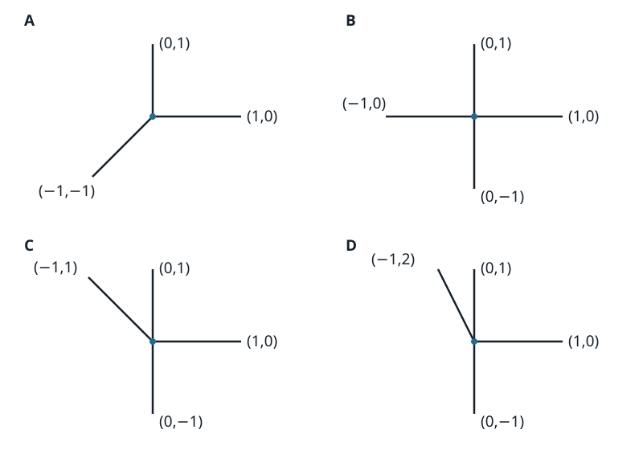
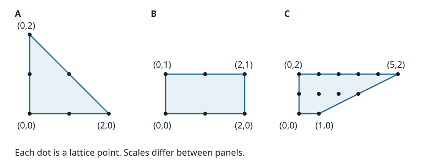
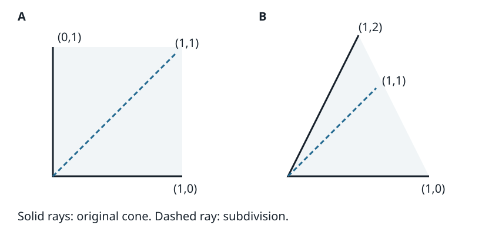

::: {.front card-id="toric-cayley-twisted-sums" tags="definition construction example"}
Define a Cayley sum, normal equivalence, and a twisted Cayley sum. Give a polygon whose associated toric surface is a ruled surface.
:::

::: {.back card-id="toric-cayley-twisted-sums"}
For lattice polytopes $P_0,\ldots,P_r\subset M_{\mathbb R}$, the Cayley sum is
$$\operatorname{Cayley}(P_0,\ldots,P_r)
=\operatorname{conv}(P_0\times e_0,\ldots,P_r\times e_r),$$
using the affine lattice where the last coordinates sum to one. Projection sends it to the standard simplex.

Normally equivalent polytopes have the same normal fan after identifying their spaces of directions. They define the same toric variety with possibly different ample polarizations.

For a surjective lattice map $\pi:M\to\Lambda$, a $\pi$-twisted Cayley sum is $R=\operatorname{conv}(R_1,\ldots,R_\ell)$, where the normally equivalent lattice polytopes $R_i$ lie in parallel fibers and their images $v_i$ are precisely the distinct vertices of $F=\pi(R)$.

Example: $P_0=[0,a]$, $P_1=[0,b]$, $a,b>0$. Their Cayley polygon is a trapezoid; its toric surface is $\mathbb F_{|a-b|}$, ruled over $\mathbb P^1$. If $a=b$, the rectangle gives $\mathbb P^1\times\mathbb P^1$.

Reference: [Di Rocco–Schaffler, Definition 1.1](https://arxiv.org/abs/2110.04842).
:::

::: {.front card-id="toric-quotient-fan-lattice-fibers" tags="definition construction comparison"}
Describe the fan of a normalized toric Chow quotient by a subtorus. What lattice condition distinguishes reduced fibers from mere control of fiber dimensions?
:::

::: {.back card-id="toric-quotient-fan-lattice-fibers"}
Let $X_\Sigma$ be projective toric, $H\subset T_N$ a subtorus with saturated cocharacter lattice $N_H$, and $q:N\to N'=N/N_H$. The fan of the normalization of $X_\Sigma\mathbin{/\!/}H$ is the common refinement of the projected cones $q(\sigma)$, $\sigma\in\Sigma$. This is the quotient fan; in polytope language it is the normal fan of the corresponding fiber polytope.

For a toric morphism of fans, the combinatorial conditions for weak semistability are:

- Every source cone $\sigma$ maps onto a target cone $\tau$.
- $q(N\cap\operatorname{span}_{\mathbb R}\sigma)=N'\cap\operatorname{span}_{\mathbb R}\tau$ for every such cone.

The first controls equidimensionality; the second excludes lattice multiplicities in fibers. Smooth target plus these conditions gives flatness with reduced fibers. Example: $\mathbb A^1\to\mathbb A^1$, $t=x^m$, has the same ray map over $\mathbb R$ as the identity but lattice image $m\mathbb Z$; its zero fiber is nonreduced for $m>1$.

Reference: Di Rocco–Schaffler, *Families of pointed toric varieties and degenerations*, §§2–3.
:::

::: {.front card-id="polyhedral-coherent-secondary" tags="definition construction example"}
Define a coherent subdivision, secondary fan, and secondary polytope for a finite point configuration. Use a square to distinguish subdivisions.
:::

::: {.back card-id="polyhedral-coherent-secondary"}
$A\subset\mathbb R^d$ finite, affinely spanning; $P=\operatorname{conv}A$.

- Height function $h:A\to\mathbb R$: project the lower faces of $\operatorname{conv}\{(a,h(a)):a\in A\}$ to $P$. The resulting subdivision is **coherent/regular**.
- Heights giving the same subdivision form a relatively open polyhedral cone. Their closures form the **secondary fan**, modulo affine functions on $A$.
- For a triangulation $T$ using vertices in $A$, set $\phi_T(a)=\sum_{\sigma\in T,\ a\in\sigma}\operatorname{vol}(\sigma)$, summing over maximal simplices with one fixed volume normalization. The **secondary polytope** is $\operatorname{conv}\{\phi_T\}$; its normal fan, with the lower-height convention, is the secondary fan.

For the four vertices of a square, compare $h_{00}+h_{11}$ with $h_{10}+h_{01}$. A strict inequality selects one diagonal; equality gives the unsubdivided square. The secondary polytope is a segment. A general subdivision need not be coherent.

Reference: Gel'fand–Kapranov–Zelevinsky, *Discriminants, Resultants, and Multidimensional Determinants*, Chapter 7; Alexeev, *Moduli of Weighted Hyperplane Arrangements*, §2.7.
:::

::: {.front card-id="polyhedral-fiber-polytope" tags="definition construction example"}
Define the fiber polytope of a projection of polytopes. What does its normal fan record?
:::

::: {.back card-id="polyhedral-fiber-polytope"}
For an affine surjection $\pi:P\to Q$, fix Lebesgue measure on $\operatorname{aff}Q$ and set
$$\Sigma(P,Q)=\frac1{\operatorname{vol}Q}\int_Q\pi^{-1}(q)\,dq.$$
The Minkowski integral is the set of averages $\operatorname{vol}(Q)^{-1}\int_Qs(q)\,dq$ of measurable sections $s(q)\in\pi^{-1}(q)$. Its image under $\pi$ is the barycenter of $Q$; translation identifies its affine span with a subspace of $\ker\pi$.

Its normal fan records the coherent subdivisions of $Q$ induced by minimizing a linear functional on each fiber of $\pi$.

Example: projecting the unit square onto its first coordinate gives vertical interval fibers. Their average is $\{1/2\}\times[0,1]$. Secondary polytopes arise from projecting a simplex with vertices indexed by $A$ onto $\operatorname{conv}A$.

Reference: Billera–Sturmfels, *Fiber polytopes*; Alexeev–Pardini, *Explicit compactifications of moduli spaces of Campedelli and Burniat surfaces*, §4.
:::

::: {.front card-id="toric-stable-polarized-gluing" tags="definition comparison example"}
Define a polarized stable toric variety. What extra data are needed beyond its complex of polytopes?
:::

::: {.back card-id="toric-stable-polarized-gluing"}
Over an algebraically closed field, a polarized stable toric variety $(X,L)$ for a torus $T$ consists of:

- A projective seminormal variety $X$ with a $T$-action and finitely many orbits.
- Connected reduced stabilizers, hence subtori.
- An ample $T$-linearized line bundle $L$.

Normalization components are polarized toric varieties. Their lattice polytopes glue along faces into a complex $|\Delta|$ with a map $\rho:|\Delta|\to M_{\mathbb R}$ integral-affine on each cell. The map need not be injective.

Face gluings also require torus translations $t_{ij}$: on triple overlaps $t_{ij}t_{jk}t_{ki}=1$, modulo changes of origins on components. The complex alone need not determine $X$.

Example: two copies of $\mathbb P^1$ glued at torus-fixed endpoints, each with $\mathcal O(1)$, correspond to two unit intervals meeting at an endpoint.

Reference: Alexeev, *Moduli of Weighted Hyperplane Arrangements*, §2.2.
:::

::: {.front card-id="toric-stable-over-target-pair" tags="definition comparison"}
Distinguish a stable toric variety over a projective target from a stable toric pair.
:::

::: {.back card-id="toric-stable-over-target-pair"}
Fix a projective $T$-scheme $V$ with linearized ample $\mathcal O_V(1)$.

| Object | Additional data on a stable toric variety $X$ |
| --- | --- |
| Over $V$ | Finite $T$-equivariant map $f:X\to V$ and $L\simeq f^*\mathcal O_V(1)$ |
| Stable toric pair $(X,B)$ | Effective ample Cartier divisor $B$, containing no $T$-orbit |

$B$ is not required to be invariant. For $\mathbb P^1$ with its standard torus action, a point of $\mathbb G_m$ gives such a divisor; either fixed point fails the orbit condition.

Reference: Alexeev, *Moduli of Weighted Hyperplane Arrangements*, §§2.4–2.7.
:::

::: {.front card-id="convex-lineality-relative-interior" tags="definition application"}
Distinguish dimension, lineality, pointedness, interior, and relative interior of a convex cone. Test them on a ray and a half-plane in $\mathbb R^2$.
:::

::: {.back card-id="convex-lineality-relative-interior"}
For a convex cone $C$, $\dim C=\dim\operatorname{span}_{\mathbb R}C$ and its lineality space is $C\cap(-C)$. It is pointed when this space is zero, and full-dimensional when its span is the ambient space. Relative interior means interior in its span.

The ray $\mathbb R_{\ge0}(1,0)$ is pointed of dimension one; its ambient interior is empty and its relative interior is $\mathbb R_{>0}(1,0)$. The half-plane $y\ge0$ is full-dimensional but not pointed: its lineality is the $x$-axis. For a closed convex cone, pointedness of $C$ is equivalent to full dimension of $C^\vee$, and full dimension of $C$ to pointedness of $C^\vee$.
:::

::: {.front card-id="convex-polyhedron-polytope" tags="definition application"}
Distinguish a polyhedron, a polytope, and a rational polyhedral cone. How do generators and inequalities describe each?
:::

::: {.back card-id="convex-polyhedron-polytope"}
A polyhedron is an intersection of finitely many closed affine half-spaces. A polytope is a bounded polyhedron, equivalently the convex hull of finitely many points. A polyhedral cone is defined by homogeneous linear inequalities, equivalently generated by finitely many vectors with nonnegative coefficients.

Relative to a lattice, rational inequalities are equivalent to rational vertex and ray data; a lattice polytope has integral vertices, a stronger condition. For example $[0,1/2]$ is rational but not a lattice polytope for $\mathbb Z$. The recession cone of a nonempty polyhedron $P$ is
$$\operatorname{rec}(P)=\{v:P+\mathbb R_{\ge0}v\subseteq P\}.$$
It is zero exactly when $P$ is bounded. If $P=\{x:Ax\ge b\}$, then $\operatorname{rec}(P)=\{v:Av\ge0\}$.
:::

::: {.front card-id="convex-extremal-exposed-faces" tags="definition application"}
Define a face and an extremal ray of a convex cone. What does a supporting functional provide? Is every generating ray extremal?
:::

::: {.back card-id="convex-extremal-exposed-faces"}
A convex subcone $F\subset C$ is a face if $x,y\in C$ and $x+y\in F$ imply $x,y\in F$. An extremal ray is a one-dimensional face. For $u\in C^\vee$, the set $C\cap u^\perp$ is an exposed face.

Every face of a polyhedral cone is exposed; general closed convex cones can have nonexposed faces. In $\mathbb R_{\ge0}^2$, the coordinate rays are extremal, but the ray through $(1,1)$ is not: $(1,1)=(1,0)+(0,1)$ violates the face condition. Adding that vector to a generating set does not create a new extremal ray.
:::

::: {.front card-id="convex-duality-separation" tags="theorem application"}
How do duality and separation test membership in a closed convex cone? What happens if the cone is not closed?
:::

::: {.back card-id="convex-duality-separation"}
In a finite-dimensional real vector space,
$$C^\vee=\{u:\langle u,x\rangle\ge0\ \forall x\in C\},\qquad
C^{\vee\vee}=\overline C$$
for a convex cone $C$. Thus $x\notin\overline C$ exactly when some $u\in C^\vee$ has $\langle u,x\rangle<0$. Dual inequalities cannot distinguish a cone from its closure.

For cones $C,D$ one has $(C+D)^\vee=C^\vee\cap D^\vee$; for closed convex cones,
$$(C\cap D)^\vee=\overline{C^\vee+D^\vee}.$$
The closure is unnecessary for polyhedral cones. These identities turn generators into inequalities and supporting functionals into faces.
:::

::: {.front card-id="convex-dual-hilbert-basis-example" tags="application"}
For $C=\operatorname{Cone}((1,0),(1,2))\subset\mathbb R^2$, compute its inequalities, dual cone, and lattice-point monoid. Why do its primitive rays not suffice?
:::

::: {.back card-id="convex-dual-hilbert-basis-example"}
The inequalities are $y\ge0$ and $2x-y\ge0$. Its dual is
$$C^\vee=\{(a,b):a\ge0,\ a+2b\ge0\}
=\operatorname{Cone}((0,1),(2,-1)).$$
Gordan's lemma says a rational polyhedral cone's lattice-point monoid is finitely generated. Here its Hilbert basis is
$$C\cap\mathbb Z^2=\mathbb N(1,0)+\mathbb N(1,1)+\mathbb N(1,2).$$
The primitive ray generators alone miss $(1,1)$. The monoid algebra is $k[u,v,w]/(uw-v^2)$, with $u=x$, $v=xy$, $w=xy^2$. The cone is simplicial but not smooth: the primitive ray determinant is two. This monoid describes the affine toric chart for the dual cone.
:::

::: {.front card-id="toric-complete-projective-support" tags="definition application"}
How does a fan distinguish completeness from projectivity? Recover the fan and an ample divisor of $\mathbb P^2$ from a polytope.
:::

::: {.back card-id="toric-complete-projective-support"}
Completeness means $|\Sigma|=N_{\mathbb R}$. A complete toric variety is projective exactly when its fan admits a strictly upper-convex integral support function, equivalently when it is the inward normal fan of a full-dimensional lattice polytope. Complete fans need not be projective in dimension at least three.

For $P=\operatorname{conv}((0,0),(1,0),(0,1))$, its inward facet normals are $(1,0),(0,1),(-1,-1)$. Adjacent pairs generate the maximal cones of the fan of $\mathbb P^2$. The inequalities $x\ge0$, $y\ge0$, $x+y\le1$ give an invariant divisor linearly equivalent to $H$, hence $\mathcal O(1)$. The function $\psi(u)=\min_{m\in P}\langle m,u\rangle$ bends across every wall.
:::

::: {.front card-id="card-f64d3b2fda3593e6" tags="definition"}
What is the **character lattice** $M$? What is its **dual lattice** $N$?
:::

::: {.back card-id="card-f64d3b2fda3593e6"}
$M =$ **characters**, $N =$**cocharacters/1PSs**.

For a torus $T$ (e.g. $T^n \coloneqq{\mathbf{G}}_m^n$), $M \coloneqq\mathop{\mathrm{Hom}}(T , {\mathbf{G}}_m)$ is the character lattice. For $T^n$ it contains elements $\chi^m$ where $\mathbf{t} \mapsto \prod t_i^{m_i}$. Then $N \coloneqq\mathop{\mathrm{Hom}}({\mathbf{G}}_m, T)$ is the lattice of cocharacters/1-parameter subgroups, containing elements $\lambda^u$ where $t\mapsto \mathbf{t}^u \coloneqq(t^{u_i})$. They are dual free abelian groups, with the perfect pairing ${\left\langle {m},~{n} \right\rangle} \coloneqq\ell$ where $\ell$ is the unique integer such that $\chi^m \circ \lambda^n: {\mathbf{G}}_m\to {\mathbf{G}}_m$ is $t\mapsto t^\ell$. Note $N\otimes_\ZZ{\mathbf{G}}_m \cong T$.
:::

::: {.front card-id="card-58d7494c921916ce" tags="definition, unsorted"}
What is a **strongly convex rational polyhedral cone**? What is its **dual cone** $\sigma {}^{ \vee }$?
:::

::: {.back card-id="card-58d7494c921916ce"}
**Convex cone**: $\mathbb R_{\ge0}\sigma\subseteq\sigma$ and $\sigma+\sigma\subseteq\sigma$, with $0\in\sigma$. Equivalently, it is closed under nonnegative linear combinations. Scaling alone defines a cone, but does not force convexity.

**Polyhedral**: finitely generated as a convex cone, $\sigma=\sum_{i=1}^s\mathbb R_{\ge0}v_i$; equivalently an intersection of finitely many closed linear half-spaces.

**Rational**: in this polyhedral setting, the generators can be chosen in the lattice $N$ (equivalently in $N_{\mathbb Q}$). Rationality depends on the chosen lattice.

**Strongly convex**: $\sigma\cap(-\sigma)=\{0\}$, or contains no nonzero subspace of $N_{\mathbb R}$, or $\dim\sigma^\vee=\dim M_{\mathbb R}$. Also called pointed.

**Dual cone**:
$$\sigma^\vee=\{m\in M_{\mathbb R}:\langle m,n\rangle\ge0\text{ for all }n\in\sigma\},$$
and $S_\sigma=\sigma^\vee\cap M$ is its semigroup of lattice points. A rational polyhedral cone is closed, and so is its dual.
:::

::: {.front card-id="card-ced0d59dc309e7b8"}
Compute the toric variety associated to $\Cone(v_1,v_2)\subset\mathbb R^2$ where $v_1=(2,1)$ and $v_2=(1,4)$, using the lattice $\mathbb Z^2$.
:::

::: {.back card-id="card-ced0d59dc309e7b8"}
Can get perps by $\pi/2$ rotation:
$$e_1\mapsto e_2,\quad e_2\mapsto-e_1
\quad\rightsquigarrow\quad
\begin{pmatrix}0&-1\\1&0\end{pmatrix}.$$
So $v_1^\perp=(-1,2)$ and $v_2^\perp=(-4,1)$. Flip $v_2^\perp$ since its normal points outside the dual cone, giving $(4,-1)$. Thus
$$\sigma^\vee=\operatorname{Cone}((4,-1),(-1,2))
=\{(a,b):2a+b\ge0,\ a+4b\ge0\}.$$
Find the semigroup generators $(4,-1),(1,0),(0,1),(-1,2)$, corresponding to
$$u,v,w,t=x^4y^{-1},x,y,x^{-1}y^2.$$
These are a Hilbert basis, not a lattice basis: adjacent pairs have determinant one and subdivide the dual cone into unimodular cones.

The torus has dimension two, so the affine variety is a surface. Comparing monomial exponents gives three relations, generating an ideal of height two:
$$X_\sigma=\operatorname{Spec}k[x^4y^{-1},x,y,x^{-1}y^2]
=\operatorname{Spec}\frac{k[u,v,w,t]}{(uw-v^4,\ vt-w^2,\ ut-v^3w)}.$$
The number of displayed equations alone does not determine the dimension; these relations are dependent.
:::

::: {.front card-id="card-9112b533b3ed2a79" tags="definition"}
Discuss how to construct an affine toric variety from a cone.
:::

::: {.back card-id="card-9112b533b3ed2a79"}
For a strongly convex rational polyhedral cone $\sigma\subset N_{\mathbb R}$:
$\sigma \leadsto S_\sigma \coloneqq\sigma {}^{ \vee }\cap M \leadsto U_\sigma = X_\sigma \coloneqq\operatorname{Spec}\CC[S_\sigma]$ where $\CC[S_\sigma] \coloneqq\left\{{ \sum_{s\in S_{\sigma}} c_s \chi^s \st c_s\in \CC\text{ and }c_s = 0 { \text{a.e.} }}\right\}$ with character multiplication $\chi^m\chi^{m'}=\chi^{m+m'}$. Its dense torus is $\operatorname{Spec}\CC[M]$.
:::

::: {.front card-id="card-0f87c32fe5c35f28"}
What is a **fan**?
:::

::: {.back card-id="card-0f87c32fe5c35f28"}
A finite collection of strongly convex rational polyhedral cones in $N_{\mathbb R}$, closed under taking faces, such that the intersection of any two cones is a face of both. Finiteness is the convention for finite-type toric varieties here.

For $\tau\le\sigma$, being a face means
$$\tau=H_m\cap\sigma,\qquad
H_m=\{n\in N_{\mathbb R}:\langle m,n\rangle=0\},\qquad m\in\sigma^\vee.$$
Allow $m=0$ for the whole cone. The support is $|\Sigma|=\bigcup_{\sigma\in\Sigma}\sigma$; it need not be convex. Completeness means $|\Sigma|=N_{\mathbb R}$.
:::

::: {.front card-id="card-364a052db48b5781"}
What is a **convex set**?
:::

::: {.back card-id="card-364a052db48b5781"}
For all $p,q\in S$ and $0\le t\le1$, the line segment $tp+(1-t)q$ lies in $S$. In every dimension, equivalently for every finite collection $\{p_i\}\subset S$ and scalars $\lambda_i\ge0$ with $\sum_i\lambda_i=1$, one has $\sum_i\lambda_i p_i\in S$.

The convex hull $\operatorname{conv}(A)$ consists of such finite convex combinations of points of $A$. The conical hull $\operatorname{Cone}(A)$ consists of finite nonnegative linear combinations, without the condition that the coefficients sum to one.
:::

::: {.front card-id="card-54e681a283e0a7dc" tags="definition"}
What is the toric variety $X_P$ associated to a polytope $P$?
:::

::: {.back card-id="card-54e681a283e0a7dc"}
A full-dimensional lattice polytope $P\subset M_{\mathbb R}$ defines a projective toric variety $X_P$ from its normal fan in $N_{\mathbf{R}}$. The lattice points $m\in P\cap M$ index monomial sections $\chi^m$ of the associated ample line bundle.

Alternatively: $X_P = \operatorname{Proj}\CC[C(P)\cap (M\times\ZZ)]$, where $C(P)$ is the cone over $P\times\left\{{1}\right\} \subseteq M_{\mathbf{R}}\times {\mathbf{R}}$, graded by the last coordinate. The fan of cones over the proper faces of $P$ (with $0$ in the interior of $P$) is the normal fan of $P^\circ$, so it defines $X_{P^\circ}$. Note $F\leq P$ is proper iff $F = P \cap(H_n + r)$ for some supporting affine hyperplane, so $F = \left\{{p\in P \st{\left\langle {p},~{n} \right\rangle} = r}\right\}$. How these are related: the normal fan of $P$ is the face fan of the polar $P^\circ$.

Alternatively: $X_P \coloneqq\bigcup_{m\text{ a vertex of } P} \operatorname{Spec}\CC[\sigma_{\widehat{m}} \cap M]$ where $\sigma_{\widehat{m}}\coloneqq\Cone(P\cap M-m)$ (for $P$ normal).

Projective embedding: for $A \coloneqq P \cap M = \left\{{m_0,\cdots, m_s}\right\}$, let $T$ be the torus with character lattice $M$ act on ${\mathbf{P}}^s$ by $t.\mathbf{x} = {\left[ {\chi^{m_0}(t) \cdot x_0: \cdots : \chi^{m_s}(t) \cdot x_s} \right]}$ and define $X_A \coloneqq\cl_{{\mathbf{P}}^s}(T. {\left[ {1:\cdots:1} \right]})$. If $P$ is very ample, $X_{P\cap M} \cong X_P$; in general $X_P$ is the normalization of $X_{P\cap M}$ (up to replacing $P$ by a multiple).
:::

::: {.front card-id="card-ef0756e944505c1e"}
What is the polytope $P_D$ associated to a torus-invariant divisor $D$? Find an example.
:::

::: {.back card-id="card-ef0756e944505c1e"}
Write $D = \sum a_\rho D_\rho$, then
$$P_D = \left\{{m\in M_{\mathbf{R}}\st{\left\langle {m},~{u_\rho } \right\rangle}\geq -a_\rho \, \forall \rho\in \Sigma(1)}\right\}.$$
On $X_P$, the divisor $D_P = \sum_F a_F D_F$ read off from the facet presentation of $P$ has $P_{D_P} = P$. For the anticanonical divisor one gets $P_{-K_{X_P}} = P$ exactly when $P$ is reflexive.

Example: for ${\mathbf{P}}^2$, the polytope of $-K = D_0 + D_1 + D_2 \sim 3H$ is a translate of $3\Delta$, where $\Delta$ is the standard simplex (the polytope of ${\mathcal{O}}(1)$).
:::

::: {.front card-id="card-5170f0e88794efdb"}
Discuss the **moment map** for $X_\Sigma$.
:::

::: {.back card-id="card-5170f0e88794efdb"}
$\mu_{\Sigma}: \CC^{{\sharp}\Sigma(1)} \to {\mathbf{R}}^{r-n}$ for $n = \dim N_{\mathbf{R}}$.
:::

::: {.front card-id="card-a026f335570d283d" tags="definition"}
Discuss the **orbit-cone correspondence**.
:::

::: {.back card-id="card-a026f335570d283d"}
Each cone $\sigma$ determines a distinguished point $x_\sigma \in U_\sigma$ corresponding to the semigroup map $S_\sigma \coloneqq\sigma {}^{ \vee }\cap M \to \left\{{0, 1}\right\}$ where $m\mapsto 1$ if $m\in \sigma^\perp$ and 0 otherwise where $\sigma^\perp \coloneqq\left\{{m\in M_{\mathbf{R}}\st{\left\langle {m},~{n} \right\rangle} = 0\,\, \forall n\in \sigma}\right\}$. Then there is a bijection from $\Sigma$ to $T\dash$orbits in $X_\Sigma$ where $\sigma \mapsto O(\sigma) \coloneqq T\cdot x_\sigma$, and an $r\dash$dimensional cone corresponds to an $n-r\dash$dimensional orbit: $\dim O(\sigma)=\dim N_{\mathbb R}-\dim\sigma$. E.g. $\dim \sigma =0 \rightleftharpoons{\mathbf{G}}_m^n$ and $\dim \sigma = n \rightleftharpoons T\dash$invariant points.

The closure relation reverses face inclusion: $O(\tau)\subseteq\overline{O(\sigma)}$ exactly when $\sigma$ is a face of $\tau$.
:::

::: {.front card-id="card-40263c3451ebf554"}
Discuss as many examples of fans and their corresponding toric varieties as you can.
:::

::: {.back card-id="card-40263c3451ebf554"}
$(\CC^{\times})^n, \CC^n, {\mathbf{P}}^n, { \mathbf{F} }_n$ for any $n$

The rational normal cone $\widehat{C}_d$ gotten from $(d,-1), (0,1)$.

The cone over a cone $V(y^2-xz)$, gotten from $(0, 1), (2, -1)$:

$\operatorname{Bl}_m X_\Sigma$ for any $\Sigma$.

$V(xy-zw)$ gotten from $(1,0,0), (0, 1,0), (1,0,1), (0,1,1)$.

Any products of the above.
:::

::: {.front card-id="card-db955c10e0df4871"}
Show that a divisor class group may not be torsionfree.
:::

::: {.back card-id="card-db955c10e0df4871"}
$\operatorname{Cl}(\widehat{C}_d) = \ZZ/d\ZZ$, see 4.14 Cox.
:::

::: {.front card-id="card-fabdf50d8dd729b0" tags="definition"}
What is a toric morphism?
:::

::: {.back card-id="card-fabdf50d8dd729b0"}
On lattices: images of cones are contained in cones. A lattice map $\phi: N_1\to N_2$ such that for each $\sigma_1 \in \Sigma_1$ there is a $\sigma_2 \in \Sigma_2$ with $\phi_{\mathbf{R}}(\sigma_1) \subseteq \sigma_2$ defines a toric morphism $X_{\Sigma_1}\to X_{\Sigma_2}$. On tori, the map is induced by the dual character map $\phi^*:M_2\to M_1$.

At the level of varieties: $\phi: X_{\Sigma_1} \to X_{\Sigma_2}$ a morphism of varieties with $\phi(T_{1})\subseteq T_2$ which restricts to a group morphism. At the level of affine toric varieties: for $V_i = \operatorname{Spec}\CC[S_i]$ and $\phi: V_1\to V_2$, toric iff $\phi^*: \CC[S_2] \to \CC[S_1]$ is induced by a semigroup morphism $S_2\to S_1$.
:::

::: {.front card-id="card-b9cfefee40bfd4f1" tags="definition"}
When is a toric variety $X_\Sigma$ **smooth**?
:::

::: {.back card-id="card-b9cfefee40bfd4f1"}
Iff each affine patch $U_\sigma$ is smooth, and $U_\sigma$ is smooth iff $\sigma$ is smooth: the minimal generators $u_\rho$ of its rays form part of a $\ZZ\dash$basis of $N$. In this case $U_\sigma \cong {\mathbf{A}}^k \times {\mathbf{G}}_m^{n-k}$ where $k = \dim \sigma$.

Compare: $\sigma$ is **simplicial** if its minimal generators are linearly independent over ${\mathbf{R}}$; then $U_\sigma$ has at worst finite quotient singularities.
:::

::: {.front card-id="card-6c26e20c90275fc8" tags="definition"}
When is a toric variety proper/complete?
:::

::: {.back card-id="card-6c26e20c90275fc8"}
A separated variety is **complete** iff universally closed, or equivalently its structure morphism $X\to \Spec k$ is proper.

$X_\Sigma$ is complete iff ${\left\lvert {\Sigma} \right\rvert} = N_{\mathbf{R}}$, i.e. full support. Why: each $n\in N$ determines a one-parameter subgroup $\lambda^n$, and $\lim_{t\to 0}\lambda^n(t)$ exists in $X_\Sigma$ iff $n$ lies in a cone of $\Sigma$. E.g. for ${\mathbf{P}}^2$ with torus points $[1:s:t]$, $\lambda^n(t) = [1: t^{n_1}: t^{n_2}]$, and the limits as $n$ ranges over the cones are the distinguished points.
:::

::: {.front card-id="card-32733ba65d2b4066"}
How is a line bundle on $X$ described?
:::

::: {.back card-id="card-32733ba65d2b4066"}
Every $\mcl\in \operatorname{Pic}(X_\Sigma)$ must be trivial when restricted to $T^n$ so $\mcl= {\mathcal{O}}_X(D)$ for some $D\in \mathop{\mathrm{Cart}}(X_\Sigma)$.
:::

::: {.front card-id="card-e41b14a903a15f7f"}
Give a toric example of a Weil divisor that is not Cartier.
:::

::: {.back card-id="card-e41b14a903a15f7f"}
Take $\sigma=\operatorname{Cone}(e_2,de_1-e_2)$, $d\ge2$, labeling $D_1$ by $de_1-e_2$ and $D_2$ by $e_2$. The principal-divisor map has matrix $\left(\begin{smallmatrix}d&-1\\0&1\end{smallmatrix}\right)$:
$$\operatorname{div}(\chi^{e_1^*})=dD_1,\qquad\operatorname{div}(\chi^{e_2^*})=-D_1+D_2.$$
Thus $\operatorname{Cl}(U_\sigma)=\mathbb Z/d$, generated by $[D_1]=[D_2]$, while $\operatorname{Pic}(U_\sigma)=0$ for this affine toric chart. The nonzero class of $D_1$ cannot come from a Cartier divisor; $dD_1$ is principal, so its Cartier index is $d$. For $d=1$ the cone is smooth and this example is Cartier.
:::

::: {.front card-id="card-e8afe0b0448db5cc"}
For a complete simplicial fan $\Sigma$ of dimension $n$, what is $\operatorname{rank}\operatorname{Pic}(X_\Sigma)$?
:::

::: {.back card-id="card-e8afe0b0448db5cc"}
$\operatorname{rank}\operatorname{Pic}(X_\Sigma)=\#\Sigma(1)-n$. Completeness makes the rays span $N_{\mathbb R}$, and simpliciality identifies Cartier and Weil classes over $\mathbb Q$. For $\mathbb F_n$, the rank is $4-2=2$, generated by a special section and a fiber. For an arbitrary noncomplete simplicial fan this formula need not give the Picard rank.
:::

::: {.front card-id="card-520a1c0ca006862d"}
When is $D$ **globally generated/bpf**?
:::

::: {.back card-id="card-520a1c0ca006862d"}
For $X_\Sigma$ whose maximal cones all have dimension $n$, and a torus-invariant Cartier divisor $D$ with Cartier data $m_\sigma$: $D$ is bpf iff $\mathcal O(D)$ is globally generated iff $m_\sigma\in P_D$ for every maximal cone.

Polytope side, when $X_\Sigma$ is complete: $\mathcal O(D)$ is globally generated iff $P_D$ is the convex hull of $\{m_\sigma:\sigma\in\Sigma(n)\}$. On an affine chart, $P_D$ can be unbounded, so this convex-hull formulation needs completeness.

Support function side, for a complete fan: $|D|$ is bpf iff $\psi_D$ is upper convex, meaning $\psi_D(tv+(1-t)w)\ge t\psi_D(v)+(1-t)\psi_D(w)$ for $0\le t\le1$. This is the concave sign convention in real analysis.
:::

::: {.front card-id="card-325ac37203c8f48a" tags="definition"}
When is $D$ **ample** or **very ample** on a complete toric variety?
:::

::: {.back card-id="card-325ac37203c8f48a"}
For a complete toric variety and a torus-invariant Cartier divisor $D$ with support function $\psi_D$ and Cartier data $m_\sigma$:

${\mathcal{O}}(D)$ is ample iff $\psi_D$ is strictly convex, iff $m_{\sigma}\neq m_{\sigma'}$ for distinct $\sigma\neq \sigma'\in \Sigma(n)$ and $P_D$ is $n\dash$dimensional with vertices $m_\sigma$.

Here $m_\sigma$ is the linear function associated to $\sigma$ defined by ${ \left.{{\psi_D}} \right|_{{\sigma}} }({-}) = {\left\langle {m_\sigma},~{{-}} \right\rangle}$, so $\psi_D(u_{\rho_i}) = -a_i$ in $D = \sum a_i D_{\rho_i}$ and $D = \sum - \psi_D(u_{\rho_i}) D_{\rho_i}$. $\psi_D$ is **strictly convex** if convex and $m_\sigma, m_{\sigma'}$ are not equal for distinct maximal cones $\sigma,\sigma'$.

$D$ is very ample iff $\psi_D$ is strictly convex **and** $S_\sigma$ is generated by $\left\{{m - m_\sigma \st m\in P_D\cap M}\right\}$ for every $\sigma\in\Sigma(n)$: lattice points of the divisor polytope generate each local semigroup at a vertex. Equivalently, $P_D$ is a very ample polytope: for every vertex $v$, the semigroup $S_{P, v} \coloneqq{\mathbb{N}}(P_v)$ where $P_v \coloneqq P\cap M-v \coloneqq\left\{{p-v \st p \in P \cap M}\right\}$ is **saturated** in $M$.

If $X$ is smooth complete, ample iff very ample.
:::

::: {.front card-id="card-1808a8a9aa6b0ae1" tags="definition"}
Discuss $\operatorname{Pic}(X_\Sigma)$ and $\operatorname{Cl}(X_\Sigma)$.
:::

::: {.back card-id="card-1808a8a9aa6b0ae1"}
The fundamental SESs: principal divisors give $M\to\operatorname{Div}_T(X_\Sigma) = \bigoplus_{\rho\in\Sigma(1)}\mathbb ZD_\rho$, $m\mapsto\operatorname{div}(\chi^m) = \sum_\rho\langle m,u_\rho\rangle D_\rho$, whose cokernel is $\operatorname{Cl}(X_\Sigma)$; restricting to Cartier divisors gives $\operatorname{Pic}(X_\Sigma)$:
$$M \to \operatorname{Div}_T(X_\Sigma) \to \operatorname{Cl}(X_\Sigma) \to 0, \qquad M \to \operatorname{CDiv}_T(X_\Sigma) \to \operatorname{Pic}(X_\Sigma) \to 0.$$
Both are short exact ($M$ injects) when the $u_\rho$ span $N_{\mathbf{R}}$, e.g. when $X_\Sigma$ has no torus factor. For a smooth toric variety, $\operatorname{CDiv}_T = \operatorname{Div}_T$ and $\operatorname{Pic}(X_\Sigma)=\operatorname{Cl}(X_\Sigma)$.
:::

::: {.front card-id="card-90316beb253de3a2" tags="definition"}
What are the **global sections** of ${\mathcal{O}}(D)$ for $D\in \operatorname{Div}_T(X_\Sigma)$?
:::

::: {.back card-id="card-90316beb253de3a2"}
For $D=\sum_\rho a_\rho D_\rho$, set $P_D=\{m\in M_{\mathbb R}:\langle m,u_\rho\rangle\geq-a_\rho\text{ for all rays }\rho\}$. The monomial $\chi^m$ is a global section of $\mathcal O(D)$ exactly when $\langle m,u_\rho\rangle+a_\rho\geq0$ for every ray, so
$$\Gamma\left(X_{\Sigma}, \mathscr{O}_{X_{\Sigma}}(D)\right)=\bigoplus_{m \in P_D \cap M} \mathbb{C} \cdot \chi^m.$$
:::

::: {.front card-id="card-4e7d32eaf9bfe942" tags="definition"}
Classify complete smooth **toric surfaces**.
:::

::: {.back card-id="card-4e7d32eaf9bfe942"}
Given by sequences of ray generators $\left\{{v_0,\cdots, v_{d-1}, v_d = v_0}\right\}$ in counterclockwise order such that each $\left\{{v_i, v_{i+1\operatorname{mod}d}}\right\}$ is a basis of $N$. Then $v_{i-1} + v_{i+1} = a_i v_i$ for integers $a_i$, with $D_i^2 = -a_i$, i.e.
$$\left(\begin{array}{c}v_i \\ v_{i+1}\end{array}\right)=\left(\begin{array}{cc}0 & 1 \\ -1 & a_i \end{array}\right)\left(\begin{array}{c} v_{i-1} \\ v_i\end{array}\right), \quad \prod_i\left[\begin{array}{cc}0 & 1 \\-1 & a_i\end{array}\right]=\mathrm{id}, \quad \sum_i a_i=3 d-12$$
where $d$ is the number of rays.

On $d=3$ rays: ${\mathbf{P}}^2$.

On $d=4$ rays: ${ \mathbf{F} }_n$ a Hirzebruch surface $({ \mathbf{F} }_0 \cong {\mathbf{P}}^1\times {\mathbf{P}}^1)$

On $d\geq 5$ rays: $\operatorname{Bl}_m X$ for $X = {\mathbf{P}}^2, { \mathbf{F} }_n$ for some $n, m$. Every smooth complete toric surface comes from $\mathbb P^2$ or a Hirzebruch surface $\mathbb F_n$ by a sequence of blowups at torus-fixed points; in fan terms, a toric blowup of a fixed point inserts the ray generated by the sum $v_i + v_{i+1}$ of the adjacent primitive ray generators.
:::

::: {.front card-id="card-2ae8f79a2659ba03"}
What is a **Gorenstein Fano variety**?
:::

::: {.back card-id="card-2ae8f79a2659ba03"}
For $X$ complete and normal: $-K_X$ is Cartier and ample.
:::

::: {.front card-id="card-e7915e75c0b25167" tags="definition"}
Classify smooth **Fano** (del Pezzo) toric surfaces.
:::

::: {.back card-id="card-e7915e75c0b25167"}
Smooth Fano polytopes: $P\subseteq N_{\mathbf{R}}$ with $0\in \mathrm{int} P$ and the vertices of every facet form a lattice basis. $P$ is reflexive, so $P {}^{ \vee }$ is a lattice polytope and $X_{P {}^{ \vee }}$ is smooth toric Fano whose normal fan comes from taking cones over proper faces of $P$ -- every smooth toric Fano variety arises this way. If $X_\Sigma$ is projective Gorenstein Fano, then $P_{-K_{X_\Sigma}}$ is reflexive, and every $X_P$ for $P$ reflexive is Gorenstein Fano. Toric *Gorenstein* Fano surfaces: just 16 equivalence classes, one for each of the 16 reflexive polygons.

Smooth toric del Pezzo surfaces (smooth projective Fanos of dimension 2, corresponding to smooth reflexive polygons): there are exactly 5, ${\mathbf{P}}^1\times {\mathbf{P}}^1$ and $\operatorname{Bl}_i {\mathbf{P}}^2$ for $i=0,1,2,3$. Get the last three by blowing up (successively) the 3 torus-invariant points on ${\mathbf{P}}^2$.

Compare: over an algebraically closed field, all smooth del Pezzo surfaces are $\mathbb P^1\times\mathbb P^1$ and the blowups of $\mathbb P^2$ at $r\leq8$ points in general position.
:::

::: {.front card-id="card-043a09de27f2abbf"}
What is a **smooth polytope**?
:::

::: {.back card-id="card-043a09de27f2abbf"}
For $\dim M = n$, each vertex meets exactly $n$ edges and the primitive vectors along each edge generate a lattice basis.
:::

::: {.front card-id="card-06bbc031ab77d89d" tags="definition"}
How does one **blowup** a toric variety, and find a (minimal) resolution?
:::

::: {.back card-id="card-06bbc031ab77d89d"}
Subdividing the fan gives a proper birational toric morphism. For a smooth toric variety, blowing up the orbit closure $V(\sigma)$ corresponds to star subdivision of the fan at the ray through the sum of the primitive generators of $\sigma$.

Minimal resolution of a toric surface: for each cone $\sigma$, take the convex hull of $(\sigma \cap N)\setminus\left\{{0}\right\}$ and insert rays through the lattice points on its compact boundary. In dimension two, inserting rays between adjacent rays resolves toric surface singularities after enough subdivisions.
:::

::: {.front card-id="card-267d685838910f37" tags="definition"}
What are the torus-invariant **Weil divisors** of a toric variety?
:::

::: {.back card-id="card-267d685838910f37"}
Each ray $\rho\in\Sigma(1)$ determines the torus-invariant prime Weil divisor $D_\rho=V(\rho)$, the closure of its codimension-one orbit. So $\operatorname{Div}_T(X_\Sigma) \cong \ZZ^{\Sigma(1)}$, and every torus-invariant Weil divisor is $D = \sum_{\rho \in \Sigma(1)} a_\rho D_\rho$.
:::

::: {.front card-id="card-18a41e6831b5ae38" tags="definition"}
What are the torus-invariant **Cartier divisors** on a toric variety?
:::

::: {.back card-id="card-18a41e6831b5ae38"}
$\operatorname{CDiv}_T(U_\sigma) \cong M/M(\sigma)$ where $M(\sigma) \coloneqq\sigma^\perp\cap M$. A $T$-invariant Weil divisor $D = \sum a_\rho D_\rho$ on $X_\Sigma$ is Cartier iff it has Cartier data $\left\{{(U_\sigma, m_\sigma)}\right\}_{\sigma\in\Sigma}$: $m_\sigma\in M$ with ${\left\langle {m_\sigma},~{u_\rho} \right\rangle} = -a_\rho$ for every $\rho\in \sigma(1)$, so that ${ \left.{{D}} \right|_{{U_\sigma}} } = { \left.{{\operatorname{div}(\chi^{-m_\sigma})}} \right|_{{U_\sigma}} }$. The data are compatible: $m_\sigma - m_{\sigma'} \in M(\sigma\cap\sigma')$, and each $m_\sigma$ is unique modulo $M(\sigma)$.

Equivalently, via an integral piecewise-linear support function $\psi = \varphi_D$, linear on each cone with ${ \left.{{\psi}} \right|_{{\sigma}} }=\langle m_\sigma,\cdot\rangle$ for $m_\sigma\in M$: it defines the torus-invariant Cartier divisor $D_\psi=-\sum_\rho\psi(u_\rho)D_\rho$.

Can also obtain from polytopes: write $P = \left\{{m\in M_{\mathbf{R}}\st{\left\langle {m},~{u_F} \right\rangle} \geq -a_F \,\,\text{ for all facets } F\leq P}\right\}$ where $u_F$ is the minimal generator along the inward normal to the facet $F$. Then take $D_P \coloneqq\sum a_F D_F$ where $D_F$ is the divisor for the ray associated to $F$ in $X_P$.
:::

::: {.front card-id="card-0c70d88cb73d4df2" tags="definition, unsorted"}
What is $K_X$ (the canonical sheaf) for $X$ toric?
:::

::: {.back card-id="card-0c70d88cb73d4df2"}
For a normal toric variety $X_{\Sigma}$, the canonical sheaf $\omega_{X_{\Sigma}}$ is given by
$$
\omega_{X_{\Sigma}} \simeq \mathscr{O}_{X_{\Sigma}}\left(-\sum_\rho D_\rho\right) .
$$
Thus $K_{X_{\Sigma}}=-\sum_\rho D_\rho$ is a torus-invariant canonical divisor on $X_{\Sigma}$. It is Cartier exactly when, on each cone, there is $m_\sigma\in M$ pairing to $1$ with every primitive ray generator of that cone.

Why: on the dense torus, choose a lattice basis of characters and the invariant rational top form $\omega=(d\chi^{m_1}/\chi^{m_1})\wedge\cdots\wedge(d\chi^{m_n}/\chi^{m_n})$. Along each torus-invariant prime divisor $D_\rho$, it has a simple pole and no zero. Hence $\operatorname{div}(\omega)=-\sum_\rho D_\rho$. On a normal toric variety, the associated rank-one reflexive sheaf is the canonical sheaf.

As a consequence, for $X \coloneqq{\mathbf{P}}^n$ we have $\omega_X = {\mathcal{O}}(-n-1)$ since there are $n+1$ rays in the fan and all $D_i\sim D_j$.
:::

::: {.front card-id="card-1f5271744b6e5146" tags="definition"}
When is a toric variety **Fano**? Describe its singularities.
:::

::: {.back card-id="card-1f5271744b6e5146"}
A toric variety is Fano if it is projective and $-K_X$ is Cartier and ample, i.e. ${\mathcal{O}}(\sum_\rho D_\rho)$ is ample. Then the primitive ray generators $u_\rho$ are the vertices of a convex polytope $Q = \operatorname{Conv}(u_\rho)\subseteq N_{\mathbf{R}}$ with $0$ in its interior, and $\Sigma$ is the fan over the faces of $Q$.

For a Gorenstein toric Fano variety, $Q$ is a reflexive polytope; smooth toric Fano varieties correspond to smooth Fano polytopes.

Singularities: $X$ has canonical singularities iff $0$ is the only interior lattice point of $Q$; $X$ has terminal singularities iff the only lattice points of $Q$ are $0$ and its vertices.
:::

::: {.front card-id="card-5d9f1806c7354a60" tags="definition"}
What are $\pi_1 X$ and $\chi(X)$ for a toric variety $X = X_\Sigma$?
:::

::: {.back card-id="card-5d9f1806c7354a60"}
$\pi_1 X_{\Sigma} \cong N/N'$ where $N' \coloneqq\left\langle{\sigma \cap N \st\sigma\in \Sigma}\right\rangle$. For a smooth complete complex toric variety, $N' = N$, so $\pi_1(X_\Sigma)=0$.

$\chi(X_\Sigma) = {\sharp}\Sigma(n)$, the number of maximal cones of $\Sigma$, equal to the number of torus-fixed points. The Euler count follows because positive-dimensional torus orbits have Euler characteristic zero.
:::

::: {.front card-id="card-6d1d3db7b29e62f7"}
How are **intersection numbers** of divisors computed?
:::

::: {.back card-id="card-6d1d3db7b29e62f7"}
For a smooth complete toric surface, order the primitive ray vectors $u_i$ cyclically. Write $u_{i-1}+u_{i+1}=b_i u_i$. Then $D_i^2=-b_i$; distinct neighboring divisors intersect once and nonneighbors are disjoint. Indices are cyclic, so the last and first rays are neighbors.

Example: the fan of $\mathbb F_n$ has rays $(1,0),(0,1),(-1,n),(0,-1)$. The neighboring sum at $(0,1)$ is $n(0,1)$, so its divisor $S$ has $S^2=-n$. A fiber $F$ has $F^2=0$, $SF=1$, and the opposite section has square $n$.
:::

::: {.front card-id="card-6a2c66d9a5d0d4c3"}
What is the **quadric cone**?
:::

::: {.back card-id="card-6a2c66d9a5d0d4c3"}
$V(z^2-xy)$.
:::

::: {.front card-id="card-ab65db23f1054bd7" tags="definition"}
What is a **reflexive polytope**?
:::

::: {.back card-id="card-ab65db23f1054bd7"}
A lattice polytope $P$ with $0$ in its interior and facet presentation
$$P = \left\{{m\in M_{\mathbf{R}}\st{\left\langle {m},~{\mu_F} \right\rangle} \geq  -1 \text{ for all facets } F}\right\}$$
with $\mu_F$ the primitive lattice normal: every facet is at lattice distance 1 from the origin. Equivalently, its polar dual $P^\circ$ is also a lattice polytope.
:::

::: {.front card-id="card-ea5e115f622b418b" tags="definition"}
What is the **polar dual** $P^\circ$ of a polytope?
:::

::: {.back card-id="card-ea5e115f622b418b"}
For a full-dimensional polytope $P\subset M_{\mathbb R}$ containing $0$ in its interior,
$$P^\circ \coloneqq\left\{{n\in N_{\mathbf{R}}\st{\left\langle {p},~{n} \right\rangle} \geq -1\, \forall p\in P}\right\}$$
The sign convention places facets of a reflexive polytope at lattice distance one from $0$. For reflexive polytopes, since $a_F = 1$ for all $F$,
$$P^\circ = \mathrm{Conv}(\mu_F \mathrel{\Big|}F \text{ is a facet of } P)$$
where $\mu_F$ is the primitive inward facet normal.
:::

::: {.front card-id="card-c993598eef760f0d"}
What is $P_{-K_X}$ for $X = {\mathbf{P}}^2$? What is its dual?
:::

::: {.back card-id="card-c993598eef760f0d"}
For the fan of $\mathbb P^2$ with rays $(1,0)$, $(0,1)$, and $(-1,-1)$, $-K_X=D_1+D_2+D_3$. Hence $P_{-K_X}=\{(a,b):a\geq-1,\ b\geq-1,\ a+b\leq1\}$, with vertices $(-1,-1)$, $(2,-1)$, and $(-1,2)$. Its polar dual is $\operatorname{conv}\{(1,0),(0,1),(-1,-1)\}$.
:::

::: {.front card-id="card-642aa3c2c055fbb4"}
How can you read the projective embedding off of a polytope?
:::

::: {.back card-id="card-642aa3c2c055fbb4"}
For a very ample lattice polytope $P$, its lattice points give the monomial sections of the associated line bundle. The map of the dense torus is $t\mapsto[\chi^m(t)]_{m\in P\cap M}$ into $\mathbb P^{|P\cap M|-1}$; its closure is the embedded projective toric variety.
:::

::: {.front card-id="card-34edf68d86bf5e90"}
What is an **integral** support function?
:::

::: {.back card-id="card-34edf68d86bf5e90"}
$\phi: {\left\lvert {\Sigma} \right\rvert} \to {\mathbf{R}}$, linear on each cone, and integral if $\phi({\left\lvert {\Sigma} \right\rvert} \cap N) \subseteq \ZZ$.
:::

::: {.front card-id="card-420bc7b24d448d6b"}
What is the **support function** associated to $D$?
:::

::: {.back card-id="card-420bc7b24d448d6b"}
For $D=\sum a_p D_p$, uniquely determined by: $\phi_D$ is linear on each cone, $\phi_D(u_p) = -a_p$ where $u_p$ are primitive ray generators.
:::

::: {.front card-id="card-e4d7f009179a711f"}
What is a **convex** support function?
:::

::: {.back card-id="card-e4d7f009179a711f"}
For a support function on a complete fan, the toric upper-convex convention is
$$\varphi(tu+(1-t)v)\ge t\varphi(u)+(1-t)\varphi(v),\qquad 0\le t\le1.$$
This is called concave in the usual real-analysis convention. Keeping $\varphi_D(u_\rho)=-a_\rho$ fixes the sign: for a globally generated invariant Cartier divisor, $\varphi_D(u)=\min_{m\in P_D}\langle m,u\rangle$.
:::

::: {.front card-id="card-7a78cafb6ac9c5bf"}
What is a **strictly convex** support function?
:::

::: {.back card-id="card-7a78cafb6ac9c5bf"}
For a complete fan, require upper convexity and, for every maximal cone $\sigma$,
$$\langle m_\sigma,u\rangle=\phi_D(u)\quad\Longleftrightarrow\quad u\in\sigma.$$
Here $\phi_D|_\sigma=\langle m_\sigma,-\rangle$. Equivalently, the maximal cones are exactly the maximal domains of linearity. “Strict” here means bending across each wall; a support function is still linear inside every cone. For a toric Cartier divisor this is the ampleness condition.
:::

::: {.front card-id="card-34d58b955698f0ee"}
Show that ${\mathbf{P}}^2$ is Fano.
:::

::: {.back card-id="card-34d58b955698f0ee"}
$\omega_X = {\mathcal{O}}(-\sum_\rho D_\rho) = {\mathcal{O}}(-D_1 - D_2\cdots - D_3) = {\mathcal{O}}(-3)$ so $-\omega_X = {\mathcal{O}}(3)$ which is ample.
:::

::: {.front card-id="card-62d3e5cd4d47b6a7"}
Why are toric varieties **normal**?
:::

::: {.back card-id="card-62d3e5cd4d47b6a7"}
$\operatorname{Spec}\CC[S]$ is normal for $S\leq M$ a finitely generated submonoid iff $S$ is saturated in $M$: if $qm\in S$ for $q>0$ and $m\in M$, then $m\in S$.

For a cone $\sigma$, the affine chart is $U_\sigma=\operatorname{Spec}k[S_\sigma]$ with $S_\sigma=\sigma^\vee\cap M$, which is saturated. Thus every affine toric chart is normal, so the toric variety $X_\Sigma$ is normal.
:::

::: {.front card-id="card-38c432a3f888bd53"}
Classify smooth **affine** toric varieties.
:::

::: {.back card-id="card-38c432a3f888bd53"}
Always of the form $X_\sigma = {\mathbf{A}}^k \times {\mathbf{G}}_m^{n-k}$.
:::

::: {.front card-id="card-e3191417e1c27334"}
How do blowups and contractions of fans change self-intersection numbers?
:::

::: {.back card-id="card-e3191417e1c27334"}
On a smooth toric surface, blowing up the fixed point where adjacent invariant curves $D_i,D_{i+1}$ meet inserts the ray $u_i+u_{i+1}$. The new exceptional curve has self-intersection $-1$, and the strict transforms of $D_i,D_{i+1}$ each lose one in self-intersection. Contracting an invariant $(-1)$-curve reverses these changes.
:::

::: {.front card-id="card-700c8b1f3d679d6c"}
How does one construct weighted projective space as a toric variety?
:::

::: {.back card-id="card-700c8b1f3d679d6c"}
For positive integer weights,
$$\mathbb P(q_0,\ldots,q_n)=\operatorname{Proj}k[x_0,\ldots,x_n],\qquad\deg x_i=q_i.$$
Equivalently, use weighted scaling $(x_i)\mapsto(\lambda^{q_i}x_i)$ on $\mathbb A^{n+1}\setminus0$. After normalizing to well-formed weights, its fan is in $N=\mathbb Z^{n+1}/\mathbb Z(q_0,\ldots,q_n)$, with cones spanned by every proper subset of the images of the coordinate vectors.

The simplex mnemonic
$$\operatorname{Conv}(0,k_1e_1,\ldots,k_ne_n)-(1,\ldots,1),\qquad k_i=\frac{\sum_jq_j}{q_i},$$
is an integral anticanonical-polytope description when $q_0=1$ and every $q_i$ divides $\sum_jq_j$. It is not the construction for arbitrary weights.
:::

::: {.front card-id="weighted-projective-charts-adjunction" tags="definition formula example"}
For weighted projective space, distinguish quotient charts, well-formedness, quasismoothness, and Cartier twists. Compute the canonical class of a weighted hypersurface.
:::

::: {.back card-id="weighted-projective-charts-adjunction"}
Over $\mathbb C$, the chart $x_i\ne0$ of $\mathbb P(q_0,\ldots,q_n)$ is $\mathbb A^n/\mu_{q_i}$, with weights $q_j$ on the other coordinates. The quotient stack retains these stabilizers; the coarse space does not.

Well-formed weights satisfy $\gcd(q_0,\ldots,\widehat q_i,\ldots,q_n)=1$ for every $i$. For well-formed weighted projective space of dimension at least two,
$$\operatorname{Cl}(X)=\mathbb Z[\mathcal O_X(1)],\qquad
\operatorname{Pic}(X)=\mathbb Z[\mathcal O_X(\operatorname{lcm}(q_i))].$$
$\mathcal O_X(d)$ is generally rank-one reflexive, not necessarily invertible. For $H=c_1(\mathcal O_X(1))$ as a rational divisor class,
$$H^n=\frac1{\prod_iq_i},\qquad K_X\sim-\Bigl(\sum_iq_i\Bigr)H.$$
A hypersurface $V(F_d)$ is quasismooth if its affine cone is smooth away from the origin. If it is also well formed (its intersection with the ambient singular locus has codimension at least two in it), adjunction gives
$$K_{V(F_d)}\sim_{\mathbb Q}(d-\sum_iq_i)H|_{V(F_d)}.$$
Quasismooth need not mean smooth on the coarse space. Example: $\mathbb P(1,1,2)$ has an $A_1$ quotient chart at $[0:0:1]$, $H^2=1/2$, and $\mathcal O(2)$ is Cartier.

Reference: Gallardo–Pearlstein–Schaffler–Zhang, *Unimodal singularities and boundary divisors in the KSBA moduli of a class of Horikawa surfaces*, §2 and its weighted-projective references.
:::

::: {.front card-id="weighted-blowup-initial-form" tags="construction example"}
Define the weighted blowup of $\mathbb A^n$ at the origin. How do its weights determine the exceptional divisor and the strict transform of a hypersurface?
:::

::: {.back card-id="weighted-blowup-initial-form"}
Choose positive relatively prime weights $a=(a_1,\ldots,a_n)$. Let $I_m$ be the ideal spanned by monomials $x^u$ with $\sum a_i u_i\ge m$. Then
$$\operatorname{Bl}_a\mathbb A^n=\operatorname{Proj}_{\mathbb A^n}\bigoplus_{m\ge0}I_m t^m.$$
Toric description: subdivide the positive orthant by the ray through $a$. The exceptional divisor is $\mathbb P(a_1,\ldots,a_n)$. On a cyclic covering chart,
$$x_i=u^{a_i},\qquad x_j=u^{a_j}y_j\quad(j\ne i),$$
then quotient by $\mu_{a_i}$ acting with weights $1,-a_j$ on $u,y_j$. Quotient singularities can remain.

If $f$ has lowest weighted degree $d$, divide its pullback by $u^d$ to obtain the strict transform. Its intersection with the exceptional divisor is the lowest-weight form $\operatorname{in}_a(f)=0$.

Weights $(1,\ldots,1)$ recover the ordinary blowup. For weights $(1,2)$ and $f=y-x^2$, the first chart gives $f=u^2(v-1)$; the strict transform is $v=1$ and meets the exceptional curve at one point.

Reference: Gallardo–Pearlstein–Schaffler–Zhang, §2.4.
:::

::: {.front card-id="card-e1a99de59c6e75bf" tags="unsorted"}
When is a toric variety Calabi-Yau?
:::

::: {.back card-id="card-e1a99de59c6e75bf"}
If the fan $\Sigma$ of $X_{\Sigma}$ has all its primitive generators lying on a hyperplane of $N_{\mathbb{R}}$, then $X_{\Sigma}$ is Calabi-Yau.

Proof. Let $D_i$ be all the toric divisors with corresponding primitive generators $u_i$. If all the primitive generators lie on a hyperplane, then we can choose a basis for $N$ such that the first coordinate of each of them is 1 , i.e. $u_{i n}=1$. But then:
$$
0 \sim \operatorname{div}\left(\chi^{e_1}\right)=\left\langle e_1, u_1\right\rangle D_1+\cdots+\left\langle e_1, u_r\right\rangle D_r=\sum D_i .
$$
Hence, since $X_{\Sigma}$ is toric,
$$
\mathcal{K} \cong \mathcal{O}_{X_{\Sigma}}\left(-\sum D_i\right) \cong \mathcal{O}_{X_{\Sigma}},
$$
where $\mathcal{O}_X(D)$ is the sheaf of the Weil divisor $D$. Consequently the canonical divisor is trivial and $X_{\Sigma}$ is Calabi-Yau.
:::

::: {.front card-id="card-97656fa2933aad33" tags="definition"}
What is: and projective toric varieties from gluing affines
:::

::: {.back card-id="card-97656fa2933aad33"}
A fan $\Sigma$ gives affine charts $U_\sigma=\operatorname{Spec}k[\sigma^\vee\cap M]$. If $\tau=\sigma\cap\sigma'$ is a common face, identify the open chart $U_\tau$ in $U_\sigma$ and $U_{\sigma'}$. Gluing all charts gives $X_\Sigma$. A lattice polytope supplies a projective example through its normal fan and associated ample divisor.
:::

::: {.front card-id="card-168d61368865c14d" tags="definition"}
What is: orbit closures
:::

::: {.back card-id="card-168d61368865c14d"}
The orbit closure $V(\sigma)=\overline{O(\sigma)}$ is itself a toric variety for the quotient lattice $N/(N\cap\operatorname{span}_{\mathbb R}\sigma)$ and the star fan of $\sigma$. It has codimension $\dim\sigma$ in $X_\Sigma$.
:::

::: {.front card-id="card-7593e551f96eb2a1" tags="examples"}
Give an example of a simplicial cone that is not smooth.
:::

::: {.back card-id="card-7593e551f96eb2a1"}
In $N=\mathbb Z^2$, the cone $\sigma=\operatorname{Cone}((1,0),(1,2))$ is simplicial because its generators are linearly independent. It is not smooth because their determinant is $2$, so they do not form a lattice basis.
:::

::: {.front card-id="card-316d069b2fb8fdc1" tags="definition"}
What is: Sufficient conditions for orbifold/quotient singularities
:::

::: {.back card-id="card-316d069b2fb8fdc1"}
If every cone of a fan is simplicial, its toric variety has finite quotient singularities: each affine chart is a quotient of a smooth toric chart by a finite abelian group. A cone is smooth precisely when its primitive ray generators extend to a basis of $N$.
:::

::: {.front card-id="card-f63abdd3dfd856a2" tags="definition"}
What is: T-Cartier and T-Weil divisors and their intersection numbers
:::

::: {.back card-id="card-f63abdd3dfd856a2"}
Torus-invariant Weil divisors are sums $\sum a_\rho D_\rho$; such a divisor is Cartier exactly when its coefficients come from integral linear functions on the cones. On a smooth complete toric surface, adjacent ray divisors intersect once and nonadjacent ray divisors do not meet. If adjacent primitive rays satisfy $u_{i-1}+u_{i+1}=b_i u_i$, then $D_i^2=-b_i$.
:::

::: {.front card-id="card-9bcd75ea5f144e70"}
When is $X_P$ normal?
:::

::: {.back card-id="card-9bcd75ea5f144e70"}
Iff $S_m\coloneqq\left\langle{m' - m \st m' \in P \cap M}\right\rangle_{{\mathbb{N}}}$ is saturated in $M$.
:::

::: {.front card-id="card-3921f2255f3d2c20"}
When is $X_P$ smooth?
:::

::: {.back card-id="card-3921f2255f3d2c20"}
$X_{\Sigma}$ is smooth where $\Sigma$ is the normal fan of $P$.

Equivalently the primitive edge vectors at each vertex form a full $\ZZ\dash$basis of $M$.
:::

::: {.front card-id="card-6ea0a224aeb2e73e"}
For a full-dimensional lattice polytope $P$, when does its monomial map embed the normal toric variety of its normal fan? Distinguish an ample divisor from a very ample polytope.
:::

::: {.back card-id="card-6ea0a224aeb2e73e"}
At every vertex $v$, the condition is
$$\mathbb N((P\cap M)-v)=\operatorname{Cone}(P-v)\cap M.$$
This says that the lattice points of $P$ generate the entire affine chart semigroup; it is the very-ampleness criterion. The divisor associated to $P$ on its normal fan is ample regardless of whether this equality holds. Some positive multiple is very ample. If the normal fan is smooth, the equality already holds for $P$.
:::

::: {.front card-id="card-1563f14bbdbb930e"}
What are $H_{u, b}$ and $H_{u,b}^+$ for $u\in N_{\mathbf{R}}$?
:::

::: {.back card-id="card-1563f14bbdbb930e"}
$$H_{u, b}=\left\{m \in M_{\mathbb{R}}:\langle m, u\rangle=b\right\}, \quad H_{u, b}^{+}=\left\{m \in M_{\mathbb{R}}:\langle m, u\rangle \geq b\right\} \subset M_{\mathbf{R}}$$
:::

::: {.front card-id="card-5264c6df4160af95"}
What is $u_F$?
:::

::: {.back card-id="card-5264c6df4160af95"}
For $P \subset M$, $u_F\in N_{\mathbf{R}}$ is orthogonal to the face $F$.
:::

::: {.front card-id="card-cd1d89861804bb0e" tags="definition"}
What is the definition of Affine semigroup?
:::

::: {.back card-id="card-cd1d89861804bb0e"}
An affine semigroup is a finitely generated submonoid $S\subset M$ of a lattice $M\cong\mathbb Z^n$. The semigroup algebra $k[S]$ is the coordinate ring of the affine toric variety $\operatorname{Spec}k[S]$; $S$ is saturated if $qm\in S$ with $q>0$ and $m\in M$ implies $m\in S$.
:::

::: {.front card-id="card-18c94d4a2124c9f4" tags="definition"}
What is the definition of Algebraic torus?
:::

::: {.back card-id="card-18c94d4a2124c9f4"}
An algebraic torus over a field $k$ is an algebraic group $T\cong\mathbf G_{m,k}^n$; over $\bar k$ it is isomorphic to $(\bar k^\times)^n$. Its character lattice is $M=\operatorname{Hom}(T,\mathbf G_m)\cong\mathbb Z^n$ and its cocharacter lattice is $N=\operatorname{Hom}(\mathbf G_m,T)\cong\mathbb Z^n$.
:::

::: {.front card-id="card-596828f9fc0c4c0b" tags="definition"}
What is the definition of Anticanonical divisor?
:::

::: {.back card-id="card-596828f9fc0c4c0b"}
An anticanonical divisor on a normal variety $X$ is a Weil divisor $D$ with $\mathcal O_X(D)\cong\omega_X^{-1}$, i.e. $D\sim-K_X$. It is Cartier exactly when $K_X$ is Cartier.
:::

::: {.front card-id="card-543a3373272883a3" tags="definition"}
What is the definition of Cartier data?
:::

::: {.back card-id="card-543a3373272883a3"}
For a torus-invariant Cartier divisor $D=\sum_\rho a_\rho D_\rho$ on $X_\Sigma$, Cartier data are elements $m_\sigma\in M$ for $\sigma\in\Sigma$ with $\langle m_\sigma,u_\rho\rangle=-a_\rho$ for every ray $\rho\in\sigma(1)$, so that $D|_{U_\sigma}=\operatorname{div}(\chi^{-m_\sigma})|_{U_\sigma}$; they satisfy $m_\sigma-m_{\sigma'}\in M(\sigma\cap\sigma')$.
:::

::: {.front card-id="card-e6dd760f34cc8383" tags="definition"}
What is the definition of Cocharacter lattice?
:::

::: {.back card-id="card-e6dd760f34cc8383"}
For an algebraic torus $T$, the cocharacter lattice is $N=\operatorname{Hom}(\mathbf G_m,T)$, the lattice of one-parameter subgroups. It is dual to the character lattice $M=\operatorname{Hom}(T,\mathbf G_m)$ via the pairing $\langle m,\lambda\rangle$ defined by $\chi^m\circ\lambda(t)=t^{\langle m,\lambda\rangle}$.
:::

::: {.front card-id="card-ca0aa9ac34954065" tags="definition"}
What is the definition of Distinguished point?
:::

::: {.back card-id="card-ca0aa9ac34954065"}
For a cone $\sigma$ in a fan $\Sigma$, the distinguished point $x_\sigma\in U_\sigma$ is defined by the semigroup homomorphism $S_\sigma=\sigma^\vee\cap M\to\{0,1\}$ sending $m$ to $1$ if $m\in\sigma^\perp$ and to $0$ otherwise. Its orbit $O(\sigma)=T\cdot x_\sigma$ corresponds to $\sigma$ under the orbit-cone correspondence.
:::

::: {.front card-id="card-5cb3e24f78d85a4d" tags="definition"}
What is the definition of Facet?
:::

::: {.back card-id="card-5cb3e24f78d85a4d"}
A facet of a polytope $P$ is a face of dimension $\dim P-1$. For a full-dimensional lattice polytope it is cut out by a supporting affine hyperplane $H_{u_F,a_F}$ with primitive inward normal $u_F$.
:::

::: {.front card-id="card-4ef2858cdbeda766" tags="definition"}
What is the definition of Facet presentation?
:::

::: {.back card-id="card-4ef2858cdbeda766"}
A facet presentation of a full-dimensional polytope $P\subset M_{\mathbb R}$ writes $P=\{m\in M_{\mathbb R}:\langle m,u_F\rangle\ge -a_F\text{ for all facets }F\}$, where $u_F$ is the primitive inward normal to $F$ and $a_F\in\mathbb Z$ for a lattice polytope. A reflexive polytope admits such a presentation with $a_F=1$ for every facet.
:::

::: {.front card-id="card-9c69e3dd4c0b2236" tags="definition"}
What is the definition of Lattice distance?
:::

::: {.back card-id="card-9c69e3dd4c0b2236"}
For a lattice hyperplane $H=\{m\in M_{\mathbb R}:\langle m,u\rangle=b\}$ with primitive normal $u\in N$ and $b\in\mathbb Z$, the lattice distance from the origin to $H$ is $|b|$.
:::

::: {.front card-id="card-b3294275c9c67711" tags="definition"}
What is the definition of Lattice polytope?
:::

::: {.back card-id="card-b3294275c9c67711"}
A lattice polytope in $M_{\mathbb R}$ is a convex polytope $P\subset M_{\mathbb R}$ whose vertices lie in the lattice $M\cong\mathbb Z^n$; equivalently $P=\operatorname{Conv}(S)$ for a finite subset $S\subset M$.
:::

::: {.front card-id="card-06dfd60dc8d94782" tags="definition"}
What is the definition of Normal fan?
:::

::: {.back card-id="card-06dfd60dc8d94782"}
For a full-dimensional polytope $P\subset M_{\mathbb R}$, its inward normal fan consists of
$$\sigma_F=\{u\in N_{\mathbb R}:\langle u,x\rangle=\min_{y\in P}\langle u,y\rangle
\text{ for every }x\in F\}$$
as $F$ ranges over the nonempty faces of $P$. It is complete; vertices give maximal cones, and face inclusion reverses cone inclusion.

Using maxima instead defines the outward normal fan, which is the negative of this fan. The inward convention matches $P_D=\{m:\langle m,u_\rho\rangle\ge-a_\rho\}$ and $\psi_D(u)=\min_{m\in P_D}\langle m,u\rangle$ for a globally generated toric Cartier divisor on a complete toric variety.
:::

::: {.front card-id="card-c6ee7d56ac48dd84" tags="definition"}
What is the definition of One-parameter subgroup?
:::

::: {.back card-id="card-c6ee7d56ac48dd84"}
A one-parameter subgroup (1-PS) of an algebraic group $G$ is a morphism of algebraic groups $\lambda:\mathbf G_m\to G$. For a torus $T\cong\mathbf G_m^n$ it has the form $t\mapsto(t^{u_1},\dots,t^{u_n})$ for a cocharacter $u\in N$.
:::

::: {.front card-id="card-ed67eb76d85ad73b" tags="definition"}
What is the definition of Piecewise-linear function?
:::

::: {.back card-id="card-ed67eb76d85ad73b"}
A function $\varphi:|\Sigma|\to\mathbb R$ is piecewise-linear with respect to $\Sigma$ if it is linear on each cone $\sigma\in\Sigma$; it is integral if $\varphi(|\Sigma|\cap N)\subset\mathbb Z$. Such a function is the support function of a torus-invariant Cartier divisor.
:::

::: {.front card-id="card-72c63fa87276e61b" tags="definition"}
What is the definition of Primitive ray generator?
:::

::: {.back card-id="card-72c63fa87276e61b"}
For a rational ray $\rho\subset N_{\mathbb R}$, the primitive ray generator $u_\rho$ is the unique nonzero element of $\rho\cap N$ that is not an integer multiple $qv$ with $q>1$ and $v\in\rho\cap N$; it generates the monoid $\rho\cap N$.
:::

::: {.front card-id="card-163fa20a259034cb" tags="definition"}
What is the definition of Quotient lattice?
:::

::: {.back card-id="card-163fa20a259034cb"}
For a cone $\sigma\subset N_{\mathbb R}$, the quotient lattice is $N(\sigma)=N/(N\cap\operatorname{span}_{\mathbb R}\sigma)$; it is the lattice of the toric variety $V(\sigma)=\overline{O(\sigma)}$.
:::

::: {.front card-id="card-7a256d4271506321" tags="definition"}
What is the definition of Reflexive sheaf?
:::

::: {.back card-id="card-7a256d4271506321"}
A coherent sheaf $\mathcal F$ on a normal variety is reflexive if the natural map $\mathcal F\to\mathcal F^{\vee\vee}$ is an isomorphism, where $\mathcal F^\vee=\mathcal Hom(\mathcal F,\mathcal O_X)$. On a smooth variety every reflexive rank-one sheaf is invertible, and $\omega_X$ is the reflexive rank-one sheaf associated to $K_X$.
:::

::: {.front card-id="card-5cc1ede20b917173" tags="definition"}
What is the definition of Saturated semigroup?
:::

::: {.back card-id="card-5cc1ede20b917173"}
A submonoid $S\subset M$ is saturated if $qm\in S$ for some $q>0$ and $m\in M$ implies $m\in S$. A finitely generated semigroup $S$ is saturated if and only if $S=M\cap\operatorname{Cone}(S)$; in particular $\sigma^\vee\cap M$ is saturated.
:::

::: {.front card-id="card-e402b717c6505552" tags="definition"}
What is the definition of Smooth fano polytope?
:::

::: {.back card-id="card-e402b717c6505552"}
A smooth Fano polytope is a full-dimensional lattice polytope $Q\subset N_{\mathbb R}$ with $0$ in its interior such that the vertices of each facet form a $\mathbb Z$-basis of the ambient lattice $N$.

The fan over the faces of $Q$ is smooth and defines a smooth toric Fano variety. The polytope $Q$ is reflexive. With the inward polar convention
$$Q^\circ=\{m\in M_{\mathbb R}:\langle m,v\rangle\ge-1\text{ for all }v\in Q\},$$
the same fan is the normal fan of $Q^\circ$. Thus the variety is $X_{Q^\circ}$ in the normal-fan notation; $Q$ is the ray polytope in $N_{\mathbb R}$, while $Q^\circ$ is the anticanonical polytope in $M_{\mathbb R}$.
:::

::: {.front card-id="card-39cd0e53c3e7c558" tags="definition"}
What is the definition of Star fan?
:::

::: {.back card-id="card-39cd0e53c3e7c558"}
For a cone $\sigma$ in a fan $\Sigma$, the star fan $\operatorname{Star}(\sigma)$ is the fan in $N(\sigma)_{\mathbb R}=N_{\mathbb R}/\operatorname{span}(\sigma)$ whose cones are the images of the cones $\tau\in\Sigma$ containing $\sigma$. The orbit closure $V(\sigma)$ is the toric variety of $\operatorname{Star}(\sigma)$.
:::

::: {.front card-id="card-316c2a3bb1f98d47" tags="definition"}
What is the definition of Star subdivision?
:::

::: {.back card-id="card-316c2a3bb1f98d47"}
Let $u_0$ be a primitive lattice vector whose ray $\rho_0$ lies in $|\Sigma|$. Keep every cone of $\Sigma$ that does not contain $\rho_0$. For each cone $\sigma$ containing $\rho_0$, replace it by the cones $\operatorname{Cone}(u_0,\tau)$ for faces $\tau\le\sigma$ not containing $\rho_0$, together with their faces.

For a smooth toric variety, blowing up $V(\sigma)$ corresponds to star subdivision at the ray through the sum of the primitive generators of $\sigma$. For example, subdividing $\operatorname{Cone}(e_1,e_2)$ at $e_1+e_2$ replaces it by $\operatorname{Cone}(e_1,e_1+e_2)$ and $\operatorname{Cone}(e_1+e_2,e_2)$, the two charts of $\operatorname{Bl}_0\mathbb A^2$.
:::

::: {.front card-id="card-f1d284ca92644cab" tags="definition"}
What is the definition of Supporting hyperplane?
:::

::: {.back card-id="card-f1d284ca92644cab"}
A supporting hyperplane of a polytope $P\subset M_{\mathbb R}$ is an affine hyperplane $H=\{m:\langle m,u\rangle=a\}$ such that $\langle m,u\rangle\le a$ for all $m\in P$ and $H\cap P\ne\emptyset$; its intersection with $P$ is a face.
:::

::: {.front card-id="card-67fdffe224052612" tags="definition"}
What is the definition of Torus factor?
:::

::: {.back card-id="card-67fdffe224052612"}
A toric variety $X_\Sigma$ has a torus factor if its primitive ray generators do not span $N_{\mathbb R}$; equivalently $X_\Sigma\cong X_{\Sigma'}\times\mathbf G_m^k$ for some $k>0$. In this case the maps $M\to\operatorname{Div}_T(X_\Sigma)$ and $M\to\operatorname{CDiv}_T(X_\Sigma)$ are not injective.
:::

::: {.front card-id="card-630a271d52290b36" tags="definition"}
What is the definition of Torus-fixed point?
:::

::: {.back card-id="card-630a271d52290b36"}
A torus-fixed point of a toric variety $X_\Sigma$ is a point fixed by the dense torus $T$. These are exactly the distinguished points $x_\sigma$ for maximal cones $\sigma\in\Sigma(n)$, so their number is $\#\Sigma(n)=\chi(X_\Sigma)$.
:::

::: {.front card-id="card-a667b11ccf419d42" tags="definition"}
What is the definition of Very ample polytope?
:::

::: {.back card-id="card-a667b11ccf419d42"}
A lattice polytope $P$ is very ample if for every vertex $v$ the semigroup $S_{P,v}=\mathbb N(P\cap M-v)$ is saturated in $M$; equivalently the associated line bundle $\mathcal O_{X_P}(1)$ is very ample and $X_P$ embeds by the full linear system $|P\cap M|$.
:::

::: {.front card-id="card-53639544f22bcf05" tags="definition"}
What is the definition of Moment map?
:::

::: {.back card-id="card-53639544f22bcf05"}
A moment map for a Hamiltonian action of a Lie group $G$ on a symplectic manifold $(X,\omega)$ is a smooth equivariant map $\mu:X\to\mathfrak g^*$ with $d\langle\mu,\xi\rangle=\iota_{\xi_X}\omega$ (this fixes the sign convention).

For a smooth projective toric variety with an ample invariant divisor $D$, choose the invariant Kähler form associated to $D$. The compact real torus $(S^1)^n\subset T$ acts Hamiltonianly. After compatible sign, scale, and translation choices, the moment image is $P_D\subset M_{\mathbb R}$. Fibers over the relative interior of a $k$-face are compact $k$-tori; vertices give fixed points. The complex torus is not the compact group used in this statement. Completeness alone does not supply an ample divisor in higher dimension.

Equivalently, symplectic reduction of $\mathbb C^{\#\Sigma(1)}$ by the compact kernel torus at the level specified by $D$ induces the moment map from the squared-coordinate norms.
:::

::: {.front card-id="card-25b38f47b27f0da3" tags="definition"}
What is the definition of Toric surface?
:::

::: {.back card-id="card-25b38f47b27f0da3"}
A toric surface is a normal surface $X$ equipped with an action of a two-dimensional torus $T\cong\mathbb G_m^2$ having a dense open orbit; equivalently, $X=X_\Sigma$ for a two-dimensional fan $\Sigma$ in $N\cong\mathbb Z^2$. It is complete iff $|\Sigma|=N_{\mathbb R}$, and smooth iff every cone of $\Sigma$ is generated by part of a $\mathbb Z$-basis of $N$.
:::

::: {.front card-id="toric-fan-atlas" tags="application figure"}
Identify the smooth complete toric surfaces in panels A–D. Adjacent rays span the maximal cones. Compute the Picard rank, Euler number, and invariant self-intersections in cyclic ray order.

{width=720px}
:::

::: {.back card-id="toric-fan-atlas"}
| Panel | Surface | Picard rank | Euler number | Self-intersections |
| --- | --- | --- | --- | --- |
| A | $\mathbb P^2$ | $1$ | $3$ | $1,1,1$ |
| B | $\mathbb P^1\times\mathbb P^1=\mathbb F_0$ | $2$ | $4$ | $0,0,0,0$ |
| C | $\mathbb F_1=\operatorname{Bl}_p\mathbb P^2$ | $2$ | $4$ | $0,-1,0,1$ |
| D | $\mathbb F_2$ | $2$ | $4$ | $0,-2,0,2$ |

Start at $(1,0)$ and move counterclockwise. Every adjacent determinant is one, proving smoothness. The cones cover the plane, proving completeness. Use $\rho=\#\Sigma(1)-2$, $e=\#\Sigma(2)$, and $u_{i-1}+u_{i+1}=-D_i^2u_i$. The negative section distinguishes C and D despite their equal Picard ranks and Euler numbers.
:::

::: {.front card-id="toric-polytope-atlas" tags="application figure"}
For each lattice polygon, recover the polarized surface, the number of sections, degree of the embedding, and genus of a general hyperplane section. For panel C use the fan of $\mathbb F_2$ with rays $(1,0),(0,1),(-1,2),(0,-1)$.

{width=790px}
:::

::: {.back card-id="toric-polytope-atlas"}
| Panel | Polarization $D$ | $h^0(D)$ | $D^2=2\operatorname{Area}(P)$ | Section genus |
| --- | --- | --- | --- | --- |
| A | $(\mathbb P^2,2H)$ | $6$ | $4$ | $0$ |
| B | $(\mathbb P^1\times\mathbb P^1,\mathcal O(2,1))$ | $6$ | $4$ | $0$ |
| C | $(\mathbb F_2,2S+5F)$ | $2+4+6=12$ | $12$ | $2$ |

Sections correspond to lattice points. The degree is normalized lattice area; the genus is the number of interior lattice points. In C, the inequalities are $x\ge0$, $y\ge0$, $-x+2y\ge-1$, $-y\ge-2$. They give $D=D_3+2D_4=F+2(S+2F)$. Its square is $4(-2)+20=12$; its interior lattice points are $(1,1),(2,1)$.

A and B have the same degree and number of sections but different polarized surfaces. Recovering the normal fan distinguishes them.
:::

::: {.front card-id="toric-subdivision-atlas" tags="application figure"}
Identify the birational operations shown by the inserted rays. Compute the exceptional self-intersection in each case and decide whether the original affine chart is smooth.

{width=740px}
:::

::: {.back card-id="toric-subdivision-atlas"}
| Panel | Original chart | Subdivision | Exceptional square |
| --- | --- | --- | --- |
| A | $\mathbb A^2$, determinant one | Blowup of the origin, inserting $(1,1)$ | $-1$ |
| B | $A_1$ singularity, determinant two | Minimal resolution, inserting $(1,1)$ | $-2$ |

In A, $(1,0)+(0,1)=(1,1)$. In B, $(1,0)+(1,2)=2(1,1)$. Each new cone has determinant one, so both resulting surfaces are smooth. The exceptional divisor is a complete $\mathbb P^1$ even though the original charts are affine. In B the resolution is crepant; in A $K_{\widetilde X}=\pi^*K_X+E$.
:::

::: {.front card-id="toric-hirzebruch-divisor-computation" tags="application"}
On $\mathbb F_n$, $n\ge0$, write $S^2=-n$, $F^2=0$, $SF=1$. For integral $D=aS+bF$ with $a\ge0$ and $b\ge na$, compute its polygon, sections, self-intersection, canonical degree, and positivity. Test $\mathbb F_2$ with $D=S+2F$.
:::

::: {.back card-id="toric-hirzebruch-divisor-computation"}
With rays $(1,0),(0,1),(-1,n),(0,-1)$, one polygon is
$$0\le y\le a,\qquad0\le x\le b-na+ny.$$
Thus
$$h^0(D)=\sum_{i=0}^a(b-ni+1)=(a+1)(b+1)-\frac{na(a+1)}2,$$
$$D^2=2ab-na^2,\qquad K=-2S-(n+2)F,\qquad DK=a(n-2)-2b.$$
$D$ is nef iff $a\ge0$, $b\ge na$; ample iff $a>0$, $b>na$. Nefness implies global generation here.

For $n=2,D=S+2F$: $h^0=4$, $D^2=2$, $DS=0$, $DF=1$. Its map contracts $S$ and gives the quadric cone in $\mathbb P^3$. Nef and big does not imply ample.
:::

::: {.front card-id="toric-blowup-polytope-cut" tags="application construction"}
Blow up the torus-fixed origin in the affine chart of $\mathbb P^2$. For $D=dH-mE$, with integers $0\le m\le d$, compute the section polygon and dimension. When is $D$ ample?
:::

::: {.back card-id="toric-blowup-polytope-cut"}
Degree-$d$ homogeneous polynomials vanishing to order at least $m$ at $[0:0:1]$ have monomials $x^iy^jz^{d-i-j}$ with
$$i,j\ge0,\qquad m\le i+j\le d.$$
The polygon is the standard triangle with its corner cut by $i+j=m$. Therefore
$$h^0(D)=\binom{d+2}{2}-\binom{m+1}{2},\qquad D^2=d^2-m^2.$$
$D$ is nef iff $d\ge m\ge0$ and ample iff $d>m>0$, since $DE=m$ and $D(H-E)=d-m$.

For $D=3H-E=-K$, there are $10-1=9$ sections and degree eight; the polygon has one interior lattice point, matching the genus-one anticanonical curve. At $m=0$ the map contracts $E$; at $m=d>0$ it factors through the ruling.
:::

::: {.front card-id="toric-cox-ring-quotient" tags="construction application"}
Describe the Cox quotient of a smooth complete toric variety. Compute it for $\mathbb P^2$ and $\mathbb P^1\times\mathbb P^1$.
:::

::: {.back card-id="toric-cox-ring-quotient"}
For rays $\rho$, let $S=\mathbb C[x_\rho]$ with $\deg x_\rho=[D_\rho]\in\operatorname{Cl}(X)$. The irrelevant ideal is
$$B=\left\langle\prod_{\rho\notin\sigma(1)}x_\rho:\sigma\text{ maximal}\right\rangle.$$
The group $G=\operatorname{Hom}(\operatorname{Cl}(X),\mathbb C^\times)$ acts through the grading, and $X=(\mathbb A^{\Sigma(1)}\setminus V(B))/G$.

| $X$ | Grading and deleted locus | Quotient |
| --- | --- | --- |
| $\mathbb P^2$ | Three variables of degree one; delete origin | $(\mathbb A^3\setminus0)/\mathbb G_m$ |
| $\mathbb P^1\times\mathbb P^1$ | Two variables of degree $(1,0)$, two of $(0,1)$; delete where either pair is zero | $(\mathbb A^2\setminus0)^2/(\mathbb G_m)^2$ |

The fan determines the deleted locus. The graded polynomial ring alone does not determine a toric GIT quotient.
:::

::: {.front card-id="toric-chow-ring-worked" tags="formula application"}
Present the Chow ring of a smooth complete toric variety from its fan, and compute the presentations for $\mathbb P^2$ and $\mathbb F_n$.
:::

::: {.back card-id="toric-chow-ring-worked"}
$$\operatorname{CH}^*(X_\Sigma)=\mathbb Z[D_\rho]/(I_{\mathrm{SR}}+I_{\mathrm{lin}}).$$
$I_{\mathrm{SR}}$ is generated by products of distinct ray divisors whose rays span no cone. $I_{\mathrm{lin}}$ is generated by $\sum_\rho\langle m,u_\rho\rangle D_\rho$ for $m\in M$.

For $\mathbb P^2$, the linear relations identify all ray divisors with $H$, and the forbidden triple gives $H^3=0$: $\mathbb Z[H]/(H^3)$, $\int H^2=1$.

For $\mathbb F_n$ with the cyclic rays used above, $D_1=D_3=F$, $D_2=S$, $D_4=S+nF$. Opposite rays yield $F^2=0$ and $S(S+nF)=0$. Hence
$$\operatorname{CH}^*(\mathbb F_n)=\mathbb Z[S,F]/(F^2,S^2+nSF),\qquad\int SF=1.$$
:::

::: {.front card-id="toric-ehrhart-degree-vanishing" tags="theorem formula application"}
For an ample torus-invariant Cartier divisor $D$ on a smooth projective toric $n$-fold, connect lattice-point counts, Ehrhart theory, cohomology, and degree. Specialize to $\mathcal O(d)$ on $\mathbb P^2$.
:::

::: {.back card-id="toric-ehrhart-degree-vanishing"}
For $k\ge0$, toric vanishing gives $H^i(X,\mathcal O(kD))=0$ for $i>0$, and
$$h^0(kD)=\#(kP_D\cap M)=\chi(\mathcal O(kD)),\qquad D^n=n!\operatorname{Vol}_M(P_D).$$
Normalize volume so a fundamental lattice parallelepiped has volume one. The Ehrhart polynomial has leading coefficient $\operatorname{Vol}_M(P_D)$; lattice-point count is not generally just Euclidean volume.

For $d>0$ on $\mathbb P^2$, $P=d\operatorname{conv}(0,e_1,e_2)$:
$$h^0(\mathcal O(kd))=\binom{kd+2}{2},\quad D^2=d^2,\quad
\#(\operatorname{int}P\cap M)=\frac{(d-1)(d-2)}2.$$
For a smooth general member of $|D|$, the last count is its genus, by adjunction and the lattice polygon formula.
:::

::: {.front card-id="toric-cyclic-quotient-cartier" tags="application"}
For $\sigma=\operatorname{Cone}((1,0),(1,r))\subset\mathbb Z^2$, $r\ge2$, compute $\operatorname{Cl}(U_\sigma)$ and the Cartier index of each invariant prime divisor. What changes when $r=1$?
:::

::: {.back card-id="toric-cyclic-quotient-cartier"}
For $m=(a,b)$, $\operatorname{div}(\chi^m)=aD_1+(a+rb)D_2$. Thus
$$D_1+D_2=0,\quad rD_2=0,\qquad\operatorname{Cl}(U_\sigma)=\mathbb Z/r.$$
Every line bundle on this affine toric chart is trivial, so $\operatorname{Pic}(U_\sigma)=0$. A local Cartier equation for $qD_2$ requires $(a,a+rb)=(0,q)$, hence $r\mid q$. Both prime divisors have Cartier index $r$.

At $r=1$ the primitive generators form a lattice basis: the chart is $\mathbb A^2$, its class group is zero, and the divisors are Cartier. Simpliciality gives $\mathbb Q$-factoriality; smoothness gives integral Cartier divisors.
:::
