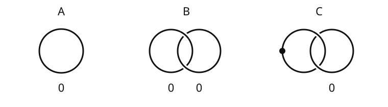
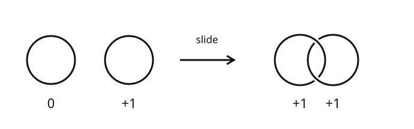

::: {.front card-id="four-manifold-transverse-surfaces-whitney" tags="definition comparison"}
What does general position give for surfaces in a smooth four-manifold? Why does a pair of oppositely signed intersections not automatically cancel?
:::

::: {.back card-id="four-manifold-transverse-surfaces-whitney"}
Transverse submanifolds of dimensions $p,q$ in an $n$-manifold meet in dimension $p+q-n$. Two surfaces in dimension four therefore meet in isolated points. A generic immersion of a surface has transverse double points; an embedding has none. The sign of an intersection compares the ordered tangent planes with the ambient orientation.

A Whitney disk pairs oppositely signed intersections: its boundary consists of one arc on each sheet, joining the two points. A smooth Whitney move needs an embedded disk whose interior misses the sheets and whose normal framing extends the boundary Whitney framing. The move then removes the pair.

In dimension four, a disk and a surface have complementary dimensions, so putting the disk in general position still leaves intersections. Null-homotopy of the Whitney circle alone does not supply a framed embedded disk with disjoint interior. Thus algebraic intersection zero does not by itself let one isotope the surfaces apart.
:::

::: {.front card-id="four-manifold-isotopy-normal-neighborhood" tags="definition construction"}
Distinguish isotopy of embeddings from homotopy. Describe a tubular neighborhood of an oriented embedded surface and its boundary.
:::

::: {.back card-id="four-manifold-isotopy-normal-neighborhood"}
An isotopy $f_t:\Sigma\hookrightarrow X$ is a smooth family of embeddings; a homotopy permits singular maps and self-intersections. For compact $\Sigma$, isotopy extension realizes $f_t$ by ambient diffeomorphisms $\Phi_t$ with $\Phi_0=\mathrm{id}$ and $f_t=\Phi_t f_0$. A homotopy need not extend this way.

The tubular neighborhood theorem identifies a neighborhood of $\Sigma$ with its oriented rank-two normal disk bundle $\nu\Sigma$. Its Euler number is $\Sigma^2$; its boundary is the associated circle bundle. Over a closed oriented surface, this Euler number classifies oriented two-plane bundles.
$$\Sigma^2=0\ \Longrightarrow\ \nu\Sigma\cong\Sigma\times D^2,$$
but choosing such a trivialization is extra data: its homotopy classes form a torsor for $H^1(\Sigma;\mathbb Z)$. These choices matter in gluing constructions. A normal circle is a meridian of $\Sigma$.
:::

::: {.front card-id="four-manifold-morse-handle-duality" tags="definition construction" cite="[@GS99, §§4.1–4.2]"}
Explain the passage from a Morse critical point to a handle attachment. Identify the core, cocore, attaching sphere, belt sphere, and dual handle.
:::

::: {.back card-id="four-manifold-morse-handle-duality"}
At an index-$k$ nondegenerate critical point,
$$f=f(p)-x_1^2-\cdots-x_k^2+x_{k+1}^2+\cdots+x_4^2.$$
Crossing its critical value attaches $h^k=D^k\times D^{4-k}$ along $S^{k-1}\times D^{4-k}$ to the preceding regular level.

| Part | Subspace |
| --- | --- |
| Core | $D^k\times\{0\}$ |
| Cocore | $\{0\}\times D^{4-k}$ |
| Attaching sphere | $S^{k-1}\times\{0\}$ |
| Belt sphere in new boundary | $\{0\}\times S^{3-k}$ |

The attaching map includes its normal framing. Turning a cobordism upside down exchanges cores with cocores and replaces index $k$ by $4-k$. A two-handle is dual to a two-handle; its dual attaching circle is the belt circle, viewed in the outgoing boundary.

Between critical values the cobordism is a product. A handle decomposition carries more data than the number of critical points: attaching maps and framings determine the manifold.
:::

::: {.front card-id="four-manifold-handles-fundamental-homology" tags="application construction"}
How does a handle decomposition compute $\pi_1$, homology, and Euler characteristic? Work out a one-handle and a two-handle whose attaching word is $x^m$.
:::

::: {.back card-id="four-manifold-handles-fundamental-homology"}
For a connected handlebody with one zero-handle:

- One-handles generate a free fundamental group.
- Each two-handle imposes the relation represented by its attaching circle.
- Handles of index $k\ge3$ do not change $\pi_1$.
- The cellular chain group $C_k$ has one generator per $k$-handle. The boundary matrix records signed intersections of attaching spheres with belt spheres of the preceding index.
$$H_k(X;\mathbb Z)=\ker\partial_k/\operatorname{im}\partial_{k+1},\qquad
\chi(X)=\sum_{k=0}^4(-1)^k h_k.$$
With one one-handle, one two-handle of word $x^m$, and no higher handles,
$$\pi_1(X)=\langle x\mid x^m\rangle,\qquad
C_2=\mathbb Z\xrightarrow{\ m\ }C_1=\mathbb Z\xrightarrow{0}C_0=\mathbb Z.$$
For $m\ne0$, $H_1=\mathbb Z/m$ and $H_2=0$; for $m=0$, $H_1=H_2=\mathbb Z$. In both cases $\chi=1$. Algebraic passage number $m=1$ does not prove geometric handle cancellation: the attaching circle must meet the belt sphere geometrically once.
:::

::: {.front card-id="four-manifold-knot-linking-framing" tags="definition application" cite="[@GS99, §4.5]"}
Define meridian, preferred longitude, linking number, and integer framing for a knot in $S^3$. How do Seifert and blackboard framings differ?
:::

::: {.back card-id="four-manifold-knot-linking-framing"}
For an oriented knot $K$, let $N(K)\cong S^1\times D^2$ be a tubular neighborhood. On its boundary:

- $\mu$ bounds a normal disk and has linking number $+1$ with $K$.
- The preferred longitude $\lambda$ is parallel to $K$ and bounds a Seifert surface in the exterior; it has linking number zero.
- For disjoint oriented knots, $\operatorname{lk}(K,J)=F\cdot J$ for an oriented Seifert surface $\partial F=K$; equivalently half the signed sum of crossings between the two components.

A normal framing of $K$ gives a push-off $K'$. Its integer coefficient is $\operatorname{lk}(K,K')$ relative to the Seifert zero framing. The corresponding push-off slope is $\lambda+n\mu$.

Blackboard framing pushes within the projection plane; its coefficient is the diagram's writhe, the signed sum of self-crossings. A Reidemeister-I curl changes blackboard framing by one, even though it preserves the unframed knot type. A framed isotopy must account for that change.
:::

::: {.front card-id="four-manifold-boundary-surgery-trace" tags="definition application"}
Relate a two-handle attachment to Dehn surgery on the boundary. Define a surgery trace and compute it for a framed unknot.
:::

::: {.back card-id="four-manifold-boundary-surgery-trace"}
Attach $D^2\times D^2$ to an oriented four-manifold $W$ along $S^1\times D^2\subset\partial W$ with coefficient $n$. On the boundary this replaces the attaching solid torus by $D^2\times S^1$; the meridian of the replacement is glued to $\lambda+n\mu$.

More generally, $p/q$ Dehn surgery on a knot exterior fills its torus boundary so that the new meridian represents $p\mu+q\lambda$, with $\gcd(p,q)=1$. Integral $n$ means $p=n,q=1$. Specify the orientation convention when naming a lens space.

The trace $W_n(K)=D^4\cup h^2_K$ has boundary $S^3_n(K)$. For the unknot $U$, $W_n(U)$ is the oriented disk bundle over $S^2$ of Euler number $n$, with intersection matrix $(n)$. For $n=0$,
$$W_0(U)=S^2\times D^2,\qquad \partial W_0(U)=S^2\times S^1.$$
For $n=\pm1$ the boundary is $S^3$ and capping with a four-handle gives $\mathbb{CP}^2$ or $\overline{\mathbb{CP}}^{\,2}$. Diffeomorphic boundaries do not imply diffeomorphic traces.
:::

::: {.front card-id="four-manifold-link-matrix-boundary" tags="formula application"}
Given an integral framed link in $S^3$, compute the homology of its surgery boundary and the intersection form of its trace. What information is lost?
:::

::: {.back card-id="four-manifold-link-matrix-boundary"}
For an $r$-component link, let $A_{ii}$ be its framings and $A_{ij}=\operatorname{lk}(K_i,K_j)$ for $i\ne j$. The trace has one zero-handle and $r$ two-handles, hence
$$\pi_1(W)=1,\quad H_2(W;\mathbb Z)\cong\mathbb Z^r,\quad Q_W=A.$$
The capped Seifert surfaces give the basis. If $Y=\partial W$, meridians generate a presentation
$$H_1(Y;\mathbb Z)\cong\operatorname{coker}(A:\mathbb Z^r\to\mathbb Z^r).$$
Thus $\det A\ne0$ gives a rational homology sphere with $|H_1(Y)|=|\det A|$.

| Link | $A$ | $H_1(Y)$ |
| --- | --- | --- |
| $n$-framed unknot | $(n)$ | $\mathbb Z/n$ |
| Zero-framed Hopf link | $\begin{pmatrix}0&1\\1&0\end{pmatrix}$ | $0$ |
| Unlinked zero-framed unknots | $\begin{pmatrix}0&0\\0&0\end{pmatrix}$ | $\mathbb Z^2$ |

The matrix forgets knotting and much of the attaching geometry. A determinant of $\pm1$ proves that $Y$ is an integral homology sphere, not that $Y\cong S^3$; one cannot infer that a four-handle caps it.
:::

::: {.front card-id="four-manifold-diagram-recognition" tags="application diagram"}
Each diagram starts from a zero-handle. Identify the four-manifold with boundary, its boundary, and its homology. A filled dot marks a one-handle.

:::

::: {.back card-id="four-manifold-diagram-recognition"}
| Diagram | Handlebody | Boundary | Reduced integral homology |
| --- | --- | --- | --- |
| A: zero-framed unknot | $S^2\times D^2$ | $S^2\times S^1$ | $H_2=\mathbb Z$ |
| B: zero-framed Hopf link | $(S^2\times S^2)\setminus\operatorname{int}D^4$ | $S^3$ | $H_2=\mathbb Z^2$, form $U$ |
| C: dotted unknot and its zero-framed meridian | $D^4$ after a one/two-handle cancellation | $S^3$ | Zero |

B has two two-handles; C has one one-handle and one two-handle. Changing a zero label to a dot changes the four-manifold. In C the two-handle passes geometrically once through the one-handle, so cancellation is geometric, not just a homology calculation.
:::

::: {.front card-id="four-manifold-handle-slides-example" tags="construction application diagram"}
The arrow indicates a two-handle slide of the zero-framed component over the $+1$ component along a short untwisted band. Compute the new intersection matrix and decide what the move preserves.

:::

::: {.back card-id="four-manifold-handle-slides-example"}
A slide replaces $K_1$ by its band sum with a framing push-off of $K_2$. With the orientations chosen in the figure, its homology class becomes $e'_1=e_1+e_2$, while $e'_2=e_2$.
$$A=\begin{pmatrix}0&0\\0&1\end{pmatrix},\qquad
P=\begin{pmatrix}1&0\\1&1\end{pmatrix},\qquad
A'=P^TAP=\begin{pmatrix}1&1\\1&1\end{pmatrix}.$$
In general the new framing is $a+b+2\ell$ when the slid handles have framings $a,b$ and mutual linking $\ell$; linking with a third component adds the two old linking numbers.

The slide preserves the diffeomorphism type of the handlebody and its boundary. Both matrices have rank one and cokernel $\mathbb Z$; the boundary here is $S^1\times S^2$. A matrix congruence is the algebraic effect of this geometric move, not a proof that arbitrary links with congruent matrices give diffeomorphic handlebodies.
:::

::: {.front card-id="four-manifold-kirby-moves-boundary-versus-trace" tags="theorem comparison" cite="[@GS99, §§5.1–5.4]"}
Which Kirby moves preserve a four-dimensional handlebody, and which preserve only its surgery boundary? Explain the role of blowups and cancellation.
:::

::: {.back card-id="four-manifold-kirby-moves-boundary-versus-trace"}
| Move | Effect |
| --- | --- |
| Framed attaching-link isotopy | Same handlebody |
| Handle slide | Same handlebody |
| Creation/cancellation of a geometrically cancelling adjacent-index pair | Same handlebody |
| Add an isolated $\varepsilon$-framed unknot, $\varepsilon=\pm1$ | Same surgery three-manifold; trace acquires an interior connected sum with the corresponding $\pm\mathbb{CP}^2$ |

Kirby's theorem: integral framed links in $S^3$ present orientation-preservingly diffeomorphic closed oriented three-manifolds iff related by handle slides and additions/deletions of isolated $\pm1$-framed unknots.

A blowdown can remove a $\varepsilon$-framed unknot linked with other components, but must twist its strands. Algebraically, for linking vector $v$,
$$\begin{pmatrix}\varepsilon&v^T\\v&B\end{pmatrix}
\quad\leadsto\quad B-\varepsilon vv^T.$$
It preserves the boundary, not the four-dimensional trace. For example blowing down either component of the $+1,+1$ Hopf link yields a zero-framed unknot.

A one/two-handle cancellation requires one geometric passage through the one-handle, with the attaching data arranged for cancellation. Algebraic passage number one with extra opposite passages does not suffice.
:::

::: {.front card-id="four-manifold-heegaard-relative-handles" tags="definition comparison"}
What are a Heegaard splitting and a relative handle decomposition? How do they help interpret four-dimensional Kirby diagrams?
:::

::: {.back card-id="four-manifold-heegaard-relative-handles"}
A Heegaard splitting of a closed oriented three-manifold is $Y=H_g\cup_\varphi H_g$, where each $H_g$ is a three-dimensional genus-$g$ handlebody and the gluing identifies their boundary surfaces. A Heegaard diagram records the meridian systems of both handlebodies on the common surface. The gluing map is essential.

The genus-zero splitting gives $S^3$; gluing two solid tori gives genus-one examples including lens spaces and $S^1\times S^2$.

A relative handle decomposition of a cobordism $W:Y_-\to Y_+$ begins with $Y_-\times[0,1]$ and attaches handles along the outgoing boundary. With boundary orientation, $\partial W=\overline{Y_-}\sqcup Y_+$. A diagram drawn in $Y_-$ needs a specified presentation of that three-manifold and the attaching link in it.

The boundary of a four-dimensional zero-handle with $g$ one-handles is $\#^g(S^1\times S^2)$. Dotted-circle notation presents those one-handles; replacing the dots by zero framings computes the boundary surgery presentation, but changes the four-dimensional handlebody.
:::

::: {.front card-id="four-manifold-spin-characteristic-sublinks" tags="definition application"}
How does an integral surgery diagram encode spin structures on its boundary? When does the surgery trace admit a spin structure?
:::

::: {.back card-id="four-manifold-spin-characteristic-sublinks"}
Let $A$ be the linking matrix of an integral framed link in $S^3$. A sublink with indicator vector $s\in(\mathbb Z/2)^r$ is characteristic iff
$$As=\operatorname{diag}(A)\pmod2.$$
Equivalently, each component's linking with the sublink equals its framing modulo two, counting its framing as self-linking when it belongs to the sublink. Characteristic sublinks correspond to spin structures on the surgery boundary. Differences of solutions lie in $\ker(A\bmod2)\cong H^1(\partial W;\mathbb Z/2)$.

The trace, built from $D^4$ by two-handles, is simply connected. It is spin iff every framing is even; the extending boundary spin structure is represented by the empty characteristic sublink.

Examples:

- Zero-framed unknot: $0s=0$ has two solutions; the boundary $S^1\times S^2$ has two spin structures, only the empty-sublink one extends over $S^2\times D^2$.
- $+1$-framed unknot: $s=1$ is the unique solution. Its boundary $S^3$ is spin, but the odd trace is not.
:::

::: {.front card-id="four-manifold-surgery-log-transform" tags="definition construction"}
Define surgery on a framed embedded sphere and a logarithmic transform along a square-zero torus. What gluing data must be retained?
:::

::: {.back card-id="four-manifold-surgery-log-transform"}
Surgery on a framed $S^k\subset X^n$ removes $S^k\times\operatorname{int}D^{n-k}$ and replaces it by $D^{k+1}\times S^{n-k-1}$ along their common boundary. Its trace is an $(n+1)$-dimensional cobordism with one index-$(k+1)$ handle. This differs from attaching a handle to the boundary of $X$ itself.

For an embedded torus $T\subset X^4$ of square zero, choose $\nu T\cong T^2\times D^2$ and a basis $(a,b,\mu)$ of $H_1(\partial\nu T;\mathbb Z)$, where $\mu$ is the normal meridian. A logarithmic transform removes $\nu T$ and reglues $T^2\times D^2$. Record the image of the new meridian,
$$\mu'\longmapsto qa+rb+p\mu,\qquad \gcd(p,q,r)=1,$$
and the full boundary diffeomorphism when needed. The multiplicity is $|p|$ in this convention; it alone need not determine the result.

Euler characteristic and signature are unchanged. Van Kampen imposes the new meridian relation on the complement group, so the fundamental group and smooth structure can change.
:::

::: {.front card-id="four-manifold-double-branched-cover" tags="construction application"}
Describe a smooth double cover of an oriented four-manifold branched over a surface. Compute its Euler characteristic and apply the construction to a smooth plane sextic.
:::

::: {.back card-id="four-manifold-double-branched-cover"}
For an oriented embedded surface $B\subset X$, start with a double cover of $X\setminus B$ whose monodromy sends each meridian to the nonidentity element of $\mathbb Z/2$. Fill over $B$ with local model
$$\pi:\mathbb C^2\to\mathbb C^2,\qquad (z,w)\mapsto(z^2,w).$$
The branch locus is $B$ downstairs; the ramification surface upstairs maps diffeomorphically to it. Existence and choice of the complement cover are part of the construction.

For closed $X$,
$$\chi(\widetilde X)=2\chi(X)-\chi(B),\qquad
\sigma(\widetilde X)=2\sigma(X)-\tfrac12 B^2.$$
The first identity separates the singly covered branch stratum from the doubly covered complement; the second is the signature formula for a smooth double branched cover.

For a smooth sextic $B\subset\mathbb{CP}^2$, $g(B)=10$ and $B^2=36$, so $\chi(\widetilde X)=24$ and $\sigma(\widetilde X)=-16$. The algebraic double cover is a K3: its canonical bundle is $\pi^*(K_{\mathbb{CP}^2}+3H)\cong\mathcal O$, and it is simply connected. These calculations connect the branched-cover construction to the K3 example.
:::

::: {.front card-id="four-manifold-plumbing-disk-bundles" tags="construction application"}
Define plumbing of oriented disk bundles over surfaces. Compute the form and boundary homology of a linear plumbing of two Euler-number $-2$ disk bundles over $S^2$.
:::

::: {.back card-id="four-manifold-plumbing-disk-bundles"}
Choose product charts $D^2_{\mathrm{base}}\times D^2_{\mathrm{fiber}}$ in each bundle and identify them by exchanging base and fiber, with orientations chosen to give a positive transverse intersection of the zero sections.

A weighted plumbing graph records the base genera and Euler numbers at vertices and the intersections along edges. For a tree of sphere bundles, the Kirby diagram has a framed unknot for each vertex and a Hopf clasp for each edge.
$$Q=\begin{pmatrix}-2&1\\1&-2\end{pmatrix},\qquad
\det Q=3,\qquad H_1(\partial W)\cong\mathbb Z/3.$$
Its eigenvalues are $-1,-3$, so it is negative definite. The two zero sections are $(-2)$-spheres intersecting once; this is the resolution plumbing of an $A_2$ surface singularity. The boundary is a lens space, with orientation fixed by the plumbing.

For a chain with weights $-b_1,\ldots,-b_r$, the continued fraction $[b_1,\ldots,b_r]^-=b_1-1/(b_2-\cdots-1/b_r)$ computes its rational surgery coefficient up to the stated orientation convention.
:::

::: {.front card-id="four-manifold-surface-smoothing-blowup" tags="construction application"}
Compare smoothing a transverse positive intersection of surfaces with blowing up an intersection. Compute the genus of a smooth plane curve by smoothing a line arrangement.
:::

::: {.back card-id="four-manifold-surface-smoothing-blowup"}
An oriented smoothing replaces the crossing disks by an annulus and represents the sum of their homology classes. For connected surfaces of genera $g_1,g_2$ meeting positively in $m>0$ points, smoothing all crossings gives a connected surface with
$$g=g_1+g_2+m-1,\qquad [\Sigma]=[\Sigma_1]+[\Sigma_2].$$
Blowing up instead replaces the point by an exceptional sphere $E$ of square $-1$. The proper transforms of two transverse branches become disjoint there, each meeting $E$ once; a surface of multiplicity $m$ has transform $\pi^*[\Sigma]-m[E]$ and square $\Sigma^2-m^2$.

Take $d$ projective lines with no triple intersection. There are $N=d(d-1)/2$ nodes. Smoothing the connected arrangement gives class $dH$, square $d^2$, and
$$\chi=2d-2N,\qquad g=1-d+N=\frac{(d-1)(d-2)}2.$$
For a complex smooth degree-$d$ plane curve this is its genus. The smoothing constructs representatives; the assertion that no smooth representative of $dH$ has smaller genus is the Thom conjecture theorem, a separate smooth-topological result.
:::

::: {.front card-id="four-manifold-fiber-sum-elliptic-examples" tags="construction application"}
Define a fiber sum along square-zero surfaces. Construct $E(1)$ from a cubic pencil and compute Euler characteristics and signatures of its iterated fiber sums.
:::

::: {.back card-id="four-manifold-fiber-sum-elliptic-examples"}
For embedded oriented genus-$g$ surfaces $\Sigma_i\subset X_i$ with trivialized normal bundles, remove $\Sigma_i\times\operatorname{int}D^2$ and glue their boundaries by a map covering an orientation-preserving surface identification and reversing the normal circle. Denote the result $X_1\#_\Sigma X_2$; the boundary gluing is part of the data.
$$\chi(X_1\#_\Sigma X_2)=\chi(X_1)+\chi(X_2)+4(g-1),\qquad
\sigma(X_1\#_\Sigma X_2)=\sigma(X_1)+\sigma(X_2).$$
Use van Kampen on the complements to compute $\pi_1$; it cannot be read from these two numbers.

A generic pencil of plane cubics has nine simple basepoints. Blowing them up gives
$$E(1)=\mathbb{CP}^2\#9\overline{\mathbb{CP}}^{\,2},\qquad
F=3H-E_1-\cdots-E_9,\qquad F^2=0.$$
The exceptional curves are sections, and a regular fiber is a torus. The standard repeated fiber sum $E(n)$ of $n$ copies of $E(1)$ has $\chi=12n$ and $\sigma=-8n$. It is simply connected; thus $b_2=12n-2$ and $(b_2^+,b_2^-)=(2n-1,10n-1)$. The standard $E(2)$ is a K3 surface.
:::

::: {.front card-id="four-manifold-lefschetz-fibration-handle" tags="definition construction"}
Define a positive Lefschetz fibration and a pencil. Relate vanishing cycles to Dehn twists, two-handles, and Euler characteristic.
:::

::: {.back card-id="four-manifold-lefschetz-fibration-handle"}
A positive Lefschetz fibration $f:X^4\to B^2$ has isolated critical points with orientation-compatible complex charts in which
$$f(z_1,z_2)=z_1^2+z_2^2\quad\text{(equivalently }z_1z_2\text{)}.$$
Away from them it is a surface bundle. A path to a critical value collapses a simple closed curve in the regular fiber, the vanishing cycle. Positive local monodromy is a right-handed Dehn twist about that curve.

Over a disk, build the singular fibration from $\Sigma_g\times D^2$ by attaching a two-handle along each vanishing cycle in a boundary fiber, with framing $-1$ relative to the surface framing. For closed base $B$ and $N$ critical points,
$$\chi(X)=\chi(B)(2-2g)+N.$$
For a fibration over $S^2$, the ordered local monodromies satisfy $T_1\cdots T_N=1$ in $\operatorname{Mod}(\Sigma_g)$.

A Lefschetz pencil is defined away from finitely many basepoints, with local model $[z_1:z_2]$ there and the same critical-point model elsewhere. Blowing up each basepoint resolves it to a fibration; each exceptional sphere is a section of square $-1$.
:::

::: {.front card-id="four-manifold-intersection-form" tags="definition comparison"}
Define the integral intersection form of a closed oriented four-manifold. Explain unimodularity, parity, signature, and its geometric meaning.
:::

::: {.back card-id="four-manifold-intersection-form"}
For connected closed oriented $X$,
$$L_X=H^2(X,\mathbb Z)/\mathrm{torsion},\qquad
Q_X(a,b)=\langle a\smile b,[X]\rangle.$$
Graded commutativity makes $Q_X$ symmetric; integral Poincaré duality makes it unimodular ($\det Q_X=\pm1$). Torsion classes pair trivially with integral classes.

| Term | Meaning |
| --- | --- |
| Even | $Q_X(a,a)\in2\mathbb Z$ for every $a\in L_X$ |
| Odd | $\exists a\in L_X:Q_X(a,a)\notin2\mathbb Z$ |
| $b_2^\pm$ | Positive/negative inertia indices of $Q_X\otimes\mathbb R$ |
| Signature | $\sigma(X)=b_2^+-b_2^-$ |
| Definite | $b_2^+=0$ or $b_2^-=0$ |

For transverse oriented embedded surfaces, their signed intersection count equals the pairing of their Poincaré duals. Self-intersection is the Euler number of the oriented normal bundle, computed by intersecting with a small transverse push-off.

For manifolds with boundary the absolute pairing need not be unimodular or nondegenerate; Poincaré–Lefschetz duality pairs relative with absolute classes.
:::

::: {.front card-id="four-manifold-characteristic-numbers" tags="formula application"}
Relate the Euler characteristic, signature, and characteristic numbers of a closed oriented smooth four-manifold. Specialize to a compact complex surface.
:::

::: {.back card-id="four-manifold-characteristic-numbers"}
For connected $X$, Poincaré duality gives $b_0=b_4=1$, $b_3=b_1$:
$$\chi(X)=2-2b_1+b_2^++b_2^-,\qquad
\sigma(X)=b_2^+-b_2^-=\tfrac13\langle p_1(TX),[X]\rangle.$$
If an almost-complex structure induces the orientation,
$$\langle c_2(TX),[X]\rangle=\chi(X),\qquad
\langle c_1(TX)^2,[X]\rangle=2\chi(X)+3\sigma(X).$$
For a compact Kähler surface with complex orientation,
$$b_1=2q,\qquad b_2^+=1+2p_g,\qquad b_2^-=h^{1,1}-1.$$
Thus $\mathbb{CP}^2$ has $(\chi,\sigma,c_1^2)=(3,1,9)$; a K3 has $(24,-16,0)$. The Chern-number equations require an almost-complex tangent bundle, whereas the Pontryagin signature formula does not.
:::

::: {.front card-id="four-manifold-standard-examples" tags="example comparison"}
Give the intersection forms, inertia pairs, and spin status of $S^4$, $\mathbb{CP}^2$, $\overline{\mathbb{CP}}^{\,2}$, $S^2\times S^2$, and a K3 surface.
:::

::: {.back card-id="four-manifold-standard-examples"}
Use complex orientations for $\mathbb{CP}^2$ and K3; the bar reverses orientation. Write $U=\begin{pmatrix}0&1\\1&0\end{pmatrix}$ and take $E_8$ positive definite.

| $X$ | $Q_X$ | $(b_2^+,b_2^-)$ | Spin? |
| --- | --- | --- | --- |
| $S^4$ | Rank-zero form | $(0,0)$ | Yes |
| $\mathbb{CP}^2$ | $\langle1\rangle$ | $(1,0)$ | No |
| $\overline{\mathbb{CP}}^{\,2}$ | $\langle-1\rangle$ | $(0,1)$ | No |
| $S^2\times S^2$ | $U$ | $(1,1)$ | Yes |
| K3 | $3U\oplus2E_8(-1)$ | $(3,19)$ | Yes |

All are simply connected, so evenness of $Q_X$ is equivalent to spin. On $S^2\times S^2$, the factor spheres have square zero and intersect once. On $\mathbb{CP}^2$, two distinct lines intersect once, so the line generator has square one.
:::

::: {.front card-id="four-manifold-connected-sum-blowup" tags="construction application"}
How do orientation reversal, connected sum, and blowup change four-manifold invariants? Distinguish $S^2\times S^2$ from $\mathbb{CP}^2\#\overline{\mathbb{CP}}^{\,2}$.
:::

::: {.back card-id="four-manifold-connected-sum-blowup"}
For closed connected oriented smooth $X,Y$, remove balls and identify boundary three-spheres by an orientation-reversing map:
$$Q_{X\#Y}=Q_X\oplus Q_Y,\quad
\sigma(X\#Y)=\sigma(X)+\sigma(Y),\quad
\chi(X\#Y)=\chi(X)+\chi(Y)-2.$$
Also $\pi_1(X\#Y)=\pi_1(X)*\pi_1(Y)$. Reversal gives $Q_{\bar X}=-Q_X$, exchanges $b_2^\pm$, and leaves $\chi$ unchanged.

Blowing up a complex surface at a point has underlying oriented smooth manifold $X\#\overline{\mathbb{CP}}^{\,2}$. Its exceptional sphere has square $-1$; $b_2^-$ and $\chi$ increase by one, $\sigma$ and $c_1^2$ decrease by one.

The forms $U$ and $\langle1\rangle\oplus\langle-1\rangle$ both have rank two and signature zero but differ in parity. Therefore $S^2\times S^2$ and $\mathbb{CP}^2\#\overline{\mathbb{CP}}^{\,2}$ are not homeomorphic. Rank and signature alone do not determine the integral form.
:::

::: {.front card-id="four-manifold-spin-spinc" tags="definition comparison"}
Define spin and $\mathrm{Spin}^c$ structures in dimension four. Relate them to $w_2$, characteristic elements, determinant lines, and twisting.
:::

::: {.back card-id="four-manifold-spin-spinc"}
A spin structure lifts the oriented orthonormal frame bundle through $\mathrm{Spin}(4)\to\mathrm{SO}(4)$; it exists iff $w_2(TX)=0$. Its isomorphism classes, when nonempty, form a torsor for $H^1(X,\mathbb Z/2)$.

A $\mathrm{Spin}^c$ structure lifts through
$$\mathrm{Spin}^c(4)=(\mathrm{Spin}(4)\times U(1))/\langle(-1,-1)\rangle
\longrightarrow\mathrm{SO}(4).$$
It has rank-two complex spinor bundles $W^\pm$, determinant line $L=\det W^\pm$, and Clifford multiplication $T^*X\otimes\mathbb C\to\operatorname{Hom}(W^+,W^-)$, with
$$c_1(L)\bmod2=w_2(TX).$$
Every closed oriented smooth four-manifold admits a $\mathrm{Spin}^c$ structure. Their classes form a torsor for $H^2(X,\mathbb Z)$; twisting by a line bundle $B$ changes $W^\pm$ to $W^\pm\otimes B$ and $c_1(L)$ to $c_1(L)+2c_1(B)$. Determinant classes do not distinguish twists by nonzero two-torsion.

Wu's formula says $w_2$ is characteristic: $\langle w_2\smile\bar a,[X]\rangle\equiv Q_X(a,a)\pmod2$ for integral $a$. A lift $c$ satisfies $Q_X(c,a)\equiv Q_X(a,a)\pmod2$. Simply connected $X$ is spin iff $Q_X$ is even; with torsion, test $w_2$ itself.
:::

::: {.front card-id="four-manifold-handles-kirby" tags="definition application"}
Define a four-dimensional handle and a Kirby diagram. How can a diagram give an intersection matrix? Give the simplest examples.
:::

::: {.back card-id="four-manifold-handles-kirby"}
An index-$k$ handle is $D^k\times D^{4-k}$ attached along $S^{k-1}\times D^{4-k}$ in the boundary of the existing manifold. A Morse function yields one such handle for each index-$k$ critical point.

A Kirby diagram records one-handles by dotted circles and two-handles by framed attaching knots; the framing trivializes the normal two-plane bundle of the knot in the boundary. With a zero-handle and only two-handles, the integral linking matrix is the intersection matrix of the resulting four-manifold with boundary: diagonal entries are framings, off-diagonal entries pairwise linking numbers.

| Diagram, then cap the $S^3$ boundary by a four-handle | Closed manifold |
| --- | --- |
| Empty two-handle diagram | $S^4$ |
| One $+1$ framed unknot | $\mathbb{CP}^2$ |
| One $-1$ framed unknot | $\overline{\mathbb{CP}}^{\,2}$ |
| Hopf link with both framings zero | $S^2\times S^2$ |

Handle slides change the basis of two-handle classes and act by integral congruence on the matrix. Cancellation removes an adjacent-index pair when the attaching sphere meets the belt sphere once with the required framing. With one-handles present, compute the handle chain complex; the raw two-handle linking matrix alone need not be the form on $H_2$.
:::

::: {.front card-id="four-manifold-freedman-donaldson-rokhlin" tags="theorem comparison" cite="[@Fre82; @Don83]"}
Compare Freedman's classification, Donaldson's diagonalization theorem, and Rokhlin's theorem. Apply them to an $E_8$ intersection form.
:::

::: {.back card-id="four-manifold-freedman-donaldson-rokhlin"}
| Theorem | Hypotheses and conclusion |
| --- | --- |
| Freedman | Closed simply connected oriented topological four-manifolds are classified up to oriented homeomorphism by their unimodular symmetric integral form and Kirby–Siebenmann invariant $\mathrm{ks}\in\mathbb Z/2$. Every such form occurs. For even forms, $\mathrm{ks}=\sigma/8\bmod2$; for odd forms, both values occur. |
| Donaldson | A closed simply connected smooth oriented four-manifold with definite form has form $\langle1\rangle^{\oplus b_2}$ or $\langle-1\rangle^{\oplus b_2}$. |
| Rokhlin | A closed smooth spin four-manifold has $\sigma\equiv0\pmod{16}$. |

The Kirby–Siebenmann class obstructs a PL structure; smooth manifolds have $\mathrm{ks}=0$. Vanishing alone does not guarantee smoothability in dimension four.

Freedman produces a simply connected closed topological manifold with form $E_8$. It has $\sigma=8$ and $\mathrm{ks}=1$, so it is not smoothable. Donaldson also excludes its even definite non-diagonal form from the smooth category; if smooth it would be spin, contradicting Rokhlin.

Even $E_8\oplus E_8$ has $\mathrm{ks}=0$ and signature divisible by sixteen, but Donaldson still excludes a smooth structure. The theorems impose different restrictions.
:::

::: {.front card-id="four-manifold-exotic-smooth-structures" tags="definition comparison"}
What is an exotic smooth structure? What do the intersection form and smooth invariants distinguish? Contrast exotic $\mathbb R^4$ with the smooth four-dimensional Poincaré problem.
:::

::: {.back card-id="four-manifold-exotic-smooth-structures"}
Two smooth manifolds are exotic relative to one another if they are homeomorphic but not diffeomorphic. A smooth structure is an equivalence class of smooth atlases on the fixed topological manifold, modulo diffeomorphism.

For closed simply connected smooth oriented four-manifolds, the intersection form determines the oriented homeomorphism type by Freedman, since $\mathrm{ks}=0$. It need not determine the diffeomorphism type. Donaldson and Seiberg–Witten invariants can distinguish smooth structures sharing the same form.

Exotic $\mathbb R^4$ exists: a smooth manifold homeomorphic but not diffeomorphic to standard $\mathbb R^4$. It is noncompact; closed-manifold intersection-form classification does not apply. Existence of an exotic smooth $S^4$ is the smooth four-dimensional Poincaré problem and remains open. Freedman's topological Poincaré theorem does not settle it.
:::

::: {.front card-id="four-manifold-seiberg-witten-equations" tags="definition"}
State the Seiberg–Witten equations and gauge quotient, including the fields, determinant connection convention, and quadratic term.
:::

::: {.back card-id="four-manifold-seiberg-witten-equations"}
Fix a closed oriented Riemannian four-manifold and a $\mathrm{Spin}^c$ structure $\mathfrak s$ with spinors $W^\pm$ and determinant $L$. The fields are a unitary connection $A$ on $L$ and $\psi\in\Gamma(W^+)$; the Levi–Civita connection and $A$ induce the Dirac operator $D_A:\Gamma(W^+)\to\Gamma(W^-)$.

Choose the Clifford identification $\rho:i\Lambda^2_+\to\operatorname{Herm}_0(W^+)$ and define $q$ by $\rho(q(\psi))=(\psi\psi^*)_0$. In this normalization the perturbed equations are
$$D_A\psi=0,\qquad F_A^+=q(\psi)+i\eta,\qquad \eta\in\Omega^2_+(X;\mathbb R).$$
Other Clifford normalizations rescale $q$; keep the convention fixed.

For $u:X\to U(1)$ the gauge action is
$$u\cdot(A,\psi)=(A-2u^{-1}du,\ u\psi).$$
The factor two reflects that $A$ is the determinant connection. The moduli space is the solution set modulo this action. Reducible solutions have $\psi=0$; their curvature equation is $F_A^+=i\eta$. Irreducible solutions have trivial gauge stabilizer.
:::

::: {.front card-id="four-manifold-seiberg-witten-invariant" tags="definition formula" cite="[@Mor14]"}
Define the numerical Seiberg–Witten invariant in expected dimension zero. State the dimension, orientation, metric-independence, and chamber conditions.
:::

::: {.back card-id="four-manifold-seiberg-witten-invariant"}
For a $\mathrm{Spin}^c$ structure $\mathfrak s$ on closed connected oriented smooth $X$, set $c=c_1(L)$:
$$d(\mathfrak s)=\frac{c^2-(2\chi(X)+3\sigma(X))}{4}.$$
This is the real expected dimension. Choose a homology orientation, an orientation of $H^1(X;\mathbb R)\oplus H^2_+(X;\mathbb R)$, to orient the moduli.

For $b_2^+>1$, a generic metric and perturbation avoiding reducibles give a compact regular moduli space. If $d=0$, its signed count is $\mathrm{SW}_X(\mathfrak s)\in\mathbb Z$ and is independent of these generic choices. Positive-dimensional invariants require cohomology insertions of total degree $d$; they are not counts of points. A nonzero invariant makes $c$ a basic class (possibly with distinct $\mathrm{Spin}^c$ structures sharing $c$ when there is two-torsion).

For $b_2^+=1$, paths can cross reducible walls, so an invariant requires a chamber in the metric/perturbation space. For $b_2^+=0$, this metric-independence statement does not apply. A dimension-zero space alone does not define an invariant without compactness, regularity, and orientations.
:::

::: {.front card-id="four-manifold-sw-applications" tags="application theorem"}
How do Seiberg–Witten invariants constrain positive scalar curvature and the genus of embedded surfaces? Apply the dimension formula to a K3.
:::

::: {.back card-id="four-manifold-sw-applications"}
For closed oriented smooth $X$ with $b_2^+>1$:

- A metric of positive scalar curvature forces all Seiberg–Witten invariants to vanish, by the spinor Weitzenböck formula and small generic perturbations.
- If $c$ is a basic class and $\Sigma\subset X$ is a connected smoothly embedded oriented surface of genus $g\ge1$, with non-torsion class and $\Sigma^2\ge0$, the adjunction inequality is
$$2g-2\ge\Sigma^2+|\langle c,[\Sigma]\rangle|.$$
The self-intersection and genus hypotheses are part of this version.

For K3, $\chi=24$, $\sigma=-16$, so $2\chi+3\sigma=0$. Its spin structure has $c=0$ and $d=0$, with $\mathrm{SW}(0)=\pm1$ according to homology orientation. Thus K3 admits no positive-scalar-curvature metric. The adjunction bound becomes $2g-2\ge\Sigma^2$; a smooth elliptic fiber has $g=1$ and square zero, attaining equality.
:::
